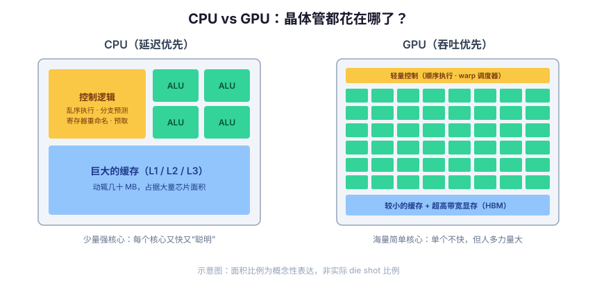
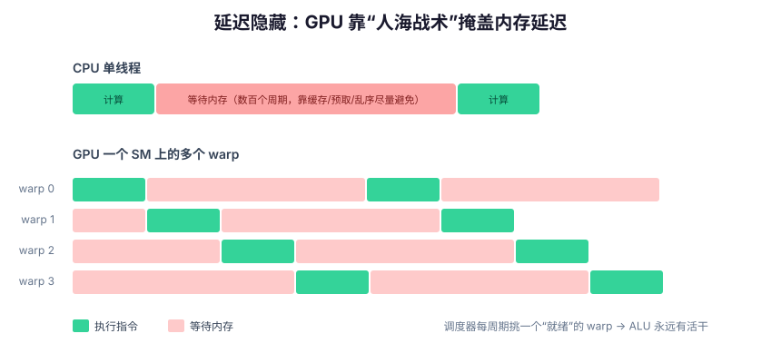
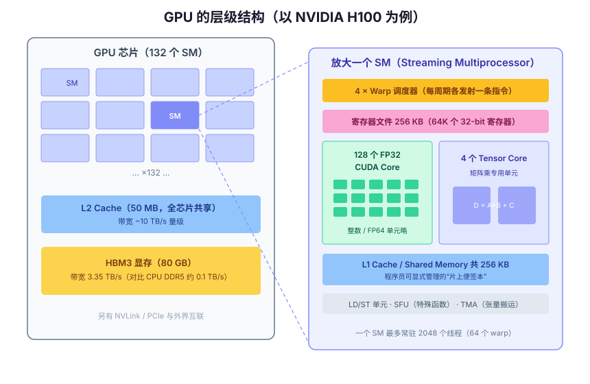
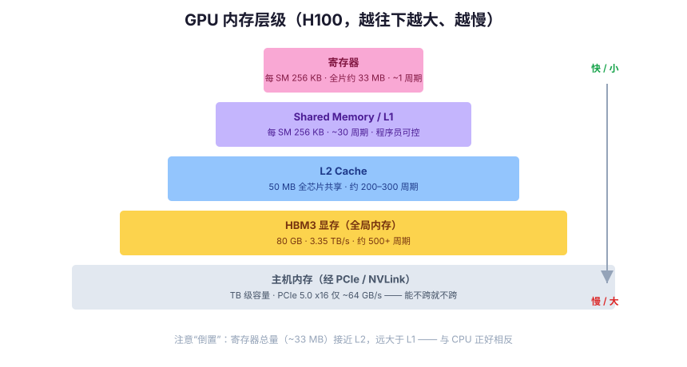

# 深入浅出 GPU 架构：从 CPU 的瓶颈说起

如果你写过几年代码，大概率对 CPU 有一个直觉上的心智模型：取指令、执行、访问内存，配上缓存和多核。但换到 GPU，很多人的认知就模糊成了一句"很多核心，擅长并行"。这篇文章想把这件事讲透：**GPU 到底和 CPU 有什么本质区别？为什么会长成今天这个样子？** 并最终回答一个问题：**为什么偏偏是游戏和 AI 这两个领域，把 GPU 推上了王座？** 我们不从 GPU 讲起，而是从 CPU 讲起——因为 GPU 的每一个设计决策，几乎都是对 CPU 某个瓶颈的直接回应。

## 一、CPU：一台为"延迟"而生的机器

先回到原点。CPU 的核心使命是什么？**让一段串行程序尽可能快地跑完。** 换句话说，它优化的是延迟（latency）——单个任务从开始到结束的时间。

过去几十年，CPU 为这个目标堆上了大量精巧的机制：

**流水线（Pipeline）**。把一条指令的执行拆成取指、译码、执行、访存、写回等阶段，让多条指令像流水线上的产品一样重叠推进。现代 CPU 的流水线深达十几到二十级。

**超标量（Superscalar）**。一个周期不止发射一条指令，而是同时发射多条。Zen 5、Apple M 系列这样的核心，每周期可以解码并发射 8 条以上的指令。

**乱序执行（Out-of-Order Execution）**。程序是按顺序写的，但 CPU 并不傻等。如果第 3 条指令在等内存，而第 7 条指令的操作数已经就绪，那就先执行第 7 条。为此 CPU 需要庞大的重排序缓冲区（ROB，现代 CPU 高达数百项）、寄存器重命名、发射队列等一整套硬件。

**分支预测（Branch Prediction）**。遇到 `if` 怎么办？流水线不能停下来等条件算出来，于是 CPU 会"赌"一个方向继续执行，赌错了就把已经做的工作全部丢掉重来。现代分支预测器准确率超过 95%，其本身就是一块不小的硅片面积，里面塞满了历史表、模式表和神经网络式的预测结构。

**多级缓存（Cache Hierarchy）**。这可能是最重要的一个。因为 DRAM 实在太慢了——这点我们马上展开。

这些机制有一个共同特点：**它们都不产生计算结果，只是为了让那几个真正干活的 ALU 不要闲着。** 打个比方，CPU 像一位米其林主厨：刀工快、经验足，配了一整个团队帮他备菜、传菜、预判下一道菜（分支预测），还有一个巨大的料理台把常用食材放在手边（缓存）。做一桌精致的宴席，他无可替代。但如果任务是给一万人食堂切土豆丝呢？



看一眼现代 CPU 的 die shot 你会发现：真正做算术运算的 ALU 只占核心面积的很小一部分，大头都给了缓存、乱序执行的控制逻辑和分支预测器。这不是设计失误，而是"延迟优先"这个目标的必然结果——**为了让一个线程跑得快，绝大多数晶体管都在做"辅助工作"。**

## 二、CPU 撞上的三堵墙

如果 CPU 能一直变快，也就没 GPU 什么事了。但 2005 年前后，CPU 的发展几乎同时撞上了三堵墙。

### 功耗墙：Dennard 缩放的终结

1974 年，IBM 的 Robert Dennard 提出了著名的 Dennard 缩放定律：晶体管尺寸缩小时，电压和电流同比例下降，**功率密度保持不变**。这意味着每一代工艺，我们都能"免费"获得更多、更快的晶体管——频率从 MHz 一路飙到 GHz，靠的就是它。

但到了 2005 年前后，这个定律失效了。晶体管小到一定程度后，漏电流（leakage）急剧上升，阈值电压降不下去，功率密度开始随缩放不降反升。芯片再提频率就会热到无法散热。标志性事件是 Intel 取消了原计划冲击 10 GHz 的 Pentium 4 后续产品——**CPU 频率从此停滞在 4~5 GHz 附近，二十年没有数量级变化。**

频率提不上去，业界的答案是多核：一个 4 GHz 核心变成 8 个、16 个。但多核带来了新问题——受 Amdahl 定律约束，程序中串行部分的占比决定了加速上限；而且即使核心数翻倍，受功耗预算限制，所有核心也无法同时跑在最高频率（这就是所谓"暗硅"问题）。

### 内存墙：越来越远的 DRAM

第二堵墙更隐蔽也更致命。过去几十年，CPU 运算速度的增长远快于 DRAM 访问延迟的改善。看一组现代 CPU（以 Zen 5 为例）的典型数字：

| 存储层级 | 容量 | 延迟 |
|---|---|---|
| L1 缓存 | 每核 48 KB (数据) | ~4-5 周期，约 1 ns |
| L2 缓存 | 每核 1 MB | ~14 周期，约 3 ns |
| L3 缓存 | 每 CCD 32 MB | ~50 周期，约 10 ns |
| DRAM (DDR5) | 数十至数百 GB | **70~100 ns，数百个周期** |

一次 DRAM 访问的时间，够 CPU 执行几百甚至上千条指令。这就是为什么 CPU 要砸下重金建三级缓存、做硬件预取、搞乱序执行——全都是在**掩盖或回避内存延迟**。但缓存只对局部性好的访问模式有效，一旦工作集超出缓存、或访问模式不规则，CPU 的实际算力利用率会惨不忍睹。

除了延迟，带宽也是问题：芯片引脚数量不随晶体管缩放增长，off-chip 内存带宽的提升远慢于片上算力的提升。双通道 DDR5 的带宽约 100 GB/s 量级——记住这个数字，后面和 GPU 对比会非常震撼。

### ILP 墙：单线程压榨到头了

第三堵墙是指令级并行（ILP）的极限。乱序执行、超标量这些技术本质上是在挖掘"一条指令流内部"的并行性，但普通程序中相邻指令的依赖关系是客观存在的，可挖掘的 ILP 有天花板。ROB 从 100 项加到 600 项，性能收益越来越小，而面积和功耗的代价却是超线性增长的。**用两倍的晶体管换 20% 的单线程性能提升**——这就是现代 CPU 设计的残酷现实。

三堵墙合起来的结论是：**"把单个核心做得更快"这条路，性价比已经耗尽了。** 要继续获得算力增长，必须换思路。

## 三、换个问题：如果我们不在乎延迟呢？

CPU 的所有复杂性都源于一个前提：**任务是串行的，延迟必须低。** 但有一大类任务天然不满足这个前提——图形渲染。

渲染一帧 4K 画面要给 800 多万个像素着色，每个像素的计算过程几乎一样，且**互相独立**。没人在乎单个像素算得多快，大家只在乎整帧什么时候算完。这类任务优化的不是延迟，而是**吞吐（throughput）**——单位时间完成的总工作量。

一旦目标从延迟换成吞吐，CPU 那套昂贵的机制瞬间变得没有必要：

- **乱序执行？不需要。** 这条指令在等内存？没关系，切去执行另外几千个线程就行，反正它们互相独立。
- **分支预测？基本不需要。** 同上，用别的线程填满流水线即可。
- **大缓存？可以砍。** 缓存是为了降低延迟，而我们现在靠海量线程"隐藏"延迟，缓存只需要做带宽放大和数据共享。

省下来的晶体管全部拿去堆 ALU。这就是 GPU 设计哲学的全部：**用海量简单核心替代少量复杂核心，用并行度隐藏延迟，用吞吐换延迟。** ACM 通讯上有篇经典文章的说法很精准：吞吐导向的处理器"心甘情愿地牺牲单线程执行速度，来换取全体线程总吞吐量的提升"。

延迟隐藏是整个 GPU 架构的灵魂，值得单独画一张图：



CPU 遇到内存访问，想方设法让这一个线程不停顿（缓存、预取、乱序）；GPU 则完全摆烂——**它假设停顿一定会发生**，解法是在每个计算单元上"超额订阅"大量线程。线程 A 在等内存？调度器零成本切换到线程 B。只要在飞的线程足够多，ALU 就永远有活干，DRAM 那几百个周期的延迟就被完全掩盖了。

注意一个关键细节：CPU 的线程切换要保存/恢复上下文，开销数千周期；GPU 的"切换"却是零开销的。为什么？因为**所有活跃线程的寄存器都同时物理存在于芯片上**——这直接导致了 GPU 一个反直觉的设计：寄存器文件比 L1 缓存大得多。这个我们后面再说。

顺便提一句历史：GPU 最初就是纯图形芯片，2001 年的可编程着色器让人们开始"滥用"它做通用计算（把数据伪装成纹理），2007 年 NVIDIA 推出 CUDA 正式把 GPU 变成通用并行处理器，而 2012 年 AlexNet 用两块 GTX 580 赢下 ImageNet，则让 GPU 和深度学习从此绑定。今天的"GPU"，图形反而成了副业。

## 四、现代 GPU 长什么样：自顶向下拆解

空谈哲学不如看实物。我们以 NVIDIA 的 H100（Hopper 架构，当前 AI 基础设施的主力机型之一）为标本，自顶向下拆一遍。



### 顶层：一片 SM 的海洋

一颗 H100（SXM5 版本）上有 **132 个 SM（Streaming Multiprocessor，流式多处理器）**。SM 是 GPU 真正的"核心"——如果非要和 CPU 类比，一个 SM 大致对应一个 CPU 核心的地位：它有自己的指令调度器、执行单元、寄存器文件和片上内存，是独立的执行单位。

132 个 SM 之外，芯片上还有一块 **50 MB 的 L2 缓存**（全芯片共享），周围环绕着 5 个 HBM3 显存栈，提供 **80 GB 容量和 3.35 TB/s 的带宽**。

3.35 TB/s 是什么概念？前面说过 CPU 的双通道 DDR5 约 100 GB/s——**GPU 的显存带宽是 CPU 内存带宽的 30 倍以上**。这不是偶然，而是必然：GPU 靠海量线程隐藏延迟，但隐藏不了带宽的不足——几十万个线程同时要数据，喂不饱就全饿死。所以 GPU 舍得用昂贵的 HBM（High Bandwidth Memory，用硅中介层把 DRAM 直接堆叠在 GPU 旁边，走数千 bit 宽的总线）。**CPU 优化延迟，GPU 优化带宽**，内存系统的设计同样遵循这条分界线。

### 中层：拆开一个 SM

每个 H100 的 SM 内部包含：

- **128 个 FP32 CUDA Core**：做单精度浮点加乘的基本单元。全芯片 132 × 128 = **16896 个**。注意"CUDA Core"这名字有营销成分——它不是完整的"核"，只是一个执行通道（lane），大致相当于 CPU 中 SIMD 单元的一个通道。
- **4 个 Tensor Core**：专做小矩阵乘累加（D = A×B + C）的固化电路，深度学习算力的真正来源，后面细讲。
- **4 个 Warp 调度器**：每周期各自挑选一个就绪的 warp 发射指令。注意是**顺序发射**——SM 内部没有乱序执行、没有分支预测、没有推测执行。省下的复杂度就是堆核心数的本钱。
- **256 KB 寄存器文件**：65536 个 32-bit 寄存器。
- **256 KB L1 缓存 / Shared Memory**：一块可配置的片上 SRAM，既可以当普通 L1 缓存，也可以由程序员显式管理（shared memory）。
- **TMA（Tensor Memory Accelerator）**：Hopper 新增的异步数据搬运引擎，让数据搬运和计算重叠。

这里请注意寄存器文件的大小：**256 KB，等于 L1 的容量，而且是每个 SM 都有**。全芯片的寄存器总量约 33 MB，逼近 50 MB 的 L2。对比 CPU（寄存器每核不到 1 KB 数量级，L1 几十 KB，L3 几十 MB），GPU 的存储层级是"倒置"的。原因正是前面说的：延迟隐藏要求所有活跃线程（一个 SM 最多 2048 个）的寄存器状态**全部常驻硬件**，这样 warp 切换才能做到零开销。



### 底层：warp 与 SIMT——GPU 最重要的执行模型

现在到了理解 GPU 最关键的一层。你写 CUDA 程序时看到的是一个个独立"线程"，但硬件并不逐个执行线程。**硬件以 32 个线程为一组，称为一个 warp（织布机上的"经纱"，织布术语，隐喻一排丝线同步运动），warp 内 32 个线程锁步（lockstep）执行同一条指令，只是操作的数据不同。**

这个模型叫 **SIMT（Single Instruction, Multiple Threads）**，是 NVIDIA 对经典 SIMD 的改良。区别在哪？

- **SIMD（CPU 的 AVX-512 等）**：程序员显式操作 512-bit 宽的向量寄存器，写代码时必须思考"这 16 个 float 怎么打包、怎么对齐、尾部余数怎么处理"。
- **SIMT**：程序员为**单个标量线程**写代码，硬件负责把 32 个线程捆成 warp 用宽执行单元跑。向量化对程序员是透明的。

SIMT 的编程体验好得多，但硬件本质仍是宽向量机，所以代价也藏不住，主要有两个：

**分支发散（Branch Divergence）**。一个 warp 内 32 个线程执行同一条指令，如果代码里有 `if-else`，而 warp 内一部分线程走 if、另一部分走 else 呢？硬件的处理办法是**两条路径都执行一遍**，用掩码关掉不相关的线程。最坏情况下（32 个线程走 32 条不同路径）有效算力只剩 1/32。这就是为什么 GPU 代码要尽量避免 warp 内的数据相关分支——不是不能写 if，而是要让同 warp 的线程尽量走同一条路。

**内存合并（Memory Coalescing）**。一个 warp 的 32 个线程同时发起访存。如果它们访问的是**连续的 32 个地址**，硬件可以合并成一两次宽内存事务，一次搬 128 字节；如果访问的地址天女散花，就得拆成 32 次独立事务，有效带宽掉一个数量级。"相邻线程访问相邻地址"是 GPU 性能优化的第一铁律。

## 五、编程模型：软件如何映射到硬件

理解了硬件，CUDA 的编程模型就不再是一堆凭空的概念，而是硬件结构的直接投影：

| 软件概念 | 映射到的硬件 |
|---|---|
| Thread（线程） | CUDA Core 上的一个执行通道 |
| Warp（32 线程） | SM 的调度单位（对程序员半透明） |
| Block（线程块） | 整体驻留在**一个** SM 上，块内线程可通过 shared memory 通信、可同步 |
| Grid（网格） | 整个 GPU，块与块之间基本互相独立 |

写一个向量加法感受一下：

```cuda
__global__ void vecAdd(const float* a, const float* b, float* c, int n) {
    int i = blockIdx.x * blockDim.x + threadIdx.x;  // 我是全局第几号线程？
    if (i < n) c[i] = a[i] + b[i];                  // 每个线程只算一个元素
}

// 主机侧：n 个元素，每块 256 线程，启动足够多的块
vecAdd<<<(n + 255) / 256, 256>>>(a, b, c, n);
```

注意思维方式的转变：CPU 写法是"一个线程循环 n 次"，GPU 写法是"启动 n 个线程，每个算一次"。循环消失了，被空间上的并行取代。当 n 是一亿时，GPU 真的会（逻辑上）启动一亿个线程——硬件按 SM 的容量分批调度这些块，这也解释了为什么块与块之间不能随意通信：它们可能根本不同时存在。

为什么中间要有 Block 这一层？因为它是**局部性的边界**。同一块内的线程保证落在同一个 SM 上，于是可以共享那 256 KB 的片上 SRAM（shared memory）、可以用 `__syncthreads()` 同步。矩阵乘法的经典优化就是：把大矩阵切成小瓦片（tile），每块线程先协作把瓦片从显存搬进 shared memory，再在片上反复使用——把对 3.35 TB/s 显存的访问，换成对约 20 TB/s 量级片上 SRAM 的访问。

而"一个 SM 上同时驻留多少个 warp"有个专门的指标：**占用率（occupancy）**。每个线程用的寄存器越多、每个块用的 shared memory 越多，SM 能同时容纳的 warp 就越少，调度器可挑选的"就绪 warp"就越少，延迟隐藏能力就越差。资源与并行度之间的这个权衡，是 CUDA 性能调优的日常。

## 六、Roofline：一个数字看穿性能瓶颈

有了架构知识，我们可以回答一个更实际的问题：**给定一个计算任务，GPU 到底能跑多快？** 答案往往不取决于算力，而取决于一个比值——**算术强度（Arithmetic Intensity）：每从显存搬运 1 字节数据，能做多少次浮点运算（FLOPs/Byte）。**

以 H100 为例：FP16 Tensor Core 算力约 990 TFLOPS（dense），显存带宽 3.35 TB/s。两者相除得到约 **295 FLOPs/Byte** 的"分水岭"（ridge point）：

- 任务的算术强度 **高于** 295：算力是瓶颈，compute-bound，ALU 忙不过来；
- 任务的算术强度 **低于** 295：带宽是瓶颈，memory-bound，ALU 大部分时间在等数据。

代入实际负载看看：

- **向量加法**：搬 12 字节（读 2 个 float 写 1 个）做 1 次加法，强度约 0.08——彻底的 memory-bound，用满 3.35 TB/s 带宽也只能发挥不到 0.1% 的峰值算力。
- **大矩阵乘（GEMM）**：N×N 矩阵乘做 2N³ 次运算、搬 O(N²) 数据，强度随 N 线性增长，N 够大时轻松超过分水岭——这是少数能"喂饱" GPU 的计算，也是深度学习与 GPU 天作之合的数学根源。
- **LLM 推理的解码阶段**：每生成一个 token 都要完整读一遍模型权重，而每个权重只参与少量计算，强度很低——典型 memory-bound。这就是为什么推理性能主要看显存带宽而非 TFLOPS，也是 KV cache 优化、量化、投机解码这些技术存在的根本原因。

一个反直觉但重要的结论：**买"算力"回来的 GPU，很多真实负载下你花钱买的其实是带宽。**

## 七、Tensor Core 与今天的 GPU：越来越不像"图形"处理器

2017 年的 Volta 架构起，NVIDIA 在 SM 里加入了 Tensor Core——不再是"一条指令做一次乘加"，而是"一条指令做一整个小矩阵乘累加"（如 4×4×4）。固化矩阵乘电路省掉了大量取指、译码、寄存器读写的开销，能效比通用 CUDA Core 高一个数量级。

配合 Tensor Core 的是精度的持续下探：FP32 → FP16 → BF16 → FP8（Hopper）→ FP4（Blackwell）。深度学习对数值精度的容忍度远高于科学计算，每砍一半位宽，同样的硅片面积和带宽就能换来接近翻倍的吞吐。

最新一代 Blackwell B200 把这些趋势推到极致：**两颗 die 拼成一颗逻辑 GPU，共 2080 亿晶体管，192 GB HBM3e 显存、8 TB/s 带宽，FP4 精度下稠密算力 9 PFLOPS**。同时，单卡早已不是故事的全部——NVLink 把 72 颗 GPU 连成一个统一内存域（GB200 NVL72），"GPU 架构"正在从芯片尺度扩展到机柜尺度。

回头看这条演化路径很有意思：GPU 因图形而生，因通用并行而壮大，如今又在为矩阵乘法特化。它正在从"通用并行处理器"部分退回"领域专用架构"——这本身就是后摩尔时代计算机体系结构的缩影：**通用性能免费增长的时代结束了，性能要从专用化里抠出来。**

## 八、GPU 不是银弹：什么时候它反而更慢

讲了这么多 GPU 的好，最后必须泼一盆冷水——理解一个架构，一半在于理解它**不擅长**什么。

**串行逻辑和分支密集的代码。** 编译器、数据库查询优化器、游戏 AI 的行为树——这类代码每一步都依赖上一步的结果，且充满不可预测的分支。GPU 的单线程性能只有 CPU 的几十分之一（低频率、顺序发射、无分支预测），并行度又用不上，跑起来惨不忍睹。

**数据量太小的任务。** 启动一个 kernel、跨 PCIe 搬运数据都有固定开销（微秒级）。给 1000 个数排序，CPU 在 L1 缓存里几微秒就搞定了，GPU 光是数据还没搬到显存，CPU 已经算完了。GPU 的吞吐优势需要足够大的问题规模来摊薄固定成本。

**不规则的内存访问。** 图遍历、稀疏数据结构、指针跳转——这些访问模式既破坏内存合并，又让缓存失效。虽然有专门的优化技术（如 CSR 格式的稀疏矩阵运算），但通常远达不到峰值性能。

**需要低延迟响应的场景。** GPU 从设计上就放弃了延迟。一个 web 请求的处理、一次系统调用，任何"路径短但要快"的任务都属于 CPU。

所以现实中的计算系统几乎都是异构的：**CPU 做指挥官——跑操作系统、处理逻辑、编排任务；GPU 做集团军——啃下数据并行的重活。** 两者不是替代关系，而是分工关系。这也是为什么 Grace Hopper、GB200 这类"CPU+GPU 超级芯片"会成为新的产品形态：与其争论谁取代谁，不如把两者焊在一起。

## 九、回答开头的问题：为什么偏偏是游戏和 AI

现在可以正面回答开头提出的问题了。一个任务要在 GPU 上跑得好，需要同时满足三个条件：**海量同质的并行工作、规则的内存访问、对单个任务的延迟不敏感**。游戏和 AI 是极少数三条全中的领域——而且各自还额外命中了 GPU 的一项专属强化。

**游戏（图形渲染）三条全中：**

1. **海量同质并行**：一帧 4K 画面有 800 多万个像素、数百万个三角形顶点，每个像素/顶点跑的是同一段着色器代码，只是数据不同——这正是 SIMT 模型的理想形态，warp 几乎不发散。
2. **规则访存**：顶点数组、纹理、帧缓冲都是连续排列的规则数据，天然满足内存合并；纹理采样的空间局部性还有专门的纹理缓存伺候。
3. **延迟不敏感、吞吐敏感**：玩家在乎的是每秒 60 帧，即整帧的吞吐；单个像素早算完 1 微秒毫无意义。16.7 ms 的帧预算对 GPU 来说是"深不见底"的延迟容忍度，足够调度器用海量 warp 把内存延迟隐藏得干干净净。
4. **额外强化**：光栅化、纹理过滤等固定功能单元是为渲染管线特化的硬件，进一步放大了优势。

**AI（深度学习）同样三条全中，而且中得更彻底：**

1. **海量同质并行**：神经网络的前向和反向传播，本质上是把同一组算子施加到张量的每一个元素上。一次矩阵乘里的每个输出元素都可以独立计算——一个 GEMM 就能产生百万级的并行度，足以填满十几万个执行通道。
2. **规则访存 + 高算术强度**：权重和激活是稠密张量，访问模式在编译期就完全可知，内存合并和 shared memory 分块可以做到极致。更关键的是第六节的结论：GEMM 的算术强度随规模线性增长，是极少数能越过 Roofline 分水岭、真正"喂饱"算力的负载。
3. **延迟不敏感**：训练在乎的是每天处理多少样本，纯粹的吞吐指标；单个样本何时算完无人关心。
4. **额外强化**：深度学习对精度的容忍度（FP16/FP8/FP4 照样收敛）和对矩阵乘的极度集中，让 Tensor Core 这种领域特化电路成为可能——AI 不只是"适合 GPU"，GPU 已经反过来为 AI 重塑了自己。

再对照第八节 GPU 不擅长的场景（串行逻辑、分支密集、不规则访存、小数据、低延迟响应），你会发现游戏渲染和深度学习恰好把每一个雷都绕开了。这不是巧合，而是双向选择：**图形塑造了 GPU 的吞吐架构，这个架构又恰好命中了深度学习的计算形态——两者共享同一个数学内核：对海量数据做同样的运算。** 所谓 GPU 的成功，本质上是"数据并行"这一计算模式的成功。

## 十、总结：一张表收尾

| 维度 | CPU | GPU |
|---|---|---|
| 设计目标 | 低延迟（单任务快） | 高吞吐（总量大） |
| 核心 | 少而复杂（几十个） | 多而简单（上万个执行通道） |
| 指令调度 | 乱序、推测、分支预测 | 顺序发射、无推测 |
| 应对内存延迟 | 大缓存 + 预取，尽力**避免**停顿 | 海量 warp 切换，**隐藏**停顿 |
| 线程切换 | 重（内核调度，微秒级） | 零开销（寄存器全部常驻） |
| 存储特点 | 缓存大、寄存器少 | 寄存器极多、缓存相对小（倒置层级） |
| 内存系统 | 优化延迟（~70 ns） | 优化带宽（3~8 TB/s） |
| 擅长 | 分支密集、串行逻辑、低延迟响应 | 数据并行、规则访存、矩阵运算 |

最后留三句话：

1. **GPU 不是"更快的 CPU"，而是对"不同问题"的回答。** CPU 回答"如何让一个任务尽快完成"，GPU 回答"如何让一百万个相同的任务总耗时最短"。
2. **GPU 的一切反直觉设计——顺序执行、倒置的存储层级、锁步的 warp——都是"用并行度换延迟容忍"这一个决策的推论。** 记住这一点，其余细节都可以推导出来。
3. **性能优化的第一问不是"怎么算得更快"，而是"数据搬运够不够少"。** 算术强度和 Roofline 模型，比任何调参技巧都更接近本质。

## 参考资料

- [NVIDIA Hopper Architecture In-Depth](https://developer.nvidia.com/blog/nvidia-hopper-architecture-in-depth/)（NVIDIA 官方 H100 架构白皮书解读）
- [Understanding Throughput-Oriented Architectures](https://m-cacm.acm.org/magazines/2010/11/100622-understanding-throughput-oriented-architectures/fulltext)（CACM 经典文章，吞吐导向架构的设计哲学）
- [Dennard Scaling - Wikipedia](https://en.wikipedia.org/wiki/Dennard_scaling)
- [The Memory Wall: Past, Present, and Future of DRAM](https://newsletter.semianalysis.com/p/the-memory-wall)（SemiAnalysis）
- [GPU Architecture: Streaming Multiprocessors, Warps, and the SIMT Model](https://www.abyiber.com/blog/gpus-architecture)
- [GPU architecture fundamentals - LLM Inference Handbook](https://bentoml.com/llm/kernel-optimization/gpu-architecture-fundamentals)
- [Nvidia's H100: Funny L2, and Tons of Bandwidth](https://chipsandcheese.com/p/nvidias-h100-funny-l2-and-tons-of-bandwidth)（Chips and Cheese 微基准实测）
- [Microbenchmarking NVIDIA's Blackwell Architecture](https://arxiv.org/html/2512.02189v1)
- [NVIDIA B200 Specs](https://www.spheron.network/blog/nvidia-b200-complete-guide/)
- [Zen 5 - Wikipedia](https://en.wikipedia.org/wiki/Zen_5) / [Running Gaming Workloads through AMD's Zen 5](https://chipsandcheese.com/p/running-gaming-workloads-through)（CPU 缓存延迟数据）
- [GPU MODE Lecture: Compute and Memory Basics](https://christianjmills.com/posts/cuda-mode-notes/lecture-004/)（Roofline 与算术强度）


