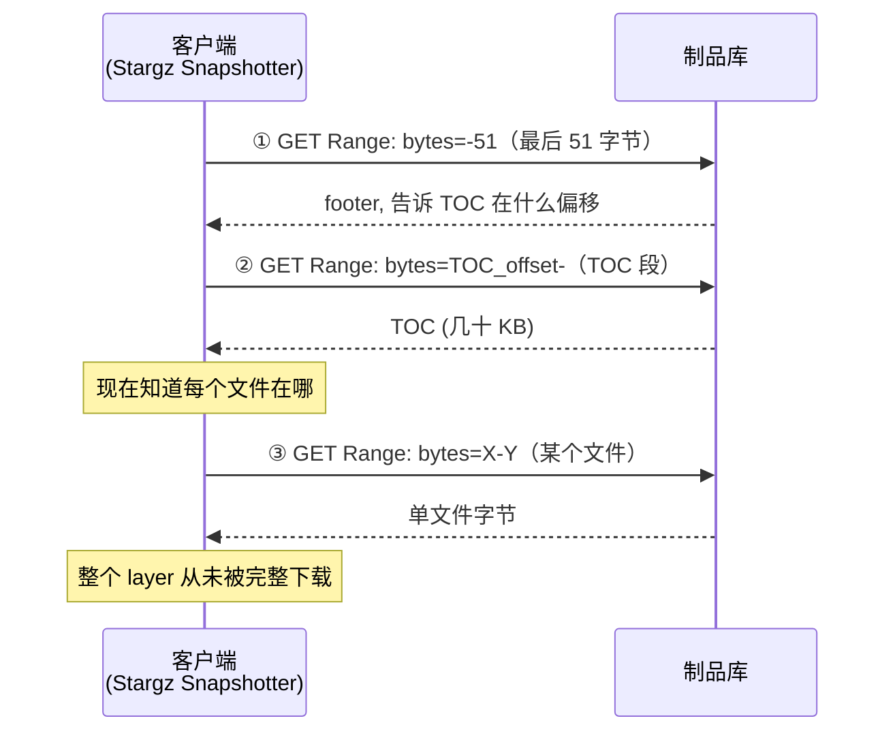
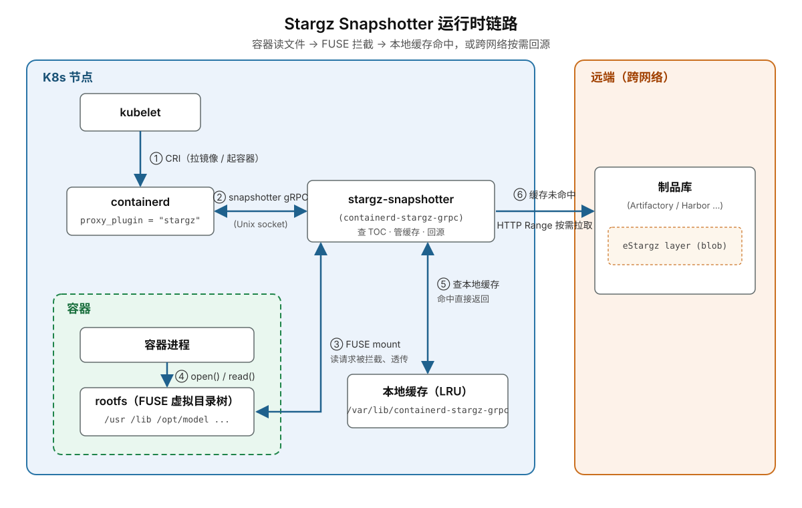

## 一、一个反直觉的数据

200 节点 × 30 GB 的账单：制品库带宽被打满、GPU 空转 90 分钟、每次发版蒸发 900 美元。Dragonfly 解决的是"数据从制品库出来"这一段的效率问题。

但有一个更基础的问题一直没人问：**这 30 GB，容器启动真的用得到吗？**

2016 年 USENIX FAST 会议上，威斯康辛大学的 Harter 团队发表了一篇题为 [_Slacker: Fast Distribution with Lazy Docker Containers_](https://www.usenix.org/system/files/conference/fast16/fast16-papers-harter.pdf) 的论文。他们做了一个测量实验：让容器从零启动到能对外服务，跟踪它在这段时间里到底读了镜像里的哪些文件。

**结论令人震惊：容器启动过程中平均只读取了镜像内容的 6.4%。**

换算到我们的场景：30 GB 的训练镜像，为了让 PyTorch 起来、CUDA 初始化、开始加载 checkpoint —— 真正被读到的可能只有 2 GB 左右。其余 28 GB 是"或许后面会用到"或"永远用不到"的东西：

- CUDA 里针对特定 GPU 架构的 kernel，但你的卡用不到那个架构
- PyTorch 里没被 import 的算子
- 各种 debug symbols、locale 文件、文档
- 训练脚本用不到的可视化工具
- 一整套预装但从未被调用的依赖

这个数字有多离谱？打个比方：**每次发版我们都在传一整套百科全书，只为让容器能查其中一个词条。**

那么自然的想法就来了：**既然只需要 6%，为什么不能只传这 6%？其余按需去取？**

这个想法太自然了，1970 年代文件系统就有类似思想（demand paging）。为什么容器社区拖到 2016 年才开始认真做？

原因非常物理：**OCI 镜像格式本身，不允许你这么干。**

---

## 二、OCI 镜像：层是分发的最小单元

今天所有主流镜像都遵循 **OCI（Open Container Initiative）镜像规范** —— Docker 镜像格式的标准化版本。在这个规范里，一个镜像由三部分组成：

- **manifest**：清单，列出镜像有哪些层、config 是谁
- **config**：环境变量、启动命令等元数据
- **layers**：若干个**层**，每层是一个文件系统变更集，以内容哈希（digest）寻址

`docker pull` 的动作就是：读 manifest → 把每一层作为一个完整的 blob 下载下来 → 逐层解压 → 叠加成容器的 rootfs。**层是分发和校验的最小单元**——你要么完整地拿到一层，要么没有这一层，没有中间态。

为什么不能只取层里的一部分？随便 inspect 一个镜像的 manifest 就能看到（`docker manifest inspect pytorch/pytorch:latest`）：

```json
{
  "schemaVersion": 2,
  "mediaType": "application/vnd.oci.image.manifest.v1+json",
  "config": {
    "mediaType": "application/vnd.oci.image.config.v1+json",
    "digest": "sha256:1a2b...",
    "size": 7023
  },
  "layers": [
    {
      "mediaType": "application/vnd.oci.image.layer.v1.tar+gzip",
      "digest": "sha256:31e3...",
      "size": 29537434          ← 基础系统层，~28 MB
    },
    {
      "mediaType": "application/vnd.oci.image.layer.v1.tar+gzip",
      "digest": "sha256:9f2c...",
      "size": 3241546824        ← CUDA + PyTorch 层，~3 GB
    }
  ]
}
```

注意两个细节：

1. 每一层的 `mediaType` 写得明明白白——`tar+gzip`：**每一层就是一个 `.tar.gz` 文件**
2. `digest` 是对**整层 blob** 算的 SHA256——想校验这一层，必须把整层下载下来

也就是说，那个 3 GB 的 CUDA + PyTorch 层，哪怕你只想要其中一个 200 KB 的 Python 文件，从格式上讲你也拿不到"其中一部分"。问题就出在这个 `tar+gzip` 上。

---

## 三、tar.gz：一次性管道的诅咒

上一节说到，OCI 规范规定每个 layer 就是一个 `.tar.gz` 文件。这一节就把它拆开，看看它为什么天生反懒加载。

`.tar.gz` 的结构简单粗暴：

```
┌──────────────────────────────────────────────────┐
│ [gzip 流头] [压缩字节流..............] [gzip 流尾] │
│              ↑ 一整个连续的 gzip 压缩流            │
└──────────────────────────────────────────────────┘
```

而 gzip 的压缩用的是 **DEFLATE 算法**，本质是"滑动窗口 + Huffman 编码"。每个字节的解码都依赖前面若干字节构成的字典。

这意味着：**你不能从中间开始解压。** 想读文件 X？必须从头解压整个流，直到解到 X 的位置。

对容器镜像的影响是灾难性的：

- 你不能用 HTTP Range 请求只拉某个文件的字节段（即使拉到了也解不出来）
- 你不能"边下边解、只解你需要的"
- 无论要不要用，**整层必须完整下载 + 完整解压**

这就是"为什么这么多年没人做按需加载"的答案 —— **格式本身就是反懒加载的**。

社区面对这个问题有两种态度：

1. **换掉 tar.gz**，用一个天生支持随机访问的新格式（比如 SquashFS、RAFS）
2. **别换 tar.gz**，想办法让它变得可以随机访问，同时**保持格式合法**

第一条路是 Nydus 选的，细节留给下一篇。第二条路是 stargz / eStargz 选的，是这一节的主角。

---

## 四、eStargz 的破局：让 tar.gz 变成 seekable

eStargz 全称 "extended stargz"。stargz 本身是 Google CRFS 团队在 2019 年提出的 "seekable stargz"，eStargz 是社区（主要是 containerd 团队）在它基础上做的增强，加了预取元数据和安全校验。两者格式思想一样，下面统称为 eStargz。

**核心洞察**是 gzip 规范里一个不太被人提起的性质：

> **多个独立的 gzip 流首尾拼接得到的字节串，本身也是一个合法的 gzip 文件。** 解压器会把它们当成一个连续的流处理。

这个性质给了我们一个惊人的操作空间：**如果我们把 tar 里每一个文件单独 gzip 压缩，得到 N 个小 gzip 流，然后把它们拼起来 —— 结果仍然是一个合法的 `.tar.gz`。**

看下对比：

**原版 tar.gz（不可 seek）**

```
gzip( [hdr_A][A_content][hdr_B][B_content][hdr_C][C_content] )
     └──────────────── 一整个连续的 gzip 流 ────────────────┘
```

**eStargz（可 seek）**

```
gzip([hdr_A][A]) ‖ gzip([hdr_B][B]) ‖ gzip([hdr_C][C]) ‖ gzip(TOC) ‖ footer
    ↑ stream 1        ↑ stream 2        ↑ stream 3       ↑ 索引

    这一长串拼起来 → 仍然是一个合法的 .tar.gz 文件
    完整解压 → 得到和原版等价的 tar 归档
```

关键性质：

- **每个文件的字节是一个自包含的 gzip 流**，可以独立解压
- **文件级 HTTP Range 请求成为可能**：知道 A 在字节 `[100, 187)`，就用 `Range: bytes=100-186` 只拉这段，本地解压得到 A 的内容
- **对不知情的客户端完全透明**：普通 `docker pull` 拉整个文件、gunzip、untar，得到的还是原来的镜像层，一模一样
- **不需要修改制品库**：制品库不知道也不关心这是 eStargz，就当普通 layer 存

**TOC（Table of Contents）** 是关键索引，也以一个独立 gzip 流的形式追加在末尾。它是一个 JSON，记录了每个文件的字节偏移和大小：

```json
{
  "version": 1,
  "entries": [
    {"name": "a.txt", "offset": 0,   "compressedSize": 87,  "size": 35, "sha256": "..."},
    {"name": "b.txt", "offset": 87,  "compressedSize": 90,  "size": 32, "sha256": "..."},
    {"name": "c.txt", "offset": 177, "compressedSize": 85,  "size": 28, "sha256": "..."}
  ]
}
```

TOC 名称是特殊的 `stargz.index.json`。最末尾还有一个固定大小的 **footer**（eStargz 为 51 字节，legacy stargz 为 47 字节），记录 TOC 在文件中的偏移位置。

整个 eStargz layer 的物理布局如下：

```
◀──────────────────── 整体仍是一个合法的 .tar.gz ─────────────────────▶

┌────────────┬────────────┬────────────┬─────┬────────────────┬───────────┐
│ gzip 流 1  │ gzip 流 2  │ gzip 流 3  │ ... │ gzip 流 N+1    │ footer    │
│ [hdr_A][A] │ [hdr_B][B] │ [hdr_C][C] │     │ [hdr_TOC][TOC] │ (51 字节) │
└────────────┴────────────┴────────────┴─────┴────────────────┴───────────┘
 offset=0     offset=87    offset=177         stargz.index.json
      ▲            ▲            ▲                    │              │
      │            │            │                    │              │
      └────────────┴────────────┴────────────────────┘              │
        TOC 记录每个文件的 offset / size / sha256                   │
                                            footer 记录 TOC 的偏移 ─┘
```

**客户端只需要两次小的 Range 请求就能拿到索引，之后按文件按需取**：



头两次请求加起来通常只有几十 KB，几乎不耗时。**从制品库视角看，你的 `docker pull` 拉的数据量近乎为零。** 容器可以立刻起来，剩下的按需去拿。

---

## 五、光"按需"还不够：Prefetch 的必要性

如果你只做到上面这一层，会遇到一个新问题。

假设容器启动过程中要按顺序读 100 个不同的文件。如果每个文件都要触发一次 HTTP Range 请求，每次网络往返 30 ms，光网络延迟就是 3 秒 —— 而且这 3 秒是**串行阻塞**的（容器进程一定要读到文件 A 才能接着读文件 B）。

用户看到的现象：`docker pull` 秒完成，但容器起了 5 秒才能对外服务。这在很多场景下不可接受。

问题是这样的：**极致的按需 = 极致的网络往返次数**。这两个约束是天然对抗的。

eStargz 的解法叫 **Prefetch + Landmark**。思路是：

1. **在构建时做一次运行时 profiling**：用 `ctr-remote optimize` 或类似工具把镜像跑一遍，从启动开始到容器"就绪"为止，记录**按时间顺序**访问了哪些文件。
2. **重排 tar 结构**：把这些"启动期文件"在 tar 流里挪到最前面，让它们的字节在物理上连续。
3. **插入 landmark 文件**：在"启动期文件区"和"其他文件区"之间塞一个特殊的空文件 `.prefetch.landmark`，标记边界。

现在镜像的布局变成：

```
                     landmark
                        ↓
┌──────────────────┬────┬──────────────────────────────────┐
│ 启动期文件       │ ✦  │ 其他文件（按需）                  │
│ 物理上连续的区域 │    │ 真的用到了再单文件 Range 取        │
└──────────────────┴────┴──────────────────────────────────┘
↑──────────────────↑
     prefetch zone：用一个大 Range 请求整段拉下来
```

启动时的动作变成：

- 读 footer + TOC（两次小请求），从 TOC 中定位 landmark 位置
- **一个大的 Range 请求**把整个 prefetch zone 拉下来（比如几百 MB）
- 容器就能启动了
- 之后运行中如果读到 prefetch zone 之外的文件，触发单文件 Range 请求，按需拉

这样把 100 次网络往返合并成了 1 次，同时启动期需要的数据也预先在本地了。

**Prefetch 的本质是"批量拉热点"，在"只拉启动需要的那 6%"和"不要让启动变成 N 次小请求"之间取得平衡。** 单纯只做按需不够 —— 你必须有一个机制把"可以预测的热路径"批量拉过来。

---

## 六、运行时：Stargz Snapshotter

有了 eStargz 格式，还需要一个运行时组件让 containerd 会用它。这个组件叫 **Stargz Snapshotter**。

它的角色是 containerd 的一个 **snapshotter 插件**。containerd 用 snapshotter 这个抽象层管理镜像层的存储 —— 默认的是 overlayfs snapshotter，把每一层真的下载并解压到本地目录。Stargz Snapshotter 换掉了这个动作：

- 当 containerd 要"挂载某层"时，Stargz Snapshotter **不真的下载这层**
- 它挂载一个 **FUSE 文件系统**，把 eStargz layer 虚拟成一个目录树
- 容器看到的是一个正常的目录，里面有 `/usr`、`/lib`、`/opt/model` 等等
- 当容器进程 `open()` 或 `read()` 某文件时，FUSE 拦截系统调用
- FUSE 处理器查 TOC 找到文件字节范围，向制品库发起 HTTP Range 请求，拿到字节，解压
- 拉到的字节缓存在本地磁盘，下次访问直接命中

对容器进程完全透明：**它以为在读本地文件系统，实际上是在触发远程按需拉取。**

整条链路的组件关系如下：



stargz-snapshotter 是一个独立进程，以 containerd 的 `proxy_plugin` 方式注册，两者通过 Unix socket 上的 gRPC 通信：

```toml
# /etc/containerd/config.toml
[proxy_plugins]
  [proxy_plugins.stargz]
    type = "snapshot"
    address = "/run/containerd-stargz-grpc/containerd-stargz-grpc.sock"
```

这带来一个有意思的结果：**pull 时间几乎为零。**（严格说这条链路走的是 containerd 生态——`ctr`、`nerdctl`、Kubernetes；Docker 引擎默认的 pull 路径不经过 snapshotter 插件。本文用 "docker pull" 只是口语化代称。）

- 传统 pull：拉整层 30 GB → 90 秒（假设 3 Gbps 单节点带宽）
- Stargz Snapshotter：拉 footer + TOC ≈ 几百 KB → **不到 100 ms**

容器可以在 pull 后立刻启动，进入 prefetch 阶段（并行拉启动期文件），几秒之内对外服务。**从任务下发到容器就绪的端到端时间从分钟级降到秒级。**


---

## 七、没有银弹

eStargz 的问题可以分成两类：**格式设计上的先天不足**，和**运行时实现上的工程隐患**。前者决定它的性能上限，后者决定它的可靠性下限。

### 7.1 格式的先天不足

**压缩率变差。** 为了让每个文件能独立解压，eStargz 把"一整层共用一个 gzip 字典"拆成了"每个文件各起一个 gzip 流"（大文件还会按 4 MiB 切成多个 chunk，道理一样）。代价是丢掉了跨文件共享的字典——同样的内容，eStargz blob 会比原版 tar.gz 更大。

Python 的 `site-packages` 就是个吃亏的例子：成千上万个小 `.py` 文件，`import` 语句和代码结构高度雷同。原版 tar.gz 把它们压进同一个流，后面的文件能复用前面积累的字典；eStargz 里每个文件都要从零建字典，还各付一份 gzip 头的固定开销。文件越小越碎，膨胀越明显。

**去重能力弱。** eStargz 没有改变 OCI 的层模型——制品库存储和寻址的单位仍然是整层 blob，文件的 offset/sha256 只用来做层内定位和校验，不是全局内容寻址。

后果很直接：团队同时维护 PyTorch 2.3 和 2.4 两个训练镜像，各有一个 3 GB 的 CUDA 层，内容 99% 重叠。只要构建产物有一个字节不同，两层的 digest 就不同，制品库和节点本地缓存都只能按整层区分，于是要完整存两份 3 GB——哪怕其中几百 MB 的 `libcudnn.so` 完全一样。下一篇会看到，Nydus 走的是内容寻址：相同内容全局只存一份，不管它出现在哪个镜像的哪一层。

### 7.2 运行时架构：一层一个 FUSE 挂载

第六节的架构图里还藏着一个容易被忽略的事实：**Stargz Snapshotter 的挂载粒度是"层"，不是"镜像"**。每个 remote 层各挂一个独立的 FUSE 文件系统，容器的 rootfs 再由 overlayfs 把这些挂载点作为 lowerdir 逐层叠起来。

对一个 28 层的镜像，这意味着几件事：

- **节点上多出 28 个 FUSE 挂载点**，总数随"镜像数 × 层数"线性增长。
- **查找和读取的间接开销变重**：每次 open/lookup 要先穿过 overlayfs 的 lowerdir 逐层查找，未命中缓存的读还要经历一次 FUSE 的用户态往返。层数越多，这层开销越明显。
- **每个挂载点都是一个独立的故障单元**。快照器要对所有 remote 层做健康检查，任一层失败就判定整个 rootfs unavailable；层数越多，快照器要同时维持的"层—制品库"连接就越多，也就越可能有一条掉线拖垮整条链。

这是 eStargz 走"在旧格式里雕花"这条路的又一处代价：它完整保留了 OCI 的层结构，也就带着"层是独立单元"的一切遗产一起继承下来——包括这里的挂载粒度和故障域。下一篇会看到，Nydus 把整个镜像合并成单一的文件系统视图，一个 rootfs 只需要一个挂载点。

### 7.3 运行时的隐患：resolve 超时会退回全量拉取

懒加载的 pull 近乎瞬时是有前提的：每一层都要先完成 resolve——读 footer、拉 TOC、和制品库建立会话——这一步有一个硬编码的 30 秒timeout。镜像层数较多或TOC较大时都有可能导致请求超时。一旦某一层超时，containerd 会**静默回退为传统的全量下载 + 解压**，懒加载的收益直接清零。

---

## 八、什么时候不该用懒加载

懒加载也有明确的适用边界。以下场景中它要么帮不上忙，要么反而拖后腿：

**镜像里大部分文件都会被用到。** 比如典型的 CI 构建镜像 —— 你会用编译器、链接器、测试套件、格式化工具、依赖管理器……启动前也无法准确 profile 出"CI 会用什么"。这时懒加载没多少可"懒"的，反而 FUSE 的间接开销会拖慢正常 IO。

**推理镜像里模型权重占主体。** 比如一个 30 GB 的推理镜像，其中 25 GB 是模型 `.safetensors`。服务启动的第一件事就是把权重全部 load 到 GPU 内存 —— 这部分是必须全量读的、无法"按需"。懒加载在这种场景下的收益仅限于剩下的 5 GB 应用代码，投入产出比不高。**这类场景下更好的方案是把权重从镜像里剥出来，用专门的模型服务或 blob storage 管理**。

**制品库高可用没保障时。** 传统 pull 是"下载完就切断依赖"，很鲁棒。懒加载的健壮性要求制品库 24/7 在线。如果你的制品库还是"周末维护窗口"的运维成熟度，别急着上懒加载。

---

## 九、小结与下一篇预告

这一篇讲了懒加载的"为什么"和"怎么做"：容器启动平均只读镜像的 6.4%，但 tar.gz 格式天生反随机访问；eStargz 用"拼接 gzip 流 + TOC 索引"在保持 OCI 兼容的前提下实现了按需拉取，Prefetch 解决了"按需"和"网络往返次数"的天然对抗，Stargz Snapshotter 把这一切接进 containerd。但雕花终究是雕花——它压缩率和去重能力受限、挂载点随层数膨胀、冷启动还有超时回退的隐患。Nydus 用独立元数据、chunk 粒度和镜像级挂载给出了更彻底的答案。

下一篇进入生产实践：Nydus + Dragonfly 在真实集群里如何部署，控制面和数据面分别长什么样，一次 lazy pull 的完整启动流程，以及最重要的——怎么从日志判断懒加载真的在生效，而不是在静默回退。

