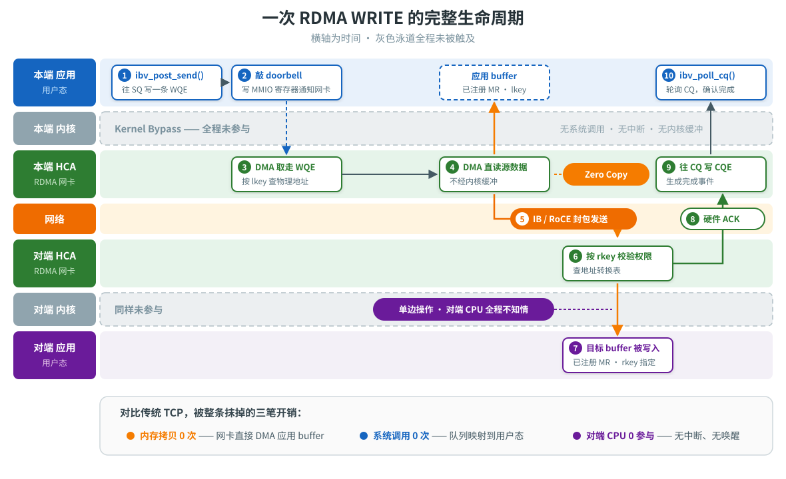

# 容器里的 RDMA：从内核旁路到 hostNetwork 与 SR-IOV

> 多机训练要跑满带宽就得用 RDMA。但 RDMA 到底是什么、为什么非它不可，很多人是从一堆 `NCCL_IB_*` 环境变量里"逆向"出来的——知道要配，不知道为什么。
>
> 这篇文章分两半。前半讲 RDMA 本身：从传统 TCP 收发一个包的完整代价讲起，到 RDMA 用什么办法把这些代价一条条抹掉，以及它为此付出的取舍。后半讲落地：容器默认根本看不到 RDMA 网卡，业界解决这件事有 hostNetwork 和 SR-IOV 两条路，复杂度差一个数量级。
>
> 读完之后，看到一份陌生的训练任务 YAML，你应该能一眼判断出它有没有真的在用 RDMA、走的是哪条路、以及为什么。

---

# 第一部分：RDMA 是什么

## 一、先看看传统网络贵在哪

要理解 RDMA 为什么存在，得先算清楚它想省掉的那笔账。

假设你在一台机器上调用 `send()` 发送 1MB 数据，对端调用 `recv()` 收下来。看起来是两个函数调用，实际发生的事情是这样的：

```text
发送侧
  应用 buffer
    │  ① CPU 逐字节拷贝
    ▼
  内核 socket send buffer (sk_buff)
    │  ② TCP 分段 / 填首部 / 校验和 / 拥塞控制状态机
    │  ③ IP 路由查找 / netfilter 钩子
    ▼
  网卡发送队列 —— 网卡 DMA 取走，发出去

接收侧
  网卡 DMA 写入 ring buffer
    │  ④ 硬中断通知 CPU
    │  ⑤ 软中断 (NET_RX softirq) 里跑协议栈：校验、重组、ACK
    ▼
  内核 socket receive buffer
    │  ⑥ CPU 逐字节拷贝
    ▼
  应用 buffer
    │  ⑦ 唤醒阻塞在 recv() 上的进程 —— 一次上下文切换
    ▼
  应用拿到数据
```

这条路上有三类开销，而且它们都随流量线性增长：

**1. 内存拷贝。** ①和⑥是实打实的 CPU 搬砖。现代内核有 `sendfile`、`splice` 之类的零拷贝手段，但通用 socket 路径上至少要一次拷贝。1MB 数据在内存带宽 20GB/s 的机器上，一次拷贝大约 50 微秒——而 100Gbps 网卡传完这 1MB 只需要 80 微秒。**拷贝本身已经和传输一样贵了。**

**2. CPU 处理协议栈。** ②③⑤是纯计算：TCP 的序列号、滑动窗口、拥塞控制、重传定时器，IP 层的路由查找和防火墙规则。业界有个粗糙但好用的经验法则：

> **1 bps 的网络吞吐大约需要 1 Hz 的 CPU 频率。**

也就是说，跑满 100Gbps 大概需要 100GHz 的 CPU 算力——按单核 3GHz 算，是 30 多个核。这在网卡只有 10Gbps 的年代不是问题（3 个核而已），但网络速度这十几年涨了 10 倍以上，单核频率几乎原地踏步。**协议栈从"顺手就跑了"变成了"要专门养一批核"。**

**3. 中断与上下文切换。** ④⑦是延迟的主要来源。一次硬中断打断 CPU 当前工作、刷掉一部分 cache；一次进程唤醒要走调度器。小包场景下这部分甚至比数据传输本身还贵。

三项加起来，数据中心内部一次 TCP 往返的延迟通常在几十微秒量级，其中真正花在光纤上的时间可能不到 1 微秒——**绝大部分时间耗在了两端的软件里。**

### 1.1 为什么分布式训练对这件事格外敏感

上面这些开销在 Web 服务里可以接受，因为业务逻辑本身也要花时间，网络占比不高。但训练场景有三个特点，让它变成了不可接受：

**流量绝对值大。** 一次 AllReduce 要同步的是整个模型的梯度。百亿参数模型的 FP16 梯度就是 20GB，Ring AllReduce 的通信量约为参数量的 2 倍，一步就是几十 GB。而训练一步只有几百毫秒。

**CPU 本来就不该干这个。** 训练节点的 CPU 的正职是数据预处理和喂数据给 GPU。如果 30 个核被协议栈占走，数据管道就会饿着 GPU——你花大价钱买的加速卡在等 CPU 收包。

**同步语义放大了一切。** AllReduce 是同步集合操作，所有 rank 必须都到齐才能进入下一步。这意味着**最慢的那条链路决定整体速度**，木桶效应。通信慢一倍，端到端训练时间就慢接近一倍，而不是"慢一点点"。

所以对分布式训练来说，RDMA 不是"优化项"，是**准入门槛**。

---

## 二、RDMA 是什么：把 DMA 的范围拉到远端

先拆名字：**R**emote **D**irect **M**emory **A**ccess。

DMA 这个概念本身并不新——本机上的外设（磁盘控制器、网卡）早就可以绕过 CPU 直接读写主存，这就是 Direct Memory Access。RDMA 做的事情是**把 DMA 的作用域从"本机外设 ↔ 本机内存"扩展到"远端网卡 ↔ 本机内存"**：

> 一台机器的网卡，可以直接把数据写进另一台机器某个进程的内存里，两端的 CPU 和操作系统都不参与。

这句话是整个 RDMA 的全部。剩下的机制都是为了让它成立。

具体到实现上，它靠三件事把上一节那三类开销依次消掉：

### 2.1 Kernel Bypass —— 干掉协议栈和中断

RDMA 网卡（业内叫 **HCA**，Host Channel Adapter；或者 **RNIC**）把自己的**工作队列直接映射到用户态进程的地址空间**。应用不再调用 `send()` 陷入内核，而是直接往这块映射内存里写一条"工作请求"，然后写一个 MMIO 寄存器（叫 **doorbell**，门铃）通知网卡"有活了"。

数据路径上一次系统调用都没有。协议处理（可靠传输、重传、分片）全部由网卡硬件完成——这些逻辑被固化进了 ASIC，不再消耗主机 CPU。

完成通知也不走中断：应用**主动轮询**（poll）一个完成队列，看有没有新的完成事件。轮询会烧 CPU，但换来的是微秒级的确定性延迟，没有中断抖动。延迟敏感的场景愿意做这个交易。

> 注意：bypass 的是**数据路径**。建连、注册内存这些**控制路径**仍然要走内核驱动——因为它们涉及权限和资源分配，不能让用户态自己说了算。

### 2.2 Zero Copy —— 干掉内存拷贝

网卡直接对**应用自己的 buffer** 做 DMA，不经过内核的 sk_buff 中转。数据在内存里只存在一份，从发送方的应用 buffer 直接落到接收方的应用 buffer。

但这件事有个前提，而这个前提后面会解释一个很关键的 YAML 配置项，先记住：**网卡做 DMA 用的是物理地址**。所以这段内存必须提前告诉网卡，而且**在整个使用期间不能被换出、不能被内核移动**。这个"提前告诉"的动作叫**内存注册**（Memory Registration）。

### 2.3 单边操作 —— 干掉对端 CPU

这是 RDMA 与 TCP 最本质、也最容易被忽略的区别。

TCP 是**双边**（two-sided）的：我 `send()`，你必须 `recv()`。数据要落到你的内存里，你的 CPU 必须醒过来接一下。

RDMA 除了提供对应的双边操作（SEND/RECV）之外，还提供**单边操作**（one-sided）：

| 操作 | 语义 | 对端 CPU |
| --- | --- | --- |
| **SEND / RECV** | 类似 TCP，接收方需预先挂好接收缓冲 | 参与 |
| **RDMA WRITE** | 我直接把数据写进你指定的那段内存 | **完全不参与，甚至不知情** |
| **RDMA READ** | 我直接把你那段内存的内容读回来 | **完全不参与** |
| **ATOMIC** | 对远端内存做原子的 CAS / FetchAdd | 不参与 |

RDMA WRITE 的语义是："把这 1MB 写到对端虚拟地址 `0x7f...` 开始的地方。"对端应用完全无感——它的 CPU 可能正在跑别的计算，内存就已经被填好了。

这一条在训练场景里价值极高：AllReduce 期间 GPU 在做规约计算，CPU 空着也好、忙着也好，数据交换都能同时进行，互不干扰。

### 2.4 核心对象：QP、CQ、MR

RDMA 编程接口叫 **verbs**（动词），底层库是 `libibverbs`。它抽象出三个核心对象，看懂这三个就看懂了 RDMA 的工作方式：

**MR（Memory Region，内存区域）**
调用 `ibv_reg_mr()` 把一段虚拟内存注册给网卡。内核会做两件事：把这些页**锁住**（`mlock`，禁止换出和迁移），并把虚拟地址到物理地址的映射写进网卡的地址转换表。返回两把钥匙：`lkey`（本地访问用）和 `rkey`（给对端做远程访问用——对端拿着 `rkey` 才能 WRITE/READ 你这段内存，这就是 RDMA 的权限模型）。

> 记住这里的"锁住"。**后面容器里那个 `IPC_LOCK` capability，根源就在这一行。**

**QP（Queue Pair，队列对）**
RDMA 版的 socket，由一个**发送队列 SQ** 和一个**接收队列 RQ** 组成。应用往队列里投递的每条请求叫 **WQE**（Work Queue Element）。QP 有几种传输类型：

- **RC**（Reliable Connected）：可靠、面向连接，语义最接近 TCP，支持全部单边操作。**训练场景基本都用它。**
- **UD**（Unreliable Datagram）：不可靠数据报，类似 UDP，一个 QP 可以和多个对端通信。
- 还有 UC、DC 等，用得较少。

RC QP 有个容易被忽略的特点：**它自己没有"连接建立"协议**。两端要通信，必须先通过**带外通道**（通常就是一条普通 TCP 连接）交换各自的 QP number、GID、rkey 等参数，然后双方各自把 QP 状态机从 INIT 推到 RTR 再到 RTS。这解释了为什么后面 NCCL 明明在跑 RDMA，却还需要一个 `NCCL_SOCKET_IFNAME` 指定 TCP 网卡。

**CQ（Completion Queue，完成队列）**
网卡干完活以后往这里塞一条 **CQE**（Completion Queue Element）。应用用 `ibv_poll_cq()` 轮询它，确认某个请求完成了、有没有出错。

把这三个对象串起来，一次 RDMA WRITE 的完整生命周期是这样的：



这张图里有三处值得停下来看：

**两条内核泳道是空的。** ①②发生在用户态内存和一个 MMIO 寄存器上，③④⑨由网卡硬件独立完成——从头到尾没有一次系统调用，也没有一次中断。对比第一节那张 TCP 路径图，②③⑤⑦四步全部消失。

**两条橙色的竖直箭头，都是穿过内核泳道直接落到应用泳道的。** 这就是零拷贝：网卡拿着 `lkey` / `rkey` 换来的物理地址，直接对应用 buffer 做 DMA，中间没有任何一份内核副本。第一节里那两次 CPU 逐字节拷贝（①和⑥）被整条抹掉。

**最下面那条泳道全程是灰的。** 对端应用的 CPU 从头到尾没醒过——它的内存被填好了，而它甚至没有收到通知。这是单边操作，也是 RDMA 和 TCP 最本质的区别：TCP 的 `recv()` 必然要求对端 CPU 参与，RDMA WRITE 不要求。

### 2.5 代价：RDMA 不是免费的午餐

正因为把复杂度推给了硬件，RDMA 也继承了硬件的脾气。这些取舍解释了后面很多"看起来莫名其妙"的运维要求：

**1. 它假设网络不丢包。** RDMA 的可靠传输由网卡实现，早期实现用的是 go-back-N 重传——丢一个包，整个窗口重传。这在丢包率 0.1% 的网络上性能会断崖式下跌。所以 RDMA 要求**无损网络**：InfiniBand 靠链路层信用机制天然无损；以太网上则必须在交换机配 **PFC**（优先级流控）和 **ECN**（显式拥塞通知）。这也是为什么"RoCE 调不通"往往是网络工程师的活，不是应用开发者的。

**2. 内存必须常驻。** 注册的内存被锁页，不能换出。大规模注册会显著吃掉可用内存，而且注册操作本身很慢（要走内核、要建页表映射），所以实践中都是**启动时一次注册，全程复用**，不能按需申请。

**3. 连接状态占内存。** 每个 RC QP 在网卡上都有状态。N 个节点全连接就是 O(N²) 个 QP，规模上到几千节点时，网卡缓存装不下 QP 状态，会频繁换入换出，性能反而下降。这是大规模 RDMA 集群的经典难题。

**4. 编程模型难。** verbs 是个相当底层的 API，手写正确的 RDMA 程序不容易。好消息是绝大多数人不需要——**NCCL、UCX、MPI 这些库已经把 verbs 封装好了**，训练框架直接用就行。这也是为什么这篇文章后面全在讲 NCCL 的环境变量而不是 verbs 代码。

---

## 三、三种实现：IB、RoCE、iWARP

RDMA 是一套语义规范，跑在什么网络上有三种选择：

| 实现 | 承载网络 | 无损保障 | 说明 |
| --- | --- | --- | --- |
| **InfiniBand（IB）** | 专用网络 + 专用交换机 + 专用网卡 | 链路层信用机制，**天然无损** | 性能与延迟最优，但整套网络设备独立于以太网，成本最高。超算和顶配训练集群常用 |
| **RoCE v2** | 标准以太网（UDP/IP 封装，端口 4791） | **需要交换机配 PFC / ECN** | 复用现有以太网设施，成本低、可路由。**公有云上的 RDMA 绝大多数是这个** |
| **iWARP** | TCP | 靠 TCP 自己保证 | 把 RDMA 语义架在 TCP 上，无需改造网络，但性能优势被 TCP 本身吃掉不少，用得较少 |

RoCE 有 v1 和 v2 两代：v1 直接封在以太网帧里，不能跨子网路由；**v2 封在 UDP 里，可路由**，现在说 RoCE 默认都指 v2。

**区分 IB 和 RoCE 很重要**，因为后面 GID 相关的那个大坑，基本只发生在 RoCE 上——原因就在于 RoCE 要同时兼容 v1/v2 和 IPv4/IPv6，导致同一个端口上存在多份寻址标识。

---

## 四、再进一步：GPUDirect RDMA

到这里数据已经是"网卡 ↔ 主机内存"直通了。但训练场景里，数据的真正起点和终点是 **GPU 显存**。

没有 GPUDirect 时，一次跨机梯度传输是这样的：

```text
GPU 显存 ──①──> 主机内存 ──②──> 网卡 ──网络──> 对端网卡 ──> 主机内存 ──> GPU 显存
          (bounce buffer，多一次 PCIe 往返 + 一次拷贝)
```

**GPUDirect RDMA** 让网卡通过 **PCIe P2P** 直接读写 GPU 显存（GPU 把一段显存通过 BAR 空间暴露出来），把中间的主机内存中转整条省掉：

```text
GPU 显存 ────────────────> 网卡 ──网络──> 对端网卡 ────────────────> GPU 显存
```

省掉的不只是拷贝时间，还有主机内存带宽和 PCIe 带宽的占用。在 8 卡机上 8 张卡同时打满网络时，这个差别很明显。

但它有**拓扑要求**：网卡和 GPU 最好挂在同一个 PCIe Switch 下。如果两者跨了不同的 CPU Socket，P2P 流量要穿过 CPU 之间的互联（QPI/UPI），性能可能还不如老老实实走主机内存——这本质上是 NUMA 亲和性问题在 PCIe 拓扑上的体现。

NCCL 用 `NCCL_NET_GDR_LEVEL` 控制"在多远的拓扑距离内仍然启用 GDR"，值越大越激进。这就是这个参数的物理含义。

---

# 第二部分：把 RDMA 放进容器

前半部分讲的都是 RDMA 本身，和容器一点关系都没有：一台裸金属机器上，装好驱动、跑 `ib_write_bw` 压测，一切顺理成章。

问题出在把训练任务放进 Kubernetes 的那一刻。

## 五、一个多机训练任务要解决四个问题

先把问题空间划清楚。一次多机 GPU 训练能跑起来，需要四个**相互正交**的问题都被解决：

| 层次 | 问题 | 典型方案 |
| --- | --- | --- |
| **调度层** | 8 台机器要么一起给我，要么都别给 | Gang Scheduling（Volcano / Kueue PodGroup） |
| **发现层** | 这些进程怎么互相找到、怎么选出 rank 0 | Headless Service + `MASTER_ADDR` / torchrun rendezvous |
| **传输层** | AllReduce 的几百 GB 走什么线路 | NCCL + RDMA ← **前半部分讲的就是这层** |
| **接入层** | 容器里到底怎么才能碰到那块 RDMA 网卡 | **hostNetwork vs SR-IOV VF** |

前三层的资料很多，最不起眼的是第四层——但它是运维复杂度的主要来源，也是最容易配错的地方。

而要讲透接入层，得先回到一个更底层的事实。

---

## 六、根因：network namespace

容器不是虚拟机。容器本质上就是**进程 + 一组 namespace 隔离 + cgroup 限额**。其中 **network namespace（netns）** 决定了"这个进程眼里的网络世界长什么样"。

一个独立的 netns 拥有自己的一整套：

- 网络设备列表（`ip link` 能看到什么）
- IP 地址与路由表
- iptables / nftables 规则
- **端口号空间**（两个 netns 可以各自监听 `:8080` 而互不冲突）

这里有一条容易被忽略、但决定了后面一切的硬约束：

> **网卡属于某一个 netns，且同一时刻只属于一个。**

你执行 `ip link set ib0 netns <ns>` 把物理网卡移进容器，宿主机自己就看不到它了。网卡不能"共享"给多个 netns——除非硬件本身支持虚拟化（这正是后面 SR-IOV 出场的原因）。

于是就有了两条根本不同的路线：

```text
路线 A（K8s 默认）：Pod 拥有独立 netns
    宿主机 netns                       Pod netns
   ┌──────────────────┐              ┌──────────────────┐
   │ eth0  (物理网卡)   │              │ eth0 (veth)      │  ← CNI 创建的虚拟网卡
   │ ib0   (RDMA 网卡)  │              │                  │  ← Pod 看不见 ib0
   └────────┬─────────┘              └────────┬─────────┘
            └──────── veth pair / bridge ─────┘

路线 B：hostNetwork = true，Pod 直接复用宿主机 netns
   ┌────────────────────────────────────────────┐
   │ eth0 (物理网卡)      ib0 (RDMA 网卡)         │  ← 容器进程直接全部可见
   └────────────────────────────────────────────┘
```

**路线 A 下，容器天生看不到 RDMA 网卡。** 接下来所有的机制复杂度，都是为了解决这一件事。

---

## 七、路线 A：把网卡搬进容器

要让一个有独立 netns 的 Pod 用上 RDMA，需要**两个独立的机制协同**。这两步经常被混为一谈，但它们由完全不同的组件负责，配错任何一个症状都不一样。

### 7.1 第一步：申请——SR-IOV 与 Device Plugin

**SR-IOV**（Single Root I/O Virtualization）是 PCIe 层面的硬件虚拟化能力。支持 SR-IOV 的 RDMA 网卡（Mellanox CX-5 / CX-6 之类）可以把一块物理网卡——称为 **PF**（Physical Function）——虚拟成 N 个 **VF**（Virtual Function）。

每个 VF 在 PCIe 层面是一个独立设备，有自己的 MAC / GID，可以被整体"分配"给某个容器或虚拟机使用。一块 PF 通常切出 8 / 16 / 32 个 VF。

关键在于：**VF 数量有限，因此它必须走 Kubernetes 的资源分配机制。**

Kubernetes 原生只认识 `cpu` 和 `memory`。厂商设备通过 **Device Plugin** 机制向 kubelet 注册，上报成 **extended resource**——一种形如 `<domain>/<name>` 的自定义资源名。常见的有：

```yaml
resources:
  limits:
    nvidia.com/gpu: 8                              # NVIDIA device plugin
    rdma/vf: 1                                     # k8s-rdma-shared-dev-plugin 等通用命名
    # 云厂商各有自己的命名，例如腾讯云 TKE：
    # tke.cloud.tencent.com/mlnx_sriov_rdma: 1     # 独占一个 SR-IOV VF
    # tke.cloud.tencent.com/tke-shared-rdma: 1     # 共享 RDMA（不独占 VF）
```

Device Plugin 干三件事：

1. 向 kubelet 注册自己负责的资源名；
2. 上报本机有多少个可用实例；
3. Pod 被调度过来时，负责把对应的设备节点（`/dev/xxx`）挂进容器。

调度器凭此做**容量约束**：这台机器只剩 3 个 VF，你要 4 个，那这个 Pod 就调度不上去。

> 注意：**这一步只解决了"有没有配额"，没有解决"网卡进不进得来"。** Device Plugin 挂进去的是字符设备文件（比如 `/dev/infiniband/uverbs0`，verbs 库靠它跟网卡对话），而网卡作为网络设备归 netns 管——这是两回事。

### 7.2 第二步：插入——CNI 与 Multus

**CNI**（Container Network Interface）是 kubelet 调用的网络插件规范：Pod 启动时，由 CNI 插件负责给这个 netns 配好网络。默认情况下只配一块 `eth0`。

**Multus** 是一个 meta-CNI：它读取 Pod 上的注解，按注解去调用多个下层 CNI 插件，从而给 Pod 插入**多块网卡**。各家云厂商也有自己的等价实现。

社区标准写法（Multus + SR-IOV CNI）是引用一个事先创建好的 `NetworkAttachmentDefinition`：

```yaml
metadata:
  annotations:
    k8s.v1.cni.cncf.io/networks: sriov-rdma-net@eth1
```

翻译过来是：除了默认那块网卡，再按 `sriov-rdma-net` 这份定义插一块进来，**并且在容器里命名为 `eth1`**。

那个 `@eth1` 后缀非常关键，后面判断"这个任务走的哪条路"就靠它。

云厂商各有自己的等价写法，例如腾讯云 TKE 用的是自己的注解 key，值里同时列出默认网络和 RDMA 网络：

```yaml
metadata:
  annotations:
    tke.cloud.tencent.com/networks: "tke-bridge,<rdma网络名>@eth1"
```

形式不同，做的是同一件事。

### 7.3 小结：路线 A 是"两步走"

```text
第一步（申请）：Device Plugin 上报 extended resource
               → 调度器保证这台机器有 VF 可用
               → resources.limits 里那一行

第二步（插入）：Multus 读注解调用 SR-IOV CNI
               → 真正把 VF 移进 Pod 的 netns
               → annotations 里那一行
```

**两步缺一不可，而且分属两套独立机制。**

这也是路线 A 运维成本高的原因：你需要在节点上正确配置 SR-IOV（BIOS 开 VT-d、驱动创建 VF）、部署 device plugin、部署 Multus、维护 NetworkAttachmentDefinition、还要保证这几者对 VF 的认知一致。任何一环出问题，症状都是"Pod 起不来"或者"起来了但 RDMA 不通"。

---

## 八、路线 B：把容器搬到网卡旁边

如果我们不要网络隔离呢？

```yaml
spec:
  hostNetwork: true
  dnsPolicy: ClusterFirstWithHostNet
```

`hostNetwork: true` 让 Pod **直接复用宿主机的 network namespace**。容器里 `ip link` 看到的就是物理机的网卡列表，用的就是物理机的 IP，监听的端口就是物理机的端口。

于是第六节那条硬约束不再是障碍——宿主机上的 RDMA 网卡对容器进程**本来就可见**。

因果链非常直接：

> hostNetwork = true → 共享宿主机 netns → RDMA 网卡天然可见 → **不需要 device plugin 切 VF，也不需要 CNI 往私有 netns 里插网卡**

第七节讲的那"两步"，一步都不需要了。resources 里不用写 RDMA 资源，annotations 里不用写网络注解，Multus 和 SR-IOV device plugin 整套组件都可以不部署。

这就是为什么很多定位单一的训练集群会直接统一走这条路——**性能完全相同，运维复杂度差一个数量级。**

### 8.1 必须配套的 dnsPolicy

`dnsPolicy: ClusterFirstWithHostNet` 不是可选的装饰，它是这个组合里的必需项。

Kubernetes 的规则是：`dnsPolicy` 默认值 `ClusterFirst`，**但对于 `hostNetwork: true` 的 Pod，`ClusterFirst` 会被当作 `Default` 处理**——也就是继承宿主机的 `/etc/resolv.conf`，指向 VPC DNS 而不是集群的 CoreDNS。

后果是：Pod 里解析不了任何集群内的 Service 域名。而分布式训练恰恰依赖这个（第十一节会看到 `MASTER_ADDR` 通常就是个 Service 域名），于是症状就是训练进程卡在 rendezvous 阶段直到超时，日志里什么错都看不出来。

`ClusterFirstWithHostNet` 的含义就是显式声明："我虽然用 hostNetwork，但 DNS 还是走 CoreDNS。"

> **这是 hostNetwork 最经典的坑，没有之一。** 把 `hostNetwork: true` 和 `dnsPolicy: ClusterFirstWithHostNet` 当成一个不可拆分的整体来记。

---

## 九、两条路都要配的东西

上面两条路解决的都是"网卡怎么进容器"。但**不管走哪条路，只要你在用 RDMA，下面这些就都得配**——它们对应的是第一部分讲的 RDMA 机制本身。

### 9.1 IPC_LOCK：内存注册的必然结果

几乎所有跑 RDMA 的容器都会带上这么一段：

```yaml
securityContext:
  capabilities:
    add: ["IPC_LOCK"]
```

回到 2.2 和 2.4：RDMA 的零拷贝要求网卡直接 DMA 应用内存，而网卡持有的是**物理地址**。内核一旦把这页换出去或者做内存压缩迁移了页，网卡就会继续往那个物理地址写——写到别人的内存上去。

所以内存注册必然伴随 `mlock()` 锁页，而锁页超过 `RLIMIT_MEMLOCK` 就需要 `IPC_LOCK` 这个 capability。

> **看到 `IPC_LOCK` 就等于看到"这里在用 RDMA"。** 这是一个非常可靠的信号，在审查陌生 YAML 时很好用。

（部分场景还会加 `privileged: true`，但那通常是为了别的东西——比如访问设备节点或修改网络参数——而不是 RDMA 本身必需的。能用 capability 精确授权就别开 privileged。）

### 9.2 GID 与 `NCCL_IB_GID_INDEX`：最坑的一个参数

RDMA 网卡的每个端口维护一张 **GID 表**（Global ID，作用类似 IP 的寻址标识，建连时双方要交换的就是它）。

第三节提过，RoCE 要同时兼容 v1/v2 和 IPv4/IPv6，所以同一个物理端口上会**同时存在多个 GID 条目**：RoCE v1 一组、RoCE v2 一组，各自还分 IPv4-mapped 和 IPv6。

你必须告诉 NCCL 用哪一个：

```yaml
env:
  - name: NCCL_IB_GID_INDEX
    value: "3"
```

网上抄来的配置里这个值经常是 `3`，因为在很多环境下 index 3 恰好对应 "RoCE v2 + IPv4"。

**但这个值绝不是通用的。** 它取决于驱动版本、OFED 版本、端口配置，换一批机器就可能变。正确做法是在目标节点上实际确认：

```bash
$ show_gids
DEV     PORT  INDEX  GID                                       IPv4          VER    DEV
---     ----  -----  ---                                       ------------  ---    ---
mlx5_0  1     0      fe80:0000:0000:0000:...                                 v1     eth0
mlx5_0  1     1      fe80:0000:0000:0000:...                                 v2     eth0
mlx5_0  1     2      0000:0000:0000:0000:0000:ffff:0a00:0164   10.0.1.100    v1     eth0
mlx5_0  1     3      0000:0000:0000:0000:0000:ffff:0a00:0164   10.0.1.100    v2     eth0
```

找 `VER` 为 `v2` 且 `IPv4` 列有值的那一行，用它的 `INDEX`。

选错的典型症状是：NCCL 能完成初始化，但建连超时，或者性能低到离谱——因为两端在用不兼容的寻址方式握手。这是 RoCE 排障要查的第一个地方。

**纯 InfiniBand 环境不需要操心这个参数**，因为 IB 没有这个多重兼容的历史包袱。

---

## 十、NCCL：一眼看出你在哪条路上

NCCL 是 PyTorch DDP 背后的集合通信库，它把第二节那些 verbs 细节全部封装掉了。但它需要先回答两个问题：进程之间**怎么互相找到**，以及**用什么传输**。

### 10.1 先分清两个平面

- **Bootstrap 平面**：各进程先用普通 TCP socket 交换元信息——包括各自的 GID、QP number 这些建连必需的参数（回顾 2.4：RC QP 建连必须先带外交换这些信息）。这一步由 `NCCL_SOCKET_IFNAME` 决定走哪块网卡。
- **数据平面**：真正的 AllReduce 流量，走 IB / RoCE verbs（受 `NCCL_IB_HCA` 等控制），或者在 RDMA 不可用时退化为 TCP。

严格说 `NCCL_SOCKET_IFNAME` 管的是 bootstrap，但它选错了整条链路就建不起来，所以实践中它是最常调、也最能说明问题的一个变量。

### 10.2 常用环境变量

| 变量 | 典型值 | 含义 |
| --- | --- | --- |
| `NCCL_IB_DISABLE` | `0` | **0 表示启用** IB / RoCE 传输，1 才是禁用。反直觉，极易看反 |
| `NCCL_SOCKET_IFNAME` | `eth0` / `eth1` | bootstrap 走哪块网卡 |
| `NCCL_IB_HCA` | `mlx5_0` | 指定用哪块 RDMA 设备（机器上往往有多块） |
| `NCCL_NET_GDR_LEVEL` | `4` | GPUDirect RDMA 的启用力度，见第四节 |
| `NCCL_IB_GID_INDEX` | 因环境而异 | RoCE GID 索引，见 9.2，**务必实测** |
| `NCCL_NVLS_ENABLE` | `0` | NVLink SHARP 开关，对驱动/硬件有要求，不确定时关掉更稳 |
| `NCCL_DEBUG` | `info` | 打印选路详情，**排障必开** |

`NCCL_DEBUG=info` 的输出会明确写出它最终选了哪块 HCA、用的什么 transport（`NET/IB` 还是 `NET/Socket`）。这是验证"RDMA 到底有没有真的生效"的唯一可靠手段——不要靠猜，也不要靠"配了就应该生效"。

### 10.3 关键：`NCCL_SOCKET_IFNAME` 是整条路线的指纹

这一节是全文最实用的一个判据。

> **`NCCL_SOCKET_IFNAME=eth1` ⟹ 一定是 SR-IOV VF 路线**
>
> `eth1` 这个名字不会凭空出现——它正是 CNI 注解里 `...@eth1` 插进来的那块 VF。容器里存在第二块网卡，本身就说明有东西被"搬"进了这个 netns。这是唯一一个单变量就能确定的情况。
>
> **`eth0` 则需要再看一个变量**，因为纯 TCP 和 hostNetwork 用的都是 `eth0`：
>
> - `eth0` + `NCCL_IB_DISABLE=0` ⟹ hostNetwork，直接用宿主机的 RDMA 网卡
> - `eth0` + `NCCL_IB_DISABLE=1` ⟹ 纯 TCP，压根没走 RDMA

拿到一份陌生的训练任务配置，先看这两行，基本就能判断出它的整个网络接入形态。再交叉验证两处：`resources` 里有没有 RDMA extended resource，`annotations` 里有没有网络注解——几者必然自洽。对不上，就说明配置本身有问题。

---

## 十一、发现层：rendezvous 与 Headless Service

RDMA 通了还不够，进程们得先知道彼此存在。torchrun 的静态 rendezvous 需要每个进程知道这几个变量：

```yaml
env:
  - name: NNODES
    value: "8"                 # 总共几台机器
  - name: LOCAL_WORLD_SIZE
    value: "8"                 # 本机几张卡
  - name: WORLD_SIZE
    value: "64"                # 全局多少个 rank
  - name: NODE_RANK
    value: "0"                 # 我是第几台
  - name: MASTER_ADDR
    value: "my-training-job"   # rank 0 在哪
  - name: MASTER_PORT
    value: "29500"
```

`MASTER_ADDR` 通常是一个 **Headless Service** 的域名：

```yaml
apiVersion: v1
kind: Service
metadata:
  name: my-training-job
spec:
  clusterIP: None              # ← headless
  selector:
    job-name: my-training-job
    node-index: "0"            # ← 只选中 rank 0 那个 Pod
  ports:
    - name: rendezvous
      port: 29500
      targetPort: 29500
```

`clusterIP: None` 意味着：不分配虚拟 IP、不做负载均衡，DNS 查询直接返回后端 Pod 的**真实 IP**。这正是分布式训练需要的语义——rank 0 必须是一个确定的、可直连的地址，绝不能被 LB 转发到别的副本上去。

selector 里加上 `node-index: "0"` 这类标签，让这个域名精确解析到 rank 0。

**这里有个漂亮的连锁反应值得指出：** 当 Pod 开启 hostNetwork 后，Pod IP 就等于宿主机 IP。于是这个 Headless Service 解析出来的直接是宿主机地址，rank 0 监听的 `:29500` 也是宿主机端口——整条 rendezvous 链路天然直连，没有任何 overlay 网络参与。hostNetwork 顺手把这一层也简化了。

顺带补一句调度层：分布式训练是"全有或全无"的，8 个 Pod 起来 7 个，那 7 个会一直空等，同时死占着几十张 GPU。多个任务同时这样就是**资源死锁**。所以需要 **Gang Scheduling**（Volcano 的 PodGroup 声明 `minMember: 8`，要么全放下要么一个不放）。这和网络无关，但它解释了为什么训练任务倾向于**整机分配**——而整机分配又恰好消解了 hostNetwork 的最大缺点，见第十三节。

---

## 十二、三种形态的完整对照

| | **A. 纯 TCP** | **B. SR-IOV VF 独占** | **C. hostNetwork** |
| --- | --- | --- | --- |
| netns | Pod 独立 | Pod 独立 | 共享宿主机 |
| extended resource | 无 | `rdma/vf: 1` | **无** |
| CNI 注解 | 只有默认网络 | 默认网络 + SR-IOV | **不需要** |
| 容器内网卡 | eth0（veth） | eth0 + **eth1**（VF） | 宿主机全部网卡 |
| `IPC_LOCK` | 不需要 | 需要 | 需要 |
| `NCCL_SOCKET_IFNAME` | eth0 | **eth1** | **eth0** |
| `NCCL_IB_DISABLE` | 1 | 0 | 0 |
| 通信性能 | 差（TCP 协议栈） | 最优 | 最优 |
| 网络隔离 | 好 | 好 | **无** |
| NetworkPolicy | 有效 | 有效 | **失效** |
| 同机混部多任务 | 可以 | 可以 | **不行**（端口冲突） |
| 运维复杂度 | 低 | **高** | 低 |

除此之外还有一种介于中间的 **shared RDMA / HCA 模式**（例如基于 ipvlan 的共享方案）：不独占 VF，多个容器共享同一块物理 HCA。它在实现上通常也需要配合 hostNetwork 或特定的 CNI，可以理解为 B 和 C 的折中。

---

## 十三、代价与选型

hostNetwork 不是免费的。它用隔离性换来了简洁，具体代价有四条：

**1. 端口全局唯一。** hostNetwork 下所有端口都是宿主机端口，因此**任何写死的端口号都意味着单机只能跑一个任务**。训练框架里 `MASTER_PORT` 这类固定端口非常常见，同机跑第二个任务必然撞。如果集群本来就是整机分配（见第十一节末尾），这不是问题；如果是混部集群，这是个雷。

**2. 网络隔离消失。** Pod 能看到宿主机全部网卡、能监听任意端口、能访问宿主机的 localhost 服务。如果再叠加 `privileged: true`，安全边界基本为零。内部可信的训练集群可以接受，多租户环境不行。

**3. NetworkPolicy 失效。** K8s 的网络策略基于 Pod IP 做匹配，而 hostNetwork Pod 的 IP 就是节点 IP，策略语义直接崩坏。

**4. DNS 必须显式配置。** 见 8.1。

**选型准则可以简化成一句话：**

> 整机独占 + 用途单一 + 内部可信 → **hostNetwork**（性能相同，运维成本低一个数量级）
>
> 需要隔离 / 需要混部 / 多租户 → **SR-IOV VF**（复杂度是为隔离性付的钱）

如果你的集群同时有这两类需求，那就得像很多平台那样在同一套编排逻辑里同时支持两条路径——这也是为什么真实世界的训练平台代码里，网络这块总是有一堆条件分支。

---

## 十四、把它收成一张图

```text
【为什么】TCP 的三笔开销：内存拷贝 + 协议栈 CPU + 中断/上下文切换
          在 100Gbps + AllReduce 同步语义下不可接受
                          ↓
【是什么】RDMA = 把 DMA 的作用域拉到远端
          ├─ Kernel Bypass  ── 用户态直接操作网卡队列，无系统调用、无中断
          ├─ Zero Copy      ── 网卡直接 DMA 应用内存（→ 必须锁页 → IPC_LOCK）
          └─ 单边操作        ── RDMA WRITE/READ 不惊动对端 CPU
          三个对象：MR（注册内存）/ QP（连接）/ CQ（完成通知）
          三种实现：IB（专网）/ RoCE v2（以太网，云上主流）/ iWARP
          再一步：GPUDirect RDMA ── 网卡直读 GPU 显存（→ NCCL_NET_GDR_LEVEL）
                          ↓
【怎么用】容器里怎么才能碰到那块 RDMA 网卡？
          根因：网卡属于且只属于一个 netns

  ┌─ 需要网络隔离 → Pod 独立 netns → 网卡不可见 → 必须"搬"进来
  │     ├─ 步骤一【申请】Device Plugin 上报 extended resource
  │     │              resources.limits: rdma/vf = 1
  │     │              （SR-IOV 把 PF 切成 VF，调度器按量分配）
  │     │
  │     └─ 步骤二【插入】Multus 读注解，调 SR-IOV CNI 插进 netns
  │                    annotations: ...networks = "<默认网络>,<rdma网络>@eth1"
  │
  │     特征：NCCL_SOCKET_IFNAME = eth1
  │     代价：组件多、配置链长、排障面广
  │
  └─ 不需要隔离 → hostNetwork = true → 共享宿主机 netns → 天然可见
        必须配套：dnsPolicy = ClusterFirstWithHostNet
        特征：NCCL_SOCKET_IFNAME = eth0
        代价：端口全局唯一、NetworkPolicy 失效、无隔离

  两条路都需要（因为它们属于"用 RDMA"而不是"怎么接入"）：
      IPC_LOCK           —— 内存注册要锁页
      NCCL_IB_DISABLE=0  —— 启用 IB/RoCE 传输
      NCCL_IB_GID_INDEX  —— RoCE 场景实测确认
```

最后留一句话，如果这篇文章只能记住一句，就记这句：

> **SR-IOV 模式是把网卡搬进容器，hostNetwork 模式是把容器搬到网卡旁边。**

两者都能跑满 RDMA 带宽。区别只在于：你愿不愿意为网络隔离，付出那一整套组件的运维成本。

