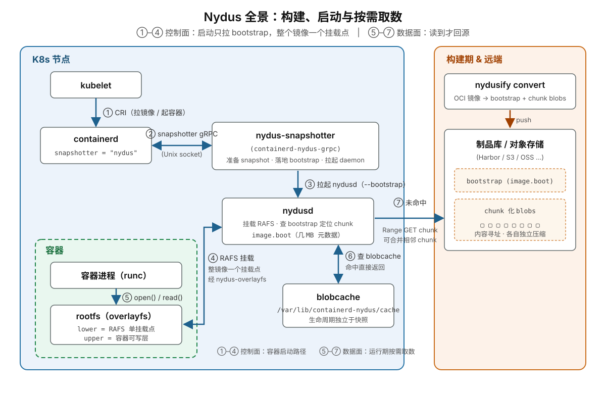
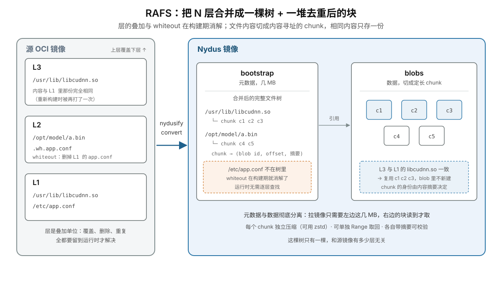
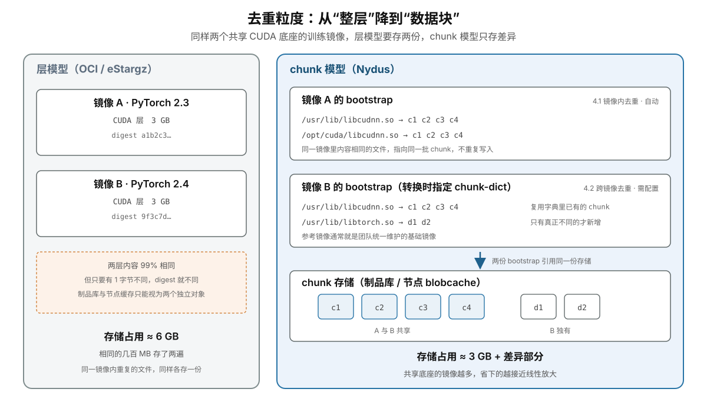

## 一、在旧格式里雕花，要付出什么代价

上一篇讲到，eStargz 可以让镜像不必全部下载完就启动，从观测结果看，`pull` 时间几乎降到了零。但这并不是免费的：它有三笔绕不开的结构性代价——压缩率变差、去重能力弱、一层对应一个 FUSE 挂载点；此外，还有 resolve 超时后静默退回全量拉取的运行时风险。

这几个问题看似互不相关，根源却是同一个：

- **压缩率变差**，是因为一层内部共用一个 gzip 字典。你想让单个文件能被独立解压，就必须把这个字典拆掉；
- **去重能力弱**，是因为层 blob 的 digest 就是寻址单位。两层只要差一个字节就是两个不同的对象，制品库和本地缓存都没有更细的粒度可用；
- **N 层 N 个挂载点**，是因为层是叠加单位。容器 rootfs 由 overlayfs 把每层 lowerdir 摞起来，镜像有多少层就得挂多少次。

三个症状，一个病根：**在 OCI 的世界里，“层（Layer）”同时承担了三份工作——压缩、寻址和叠加。**

可以把它想成一家仓库：货物按“整层”打包，仓库按“整层”编号，出库时还要按“整层”一层层摞起来。只要其中一个环节想改得更细，另外两个环节就会跟着受影响。

eStargz 没有推翻这套模型，而是在层内部增加索引和可随机读取能力。这样做的好处是兼容性极佳：旧运行时不认识 eStargz，也能把它当成普通 OCI 镜像使用。代价是，它能优化到什么程度，仍然受“层”这个基本单位限制。

上一篇把这条路线称为“在旧格式里雕花”。这不是贬义，而是一种清醒的工程取舍：少实现一部分高级功能，让现有工具尽量无须修改。

但如果允许你把这三顶帽子摘下来重新分配呢？

这正是本文主角 Nydus 的思路：**把压缩和寻址的单位从 layer 缩小到 chunk，把叠加的单位从 layer 放大到整个镜像。**这样一来，“层”仍然可以存在于镜像的构建和分发语义中，却不再主导运行时的数据读取。

下面先拆开看它是怎么做到的，再算清楚为此付出的代价。

---

## 二、Nydus：把“目录”和“货物”分开

Nydus 是 **CNCF Dragonfly 项目下的子项目**，可以先把它拆成两部分：

- **RAFS**（Registry Acceleration File System）：一套专为镜像加速设计的只读文件系统格式；
- **`nydusd`**：一个根据文件访问请求，从远端按需取回数据的守护进程。

如果把镜像比作一座仓库，RAFS 负责规定“目录怎么写、货物怎么分块摆放”，`nydusd` 则像仓库管理员：先拿到目录，等容器真正要用某件货物时，再去对应位置把那一块取回来。

把这两部分和节点上的其他组件放进一张图，就能看到 Nydus 的整体结构——左边是运行容器的节点，右边是镜像转换过程和远端存储：



图中 **①～④ 是控制面**：containerd 把快照管理交给 `nydus-snapshotter`；snapshotter 落地 bootstrap、启动 `nydusd`；`nydusd` 挂载出整个镜像的只读视图；最后，overlayfs 在上面叠加一个可写层，再交给 runc。

这里最值得注意的是：lowerdir **只有一个**，与镜像原本有多少层无关。图中的 **⑤～⑦ 是数据面**，只有当容器运行后真正读取文件时才会发生，第五节会详细展开。

两条启动路径对照着看：

```text
传统 OCI： 逐层下载 → 逐层解压落盘 → overlayfs 叠成 rootfs → 启动
Nydus  ： 拉 bootstrap（几 MB）→ 挂载 RAFS → overlayfs 叠可写层 → 启动 → 运行期按需取 chunk
```

传统 OCI 把大量 I/O **前置**到启动阶段；Nydus 则把文件内容的下载**延后**到真正访问它的那一刻。

因此，有一句话必须先说清楚：**Nydus 并没有让网络变快，它只是让容器启动不再等待所有镜像数据下载完成。**省下来的工作并未消失，只是被推迟了。到了第六节，这会变成一笔必须偿还的账。

---

## 三、RAFS：一棵树 + 一堆块

RAFS 的核心设计可以浓缩成一句话：**把“文件在哪里”和“文件内容是什么”分开保存，而且目录描述的是整个镜像，而不是某一层。**

一个 Nydus 镜像由两部分构成：

- **bootstrap**：镜像的“目录册”，记录完整的文件系统结构，以及每个文件的数据在哪里；
- **blobs**：真正存放文件内容的“货架”，文件内容会被切成许多 chunk 保存。

### 3.1 bootstrap：整个镜像只有一棵树

bootstrap 保存完整的文件系统元数据，包括目录结构、文件名、权限、属主、大小和时间戳。更关键的是，它还记录了：**一个文件由哪些 chunk 组成，以及每个 chunk 位于哪个 blob 的哪个偏移位置**，并附带用于完整性校验的摘要。

这里有一个特别容易被忽略、但影响极其深远的细节：

> **bootstrap 中保存的，是所有镜像层合并之后的最终文件树。**层与层之间的覆盖关系、whiteout（删除标记）和 opaque 目录，都已经在**构建期**处理完毕。

对比传统 OCI：假设一个镜像有 28 层，运行时需要由 overlayfs 把 28 个目录依次叠起来。查找一个文件时，可能要从最上层一路向下寻找，直到命中，或者确认它已被 whiteout 删除。

Nydus 把这项工作提前到了 `nydusify` 转换阶段。容器启动时拿到的已经是一棵合并完成、没有歧义的文件树，不需要再现场还原各层之间的覆盖关系。

这就是“Nydus 把整个镜像合并成单一文件系统视图，一个 rootfs 只需要一个挂载点”的物理依据。并不是运行时更擅长逐层查找，而是**逐层合并这个问题，早在构建期就已经解决了**。

bootstrap 通常只有几 MB 到几十 MB，而它描述的镜像可能有几十 GB。这种悬殊的体积差，正是“pull 近乎瞬时”的原因：**启动阶段所谓的“拉取 Nydus 镜像”，主要只是先下载这份目录册，而不是把仓库里的全部货物搬到本地。**

### 3.2 blobs：把文件切成可独立取回的小块

文件内容不再以“整层 tar 流”的形式保存，而是被切成定长 **chunk**（Native RAFS 常见大小为 1 MiB）。每个 chunk 都具备三个特征：

- **独立压缩**：解压这一块时，不需要先解压前面的内容；
- **按内容寻址**：它的身份由内容摘要决定，而不是由“属于哪一层、哪个文件”决定；
- **可单独取回**：只要知道偏移和长度，就能通过一次 HTTP Range 请求获取。

这里很容易与 eStargz 混淆。eStargz 同样会切分数据：通常每个文件对应一个 gzip 流，大文件还会继续按 4 MiB 切块。但它切分的主要目的，是让运行时能够 `seek` 到某个位置；一个块仍然通过“某个 layer 中的某段偏移”来定位。

Nydus 更进一步：chunk 是**按内容寻址**的。只要内容完全相同，无论它出现在哪个文件、哪一层，甚至哪个镜像里，都可以被识别为同一个 chunk。这正是后面实现细粒度去重的基础。

这种设计还带来一个额外好处：**压缩算法不再被 `.tar.gz` 格式限制。**eStargz 为了保证产物整体仍是合法的 `.tar.gz`，只能使用 gzip；RAFS 没有这层兼容包袱，可以选择 zstd 等算法，在压缩率与解压速度之间获得更灵活的平衡。

把 3.1 和 3.2 放在一起看，就是一次 `nydusify` 转换所做的全部事情：



图中有两条线索。一是**左边三层合并成右边一棵树**：`.wh.app.conf` 这类 whiteout 标记在构建期就被处理掉，被删除的文件不会出现在 bootstrap 里，运行时因此不需要逐层查找。二是**相同内容只保留一份**：L3 与 L1 中的 `libcudnn.so` 内容一致，转换时直接复用同一批 chunk，blob 中不再新增数据——这也是下一节讨论去重的起点。

### 3.3 和 eStargz 摆在一起看

把两种布局画出来，差别一目了然：

```
eStargz（每层一个文件，索引在层内）

  layer 1 ──▶ [gzip(A)][gzip(B)][gzip(C)] ... [gzip(TOC)][footer]
  layer 2 ──▶ [gzip(D)][gzip(E)]          ... [gzip(TOC)][footer]
  layer 3 ──▶ [gzip(F)][gzip(G)][gzip(H)] ... [gzip(TOC)][footer]
                ▲
                └─ 每层各有一份索引，只认识自己层内的文件


RAFS（一份镜像级索引 + 一堆内容寻址的块）

  ┌──────────────────────────────────────────────┐
  │  bootstrap（几 MB）                            │
  │  ├─ 合并后的完整文件树（whiteout 已消解）        │
  │  ├─ 文件 ──▶ chunk 列表                        │
  │  └─ chunk ──▶ (blob id, offset, 压缩长度, 摘要) │
  └───────────────────┬──────────────────────────┘
                      │  引用
        ┌─────────────┴─────────────┬─────────────┐
        ▼                           ▼             ▼
  ┌───────────┐              ┌───────────┐  ┌───────────┐
  │  blob 1   │              │  blob 2   │  │  blob 3   │
  │ ▢▢▢▢▢▢▢▢ │              │ ▢▢▢▢▢▢▢▢ │  │ ▢▢▢▢▢▢▢▢ │
  └───────────┘              └───────────┘  └───────────┘
    定长 chunk · 内容寻址 · 各自独立压缩 · 可单独 Range 取回
```

一句话概括这张图：**TOC 只知道某一层里有什么，bootstrap 则知道整个镜像最终长什么样。**

后面谈到的所有差异——能否跨层去重、rootfs 需要几个挂载点、缓存按什么粒度复用——都可以追溯到这里。

> **注：RAFS 有两条挂载形态**
>
> RAFS v5 使用私有元数据格式，只能由 `nydusd` 在用户态解析，因此需要经过 FUSE。RAFS v6 的元数据布局与内核中的 **EROFS 兼容**，可由内核直接解析；本地没有所需数据时，再通过 fscache 从远端读取。缓存中已有数据时，请求不必反复穿越用户态，随机读取小文件所经过的步骤会明显减少。
>
> 代价是，使用 fscache 要求**内核版本不低于 5.19**；旧内核只能退回 FUSE 模式。这个版本要求会在第六节再次出现。

---

## 四、去重：把上一篇那个 3 GB 的例子算完

上一篇留下了一个 3 GB 的例子，这里把账算完。

假设团队同时维护 PyTorch 2.3 和 2.4 两个训练镜像。它们各有一个 3 GB 的 CUDA 层，内容有 99% 相同。

在 eStargz 和标准 OCI 的模型里，只要两个层有一个字节不同，最终 digest 就不同。制品库和节点缓存只能把它们视为两个独立对象，结果就是：**两个 3 GB 的层都要完整保存**，即使其中几百 MB 的 `libcudnn.so` 一模一样。

更进一步，即使重复内容出现在**同一个镜像的不同层**里，层模型也无法自动识别：同一个文件出现两次，就会实际保存两份。

而 Nydus 以内容摘要标识 chunk，去重的粒度从“整层”缩小到了“数据块”，答案因此发生了变化。

### 4.1 镜像内去重：自动的

`nydusify` 转换镜像时，内容相同的 chunk 只需保存一份；bootstrap 中的多个文件位置可以共同引用它。这种镜像内部的去重不需要额外配置。

训练镜像中的重复内容往往比想象中更多：多阶段构建遗留的重复依赖、被 `pip install` 到不同虚拟环境中的同一批 wheel、在多个层中反复复制的模型配置文件……在层模型中，它们是“不同层里的不同副本”；在 chunk 模型中，相同部分可以指向同一份数据。

### 4.2 跨镜像去重：要配

跨镜像共享则不是自动获得的，它依赖 **chunk-dict**。转换新镜像时，需要指定一个参考镜像——通常是团队统一维护的基础镜像。`nydusify` 会优先复用字典中已经存在的 chunk，只有找不到时才写入新数据。

配置好 chunk-dict 后，再看开头的例子：PyTorch 2.3 和 2.4 使用相同的 CUDA / cuDNN 基础环境，那些内容相同的 `.so` 数据只需保存和缓存一次。

**使用相同基础环境的镜像越多，节省的空间和网络流量越多。**如果 10 个训练镜像都使用同一套 CUDA / cuDNN，理想情况下就不必另外保存和下载 9 份相同的 chunk。

把 4.1 和 4.2 放进同一张图，和层模型对照着看：



左边是层模型：两个 CUDA 层内容 99% 相同，但 digest 不同，于是各存一份。右边是 chunk 模型：镜像 A 内部两个内容相同的文件指向同一批 chunk，这一步不需要配置；镜像 B 转换时带上 chunk-dict，`libcudnn.so` 直接复用 A 已有的 c1–c4，只有真正不同的 `libtorch.so` 才写入新的 d1、d2。最终落到存储上的，是一份共享数据加上差异部分。

内容寻址也顺带提供了完整性校验的基础：每个 chunk 都有摘要，bootstrap 自身也有摘要，取回数据后可以逐块验证；在 RAFS v6 的 EROFS 路径上，特定部署形态（例如机密容器场景）还可以叠加 dm-verity 做块级校验。**去重与校验看似是两种能力，底层依赖的却是同一件事：内容本身就是身份。**

### 4.3 但这里有个诚实的边界

跨镜像去重的收益，强依赖**构建规范**。

chunk 能否复用，取决于两次构建生成的字节是否完全一致。如果各团队各自维护基础镜像、基础镜像使用 `latest`、`pip install` 不锁版本，或者编译产物中混入时间戳和构建路径，那么两个“看起来一样”的 CUDA 层，实际字节可能并不相同，chunk-dict 找到相同 chunk 的比例也会很低。

**在这种情况下，chunk 级去重虽然存在，却很难真正节省存储空间。**

因此，想真正获得跨镜像去重收益，前置条件并不只在 Nydus，而在构建流水线：统一基础镜像、锁定依赖版本，并尽量实现可复现构建。

这件事的难度经常被低估。它不只是安装一个组件，还意味着要改变整个团队构建镜像的习惯。

---

## 五、数据面：容器跑起来之后

沿着第二节的路径，容器已经成功启动。但此时本地磁盘上除了几 MB 的 bootstrap，几乎没有真正的文件数据：大部分内容仍在远端。

接下来，容器每一次读取尚未缓存的文件，才会触发真正的按需加载，也就是架构图中的 ⑤～⑦。

### 5.1 一次 read 的完整旅程

以容器第一次读取某个文件为例，请求会依次经过下面这条路径：

```text
容器进程 read()
  └─▶ overlayfs：upperdir 没有，落到 lowerdir
        └─▶ RAFS 挂载点（FUSE，或 v6 的 EROFS/fscache 路径）
              ├─ 页缓存命中 ────────────────────────▶ 直接返回
              ├─ blobcache 命中 ───────────────────▶ 解压后返回
              └─ 都没命中
                    ├─ 查 bootstrap：这个偏移落在哪个 chunk
                    ├─ 向远端存储发送 Range GET，取回该 chunk（可合并相邻 chunk）
                    ├─ 校验摘要 → 解压
                    └─ 写入 blobcache + 页缓存 → 返回
```

### 5.2 为什么“合并相邻 chunk”很重要

懒加载有一个天然矛盾：读取越精确，网络请求往往越零碎。极端情况下，串行读取 100 个小文件，可能意味着 100 次网络往返（RTT）。即使实际下载的数据量不大，累计延迟也可能很可观。

Nydus 的 chunk 大小固定，并在 blob 中连续排布，这使合并请求更加容易。当 `nydusd` 发现多个待读取的 chunk 在物理位置上相邻时，可以把它们**合并到一个 Range 请求中**一次取回。顺序读取大文件时，还可以提前读取后续 chunk。

eStargz 每次从远端读取的，通常是“某个文件对应的 gzip 数据段”。不同文件在物理上是否相邻，取决于 tar 中的排列顺序，运行时很难按固定大小合并请求。因此，eStargz 通常依靠**构建期物理重排 + landmark** 来缓解问题：提前把启动阶段会访问的文件放在一起，再用一个较大的 Range 请求批量取回。

两种预取思路的差别值得对照一下：

- **eStargz：物理重排。**构建时先记录一次启动过程中访问了哪些文件，再把这些文件移动到 tar 流前部；运行时用一个大 Range 请求取回整段。文件顺序会固定在镜像中，因此记录结果是否准确非常关键。
- **Nydus：元数据指示。**bootstrap 可以携带预取表，在转换时指定要预取的目录或路径模式。`nydusd` 启动后，会用独立线程在后台批量拉取。数据布局无须随预取策略一起调整，策略更容易修改。

### 5.3 和 eStargz 的关键差异

把两条路线的数据面放在一起看，差异会更加直观：

| | eStargz | Nydus |
|---|---|---|
| **挂载模型** | N 层 → N 个 FUSE 挂载 + overlayfs 叠加 | 整镜像一个合并挂载，与层数无关 |
| **单次远端读取的单位** | 某文件对应的一段 gzip 流 | RAFS chunk，可合并读取相邻 chunk |
| **解压与命中路径** | 用户态 FUSE + gzip | 用户态 FUSE（v5）或内核态 EROFS + fscache（v6）；zstd |
| **缓存定位** | 按 layer blob 的字节范围 | 按 chunk（内容寻址） |
| **内容复用** | 仅整层 blob 级，跨文件跨层都不去重 | chunk 级，镜像内自动、跨镜像靠 chunk-dict |
| **未访问的数据** | 永不下载 | 永不下载 |

最后一行是两者的共同点，也是懒加载的全部意义所在。

但表中还藏着一个共同风险：**每一次缓存未命中，都可能把一次普通文件读取变成一次网络读取。**数据面设计得越精细，运行期就越依赖缓存、网络和远端后端。第六节要算的，正是这笔账。

---

## 六、代价：省下的时间，最终要在哪里偿还

Nydus 的代价可以概括为：**启动时没有完成的工作，需要在运行时继续完成。**

传统 pull 像一次性付清：先完成下载、解压并占用磁盘，容器启动后，读取镜像文件通常不再依赖制品库。Nydus 更像分期付款：启动时只下载几 MB 的 bootstrap，相当于付了首付；剩余成本则在运行期间，随着一次次缓存 miss 陆续偿还。

下面这些看似不同的问题，本质上都是“把下载推迟到运行期”带来的连锁反应。

### 6.1 首读放大：钱没消失，只是挪了位置

先看一组我们在概念验证阶段观察到的趋势。由于具体数据和镜像信息不便公开，这里只保留倍数关系。实际结果会受到镜像、网络和后端影响，因此仍需先在少量测试节点上重新测量：

- **拉取 + 启动**：Nydus 比原生 OCI 快约**一个数量级**，镜像越大，优势通常越明显；
- **冷 blobcache 下的密集首读**：如果把镜像中的几十 GB 数据完整读取一遍，Nydus 反而可能**慢约一倍**；
- **缓存热起来之后**：两者差距明显收敛。

需要说明的是，第二条是刻意构造的全量顺序读。典型训练任务只会读到镜像中的一小部分，实际差距通常远小于此。

第二条看似反常，其实原因很直接：**pull 阶段没有完成的工作，被转移到了 read 阶段。**每次缓存中没有所需数据，都可能需要通过 Range 请求从远端下载、校验摘要、解压，并写入 blobcache。

原生 OCI 通常按层顺序、批量地完成下载和解压；懒加载则可能在应用读取过程中，以更随机、更零散、夹杂网络往返的方式补齐数据。总工作量没有凭空消失，执行方式反而可能更昂贵。

由此有一个直接的推论，也是选型时最该问自己的问题：

> **如果任务一启动就会读遍整个镜像，懒加载的大部分收益都会被抵消。**

例如，一个推理服务启动后立刻要把 25 GB 权重全部加载到显存，这 25 GB 无论如何都必须读取，“懒”不起来。训练任务也要看具体行为：如果进入第一个 step 之前，就必须扫描数据集并加载全部权重，那么只是把等待从 Kubernetes 的 `Pulling` 阶段挪到了应用初始化阶段，端到端时间未必会缩短。

### 6.2 运行时依赖变重

`nydusd` 是常驻进程，而且它的生命周期与很多人的直觉不同：

> **在“每容器一个 daemon”的模式下，`nydusd` 的生命周期绑定的是容器的 active snapshot，而不是镜像本身。**

容器执行 `Prepare` 时，它被创建；执行 `Remove` 时，它才被销毁。（nydus-snapshotter 也支持 shared daemon 模式，以及 RAFS v6 + fscache 的形态；那时一个常驻进程服务多个容器，下面几个问题的表现也随之不同。）这会带来几个实际问题：

- **强制删除 Pod 可能留下孤儿进程。**`kubectl delete --force` 可能打断 snapshotter 的 `Remove` 流程，导致“卸载挂载点 + 停止 daemon”没有执行，从而残留孤儿 `nydusd`。它不会因为长时间空闲而自动退出，节点运行越久，残留进程可能越多。
- **只结束进程不能完成清理。**如果 snapshotter 启用了 daemon 恢复或重启策略，它会根据自身记录重新启动被结束的 daemon。要完整清理，需要从上游删除对应的 Pod 或 snapshot（`crictl rmp` / `ctr snapshots rm`），让 snapshotter 执行完整的销毁流程。
- **需要检查的环节更多。**容器读取文件报错时，问题可能来自应用、overlayfs、`nydusd`、blobcache、远端存储，甚至过期凭据。每增加一个组件，就增加一类故障可能。

### 6.3 blobcache 不属于快照

另一个需要特别注意的问题是：**blobcache 与快照拥有不同的生命周期。**

- 删除容器或快照，**都不会自动删除缓存**。随着节点运行过的镜像越来越多，缓存目录会持续增长，因此必须单独限制容量，并制定清理规则。
- 反过来，**在 daemon 仍然运行时手动删除缓存目录也很危险**。文件虽然被 unlink，但文件描述符仍可能保持打开，`nydusd` 的内存状态和磁盘状态不再一致，容器侧可能出现 `input/output error`。

正确顺序是：先让相关 daemon 全部退出，再清理缓存。可惜在“半夜磁盘告警，先赶紧删点东西”的场景里，这条规则最容易被忽略。

监控上至少要补充两个指标：**blobcache 容量增长曲线**和**缓存命中率**。前者决定何时扩盘或清理，后者决定第 6.1 节所说的首读成本究竟有多高。

### 6.4 产物非原生 OCI：无法自动改用普通拉取方式

这是 Nydus 和 eStargz 之间最本质的工程差别。

eStargz 的产物仍是合法 OCI 层。**不认识 eStargz 的运行时，会把它当作普通镜像全量拉取。**即使 Pod 被调度到未安装相关组件的节点，通常也只是没有加速，容器仍然可以启动。

Nydus 则无法自动改用普通拉取方式。转换后的数据层不能由普通 OCI 运行时直接解包，**没有 Nydus 运行时支持的节点无法直接启动它**。这意味着：

- 小规模试用时需要把节点分组，并设置相应的调度规则，避免使用 Nydus 镜像的 Pod 被分配到未安装组件的节点；
- 制品库通常需要同时保留原生镜像和 Nydus 镜像，构建流水线也会多出一个转换环节，存储成本和构建时长都会增加；
- 安全扫描、镜像签名和准入策略等工具链，需要逐一验证能否识别转换后的产物。在合规要求严格的组织中，这一步甚至可能比运行时改造更耗时。

### 6.5 对内核版本的要求

第三节已经提到：RAFS v6 使用 fscache 时要求**内核 ≥ 5.19**。这只是入门门槛——failover、共享 daemon 等能力往往还需要更高版本，落地前要按发行版内核逐项确认。

旧内核可以退回 FUSE 模式，核心功能仍然可用，但 RAFS v6 相比 v5 的一项重要性能优势——元数据由内核解析、缓存中已有数据时不再穿越用户态——就无法完全发挥。

内核版本不一致的集群，需要按内核版本划分测试节点。尤其要注意：**不能用“顺序读取性能接近 loop device”的测试结果来说明 FUSE 模式的性能**，因为这类结果通常来自 fscache 模式。

### 6.6 后端可达性 = 镜像可用性

最后一条，也是运维上最需要提前想清楚的一条。

传统 pull 有一个朴素的可靠性优势：镜像完整下载后，运行中的容器就不再依赖制品库。即使制品库临时故障，已经启动的容器通常仍能继续读取本地文件。

懒加载却把这种依赖**延长到了整个容器生命周期**。一个已经运行三天的训练任务，如果突然读取此前从未访问过的文件，仍可能需要通过网络从远端下载。

后果是：

- 远端存储无法访问、blob 被误删、凭据过期或网络抖动，都可能让**运行中的容器**出现 `input/output error`；
- 故障影响从“启动阶段”扩展到了“整个生命周期”。一次制品库抖动，可能同时影响大量已经运行数小时的训练任务。

因此，如果制品库和网络连接还不够可靠，就不宜贸然把懒加载用于关键训练任务。对 Nydus 来说，镜像存储服务已经从“启动时依赖”变成了“运行期依赖”。

### 6.7 两条路线的完整对照

技术部分到此为止，下面用一张表总结：

| 维度 | eStargz | Nydus（RAFS v6） |
|---|---|---|
| 格式本质 | OCI `tar.gz` 的可随机读扩展（多 gzip 流 + TOC） | 专用只读文件系统 RAFS：bootstrap + chunk 化 blobs |
| 与 OCI 兼容 | ✅ 完全兼容，旧运行时退化为全量拉取 | ⚠️ 产物非原生 OCI，必须有 Nydus 运行时 |
| 制品库要求 | 任意标准制品库（需支持 HTTP Range） | 任意标准制品库（当普通 blob 存，同样需支持 Range）或对象存储 |
| 去重粒度 | 仅整层 blob-digest 级，跨文件跨层都不去重 | chunk 级：镜像内自动，跨镜像需 chunk-dict |
| 挂载模型 | 按层挂载，N 层 → N 个 FUSE + overlayfs 叠加 | 整镜像一个合并挂载，与层数无关 |
| 按需加载位置 | 用户态 FUSE + gzip 解压 | 用户态 FUSE（v5）或内核态 EROFS + fscache（v6） |
| 压缩算法 | 受限于 gzip | gzip / zstd 等 |
| 随机小文件 IO | 一般 | 潜力更好（尤其 fscache 路径），需按实际后端验证 |
| 预取机制 | 构建期物理重排 + landmark | bootstrap 预取表，运行时后台批量拉 |
| 运行时依赖 | 1 个 snapshotter 进程 | snapshotter + nydusd + mount helper |
| P2P 分发 | 无一等公民集成，可经支持 Range 的 mirror 间接使用 | 可直接与 Dragonfly 配合使用 |
| 完整性校验 | ChunkDigest | chunk / bootstrap 摘要，v6 可叠 dm-verity |
| 转换工具 | `nerdctl image convert --estargz` | `nydusify convert` |
| 改造成本 / 能力上限 | 低 / 中 | 中 / 高 |

---

## 七、写在技术博客之外的话

到这里，技术账已经基本算清：Nydus 可以实现更多功能，但也增加了运行时组件和运维工作。但真正决定是否采用它的，往往不是某一项性能指标。

**决定选型的，通常不是哪个技术更好，而是谁在为启动时间付钱。**

### 7.1 被吐槽十年的 OCI，为什么还是主流

`tar.gz` 不擅长随机访问，社区对此抱怨已久。可它今天依然是默认选择，最重要的原因只有一个：

> **所有人都实现了它。**

围绕“layer + digest”建立的工具链极其庞大：Harbor、Artifactory、ECR 等制品库，`docker build`、BuildKit、Kaniko 等构建工具，Trivy、Clair 等漏洞扫描工具，还有签名验签、准入控制、CI/CD、离线分发、灾备和审计系统。它们共享同一个基本假设：镜像由一组按 digest 寻址的层组成。

**一种格式的价值，不只在于设计是否优雅，还在于它是不是所有参与方的最大公约数。**任何替代方案都需要与这条工具链逐环适配。参与方越多，协调成本就越高。

再回头看 eStargz 的“在旧格式里雕花”，就能理解这种选择并非保守，而是为了尽量少修改现有工具。它放弃一部分功能，换来制品库、扫描、签名等工具继续工作的可能性。这也解释了为什么这种方案虽然不如专用格式彻底，仍然会被广泛采用。


### 7.2 启动慢，对谁才是问题

接下来再问一个更根本的问题：**启动慢，对你的业务真的是重要问题吗？**

对**长时间运行的大规模训练**来说，答案往往是否定的。一个任务要运行几天甚至几周，启动多花五分钟，占整个生命周期的比例可能微乎其微。这类场景更值得优先解决的，通常是训练稳定性、checkpoint 保存与恢复、通信效率以及故障恢复速度。

换句话说：**如果启动时间占比不到 1%，引入懒加载就可能增加许多运行时故障类型，却只能换取非常有限的时间收益。**一次 blobcache 异常导致的训练中断，就可能抵消此前节省的全部启动时间。

但也有例外，它们的共同点是：**启动成本会被次数放大。**

- **Spot / 抢占式训练**：被抢占一次就换一次节点，启动成本乘以抢占频率；
- **大集群的故障重调度**：节点规模上去之后，“总有节点在故障”，重调度会成为常态；
- **调试和频繁发布版本**：改一行代码就要重新运行一次，工程师会反复等待。

因此，不应只看“单次启动需要多久”，更应该看：

> **启动时间 × 启动次数 ÷ 总运行时间**

如果这个比值很低，继续优化镜像启动的优先级就不高。

### 7.3 但 serverless 是另一个世界

如果把同一项技术放到 RunPod、Modal 这类 serverless GPU 平台上，结论可能完全相反。

在那里，**计费单位是秒，用户也会直接感受到每一秒的等待。**从点击“运行”到服务可用之间的时间，无法像长时间训练那样在总运行时间中变得微不足道。冷启动 90 秒与冷启动 3 秒，带来的并不只是性能数字差异，而是截然不同的使用体验。

镜像在这里也不再只是“运行环境的一部分”，而是**服务启动过程中的一个步骤**。它与 CDN、网页加载时间属于同一类问题：延迟直接影响体验，体验又会影响用户是否继续使用产品。

更关键的是，规模效应的方向也反过来了：

- 在训练集群中，一个镜像可能在同一节点上连续运行一周，chunk 级去重和 blobcache 跨镜像复用的机会有限；
- 在 serverless 平台上，同一节点一天内可能启动几十甚至上百个租户镜像，而它们往往共享 CUDA、PyTorch 和常用依赖。**chunk 级去重和缓存复用的价值会被显著放大**：后启动的某个镜像，大部分 chunk 可能已经存在于本机 blobcache 中。

因此，对 serverless GPU 平台来说，镜像加速会直接影响服务能否在规定时间内启动。这也解释了为什么许多平台会自行开发或大幅修改懒加载方案：它们的服务方式几乎不允许较长的冷启动时间。

一句话收束：**同一项技术，在长时间训练平台上可能收益有限，在 serverless 场景中却可能直接决定服务是否可用。差别不只在技术本身，还在于启动延迟是否计费，以及用户是否需要等待。**

### 7.4 那到底怎么决定

先不要急着比较技术参数，回答下面三个问题：

1. **启动时间占总运行时间多少？**如果只占很小比例，应优先优化其他瓶颈。
2. **不同镜像之间有多少相同内容？**只有一两个镜像时，chunk 去重收益有限，eStargz 所需的修改较少，可能更合适；几十个镜像共享同一个基础镜像时，Nydus 才更容易节省大量空间和网络流量。
3. **组织里是否有人长期维护这套系统？**如果没有，应优先选择发生故障时仍能按普通镜像启动、并且团队更熟悉的方案。

最后还要保持一个诚实的立场：本文中的倍数和趋势，都来自特定镜像、网络和后端条件。**真正的收益，必须先在少量测试节点上，用自己的镜像重新测量。**阅读社区或厂商材料时，也要仔细确认缓存是否已有数据、远端存储距离多远、读取方式是什么，不要把理想条件下的数字直接当作生产环境的预期结果。

---

## 八、小结

最后，用三句话收束全文：

- **eStargz 是在旧格式里雕花，Nydus 则是重画一张图纸。**前者继续以 layer 为压缩、寻址和叠加单位；后者把压缩与寻址细化到 chunk，把运行时文件系统视图提升到整个镜像。
- **新设计带来的收益**，包括 chunk 级去重、与层数无关的单一合并挂载、可选的内核态数据路径，以及更灵活的压缩算法。
- **对应的代价**，是许多工作从启动阶段转移到了运行阶段：冷缓存首次读取更慢、常驻 daemon 带来生命周期问题、blobcache 需要单独管理、普通 OCI 运行时无法直接使用转换后的镜像，而且容器运行期间会持续依赖远端镜像存储。

技术之外，更重要的结论是：**OCI 被广泛使用，不仅因为格式本身，还因为大量工具都支持它；替换方案最昂贵的部分，往往不是安装组件，而是学习新的维护和故障处理方法；启动慢对长时间训练可能无关紧要，对 serverless 却可能直接影响使用体验。**

所以，镜像懒加载从来不是一道“哪项技术更先进”的单选题。真正该问的是：**你的业务是否足够需要它，你的基础设施是否承受得起它，你的团队是否维护得住它。**
