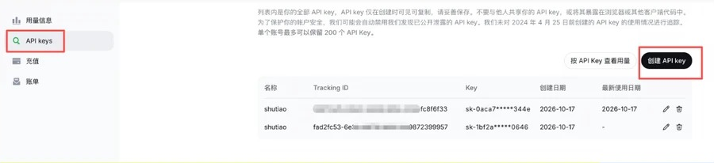
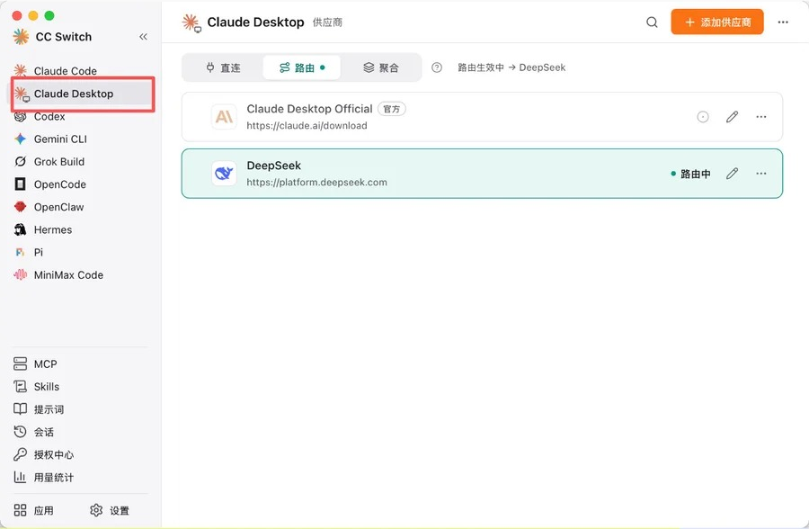
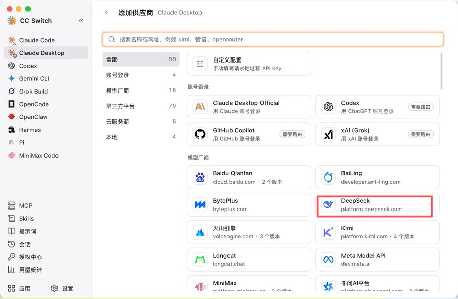
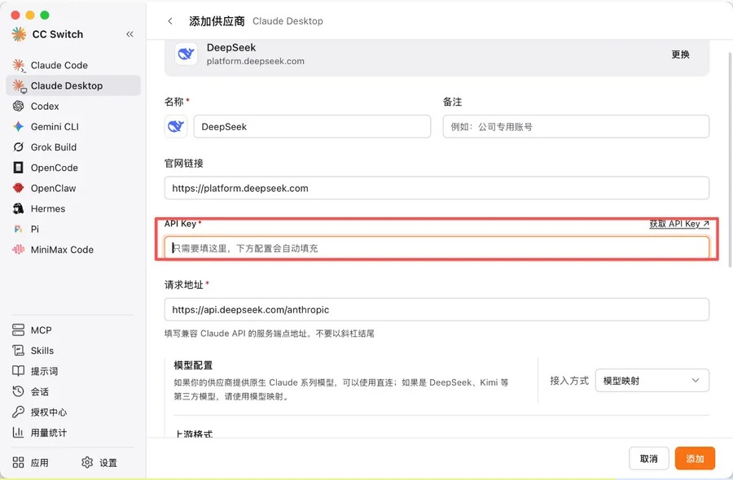
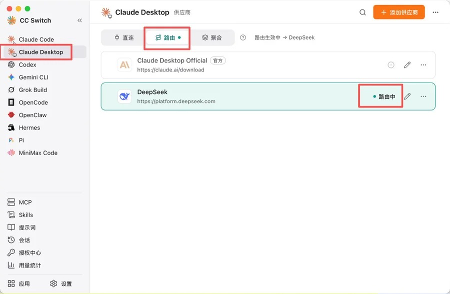
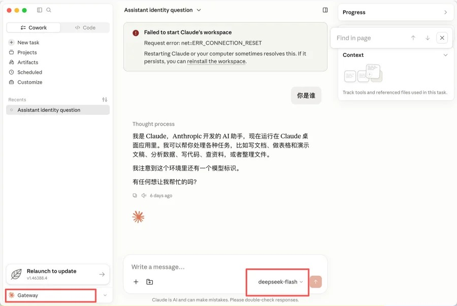
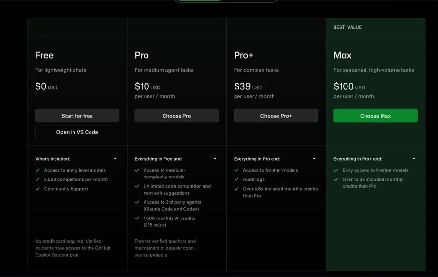
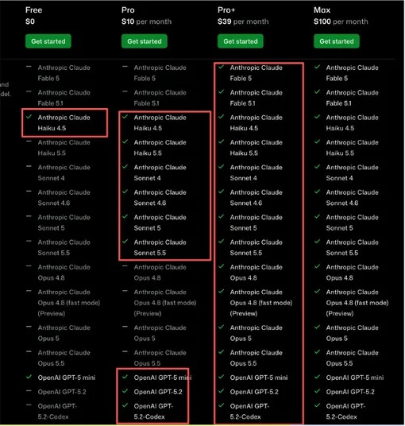
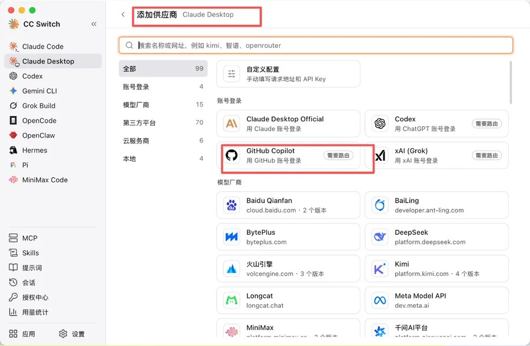

# Codex & Claude 桌面端零基础安装教程

> 本文整理自小红书博主「去薯条整点码头」的笔记[《Codex & Claude 零基础安装教程》](https://www.xiaohongshu.com/discovery/item/6adb3a3e000000002b02838e)，在原文基础上重新组织了结构、补充了说明。截图均来自原笔记。

很多人第一次接触 Claude、Codex 这类工具时，最先卡住的不是"怎么用"，而是"我到底要装什么"。这篇文章先把几个概念讲清楚，再按需求给出三种可选方案，最后附上一个最省事的选择。

## 一、先搞清楚几个概念

### 模型和 harness（客户端）

当我们说"用 Claude"时，其实指的是一个比较宽泛的东西。以 Claude 为例，它大致分为三部分：

- **模型**：真正负责思考的那部分，比如 Claude Opus、Sonnet；
- **桌面端**（Claude Desktop）：装在电脑上的应用；
- **命令行**（Claude CLI / Claude Code）：主要给程序员用，本文不展开。

可以简单理解为：**模型是大脑，客户端（harness）是四肢**。大脑能思考，但没法帮你搬起一个箱子。如果你希望 AI 直接操作你的电脑——比如写一篇论文存到本地、调用剪辑软件剪视频、整理一个文件夹——那你就需要一个桌面端来充当"四肢"。

理解了这一点，就会发现：**客户端和模型是可以分开选的**。桌面端用 Claude 或 ChatGPT（Codex）的，背后的模型却可以换成 DeepSeek、GitHub Copilot 提供的模型等。这正是后面几种方案的核心思路。

### 你想用 AI 做什么？

在动手之前，先回到自己的需求：

- **只是聊天、问问题**：讨论问题、查资料、写点东西——那完全不需要桌面端。直接用网页版就行，比如 claude.ai、chatgpt.com、gemini.google.com；如果没有海外网络环境，[DeepSeek 网页版](https://chat.deepseek.com) 也是不错的选择。
- **希望 AI 操作你的电脑**：整理报表、清理磁盘、批量处理文件等耗费人力的事情——那就继续往下看。

## 二、下载和安装

Mac 和 Windows 的安装方式略有不同，是否有海外网络环境也会影响下载途径：

| 情况             | 安装方式                                                                                                                       |
| -------------- | -------------------------------------------------------------------------------------------------------------------------- |
| Mac + 能访问海外网站  | 在 [chatgpt.com/download](https://chatgpt.com/download/) 和 [claude.com/download](https://claude.com/download) 下载对应的 dmg 安装包 |
| Mac + 无法访问海外网站 | 使用网盘安装包（见文末附录）                                                                                                             |
| Windows        | 使用网盘安装包装（见文末附录）                                                                                                            |

>访问海外网站时节点不要选香港，选日本、新加坡等地区。原因是 OpenAI、Anthropic 的服务都不支持香港地区。

## 三、三种使用方案

装好桌面端之后，关键是给它接上一个"大脑"。原作者给出了三种组合：

| 方案        | 组合                                  | 成本               | 推荐度    |
| --------- | ----------------------------------- | ---------------- | ------ |
| 便宜高效版     | Codex / Claude 桌面端 + DeepSeek API   | 按量付费，十块钱起        | ⭐⭐⭐ 推荐 |
| 浅尝 Opus 版 | Codex / Claude 桌面端 + GitHub Copilot | Copilot 订阅（需信用卡） | ⭐⭐⭐ 推荐 |
| 高风险版      | Claude 桌面端 + Claude 官方订阅            | Claude 订阅        | ❌ 不推荐  |

前两个方案用的都是同一个工具：**cc-switch**。它能让 Claude / ChatGPT 的桌面端连接到其他模型提供商，相当于在桌面端和模型之间加了一个"转接头"。

### 方案一：便宜高效版（桌面端 + DeepSeek API）

**第 1 步：安装 cc-switch**

到 [ccswitch.io](https://ccswitch.io/zh/) 下载安装 cc-switch。打开后左侧是它支持的各类客户端（Claude Code、Claude Desktop、Codex、Gemini CLI 等），右侧是当前客户端配置的模型供应商。

**第 2 步：在 DeepSeek 开放平台充值**

打开 [platform.deepseek.com](https://platform.deepseek.com/)，在左侧「充值」页面充值，十块钱就够先体验一阵了。首次使用可能需要先完成实名认证。

**第 3 步：创建 API Key**

继续在平台左侧进入「API keys」，点击右上角「创建 API key」。

> ⚠️ **这个 Key 非常重要，千万不要泄露给别人**，否则别人也能消耗你充值的额度。Key 一般只在创建时完整显示一次，记得妥善保存。

**第 4 步：在 cc-switch 里选择客户端**

打开 cc-switch，在左侧选择你要用的桌面端：用 Claude 就选 **Claude Desktop**，用 ChatGPT 就选 **Codex**。

**第 5 步：添加 DeepSeek 供应商**

点击右上角「添加供应商」，在「模型厂商」分类里找到 **DeepSeek**：

然后在 API Key 一栏填入刚刚创建的 Key。下面的请求地址（`https://api.deepseek.com/anthropic`）、模型映射等配置会自动填好，不用改。

**第 6 步：保存并启用**

点击「添加」保存。回到供应商列表，确认上方切到了「路由」模式，DeepSeek 一栏显示「路由中」，并且顶部提示「路由生效中 → DeepSeek」。

**第 7 步：重启桌面端验证**

重启你的 Claude / ChatGPT 桌面端。如果看到左下角变成了 **Gateway**，右下角的模型变成了 **deepseek**（如 `deepseek-flash`），就说明配置成功了。

### 方案二：浅尝 Claude Opus 版（桌面端 + GitHub Copilot）

这个组合的配置方式和方案一几乎一样，区别只是把后端模型从 DeepSeek 换成了 GitHub Copilot。

GitHub Copilot 的订阅里集成了众多模型，其中就包括 Claude Opus。如果你想体验一下 Opus，这是个不错的选择，而且不用担心 Claude 账号被封的问题。缺点是**需要一张可以付美元的信用卡**。

**第 1 步：选择套餐**

进入 [github.com/features/copilot/plans](https://github.com/features/copilot/plans)，可以看到几档订阅套餐（原作者截图时为 Free / Pro $10 / Pro+ $39 / Max $100 每月，具体以官网为准）：

不同套餐能用的模型不一样。按原作者截图时的情况，Free 只能用 Haiku 等入门模型，Pro 能用到 Sonnet，**要用 Opus 5.5 需要 Pro+ 及以上套餐**：

**第 2 步：订阅**

点击 Get started。没有 GitHub 账号的需要先注册登录，然后绑定信用卡付款。

**第 3 步：在 cc-switch 中添加 GitHub Copilot**

接下来就轻车熟路了：打开 cc-switch，右上角「添加供应商」，在「账号登录」分类里选择 **GitHub Copilot**，按提示用 GitHub 账号登录授权即可。之后同样保存、启用、重启桌面端。

### 方案三：高风险版（Claude 桌面端 + Claude 官方订阅）

原作者明确不推荐这个方案：操作最复杂，而且风险最高。

原因在于 Claude 官方服务**不支持中国大陆地区**，在不支持的地区注册或使用违反其服务条款，账号很容易被封禁，订阅费用也可能打水漂。原作者的评价是"真心不建议"，这里也就不展开具体步骤了。

如果你本身就身处 Claude 支持的地区，那直接在 [claude.ai](https://claude.ai) 注册订阅、下载桌面端登录即可，这是最省心的官方用法。

## 四、This is not the end：最省事的选择

看到这里你可能会发现：你真正需要的，可能只是**一个好用的桌面端 + 一个好用的模型**。那有没有最省事的方式？有的。

- **DeepSeek 自己的桌面端**：DeepSeek 也推出了自己的 harness 桌面端，充值 DeepSeek API 后直接使用即可，不需要 cc-switch 转接。地址：[deepseek.com/harness](https://www.deepseek.com/harness/)
- **Codex + ChatGPT 订阅**：直接用 Codex 并订阅 ChatGPT（需要海外网络环境），每月 20 美元。据原作者说，最近 ChatGPT 频繁重置额度，性价比也不错。

## 小结

| 你的需求 | 建议 |
| --- | --- |
| 只是聊天问问题 | 网页版就够了，DeepSeek / ChatGPT / Gemini 均可 |
| 想让 AI 操作电脑，预算有限 | Claude / Codex 桌面端 + cc-switch + DeepSeek API |
| 想体验 Claude Opus | Claude / Codex 桌面端 + cc-switch + GitHub Copilot Pro+ |
| 想要最省事 | DeepSeek 桌面端，或 Codex + ChatGPT 订阅 |

## 附录

- 安装包网盘：[https://pan.quark.cn/s/ae136d0fd322](https://pan.quark.cn/s/ae136d0fd322)（
- cc-switch：[https://ccswitch.io/zh/](https://ccswitch.io/zh/)
- DeepSeek 开放平台：[https://platform.deepseek.com/](https://platform.deepseek.com/)
- GitHub Copilot 套餐：[https://github.com/features/copilot/plans](https://github.com/features/copilot/plans)
