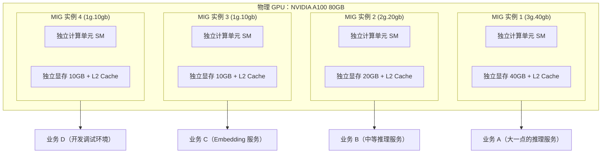

## 一、一个让人肉疼的问题：80GB 的卡，只用了 8GB

如果你在公司维护过 AI 基础设施，或者自己租过 GPU 服务器，大概率见过这样一幕：

团队花大价钱采购了一批 **NVIDIA A100 / H100（80GB 显存）**，结果登录监控一看——

- 业务 A 跑着一个轻量级 Embedding 模型，只占了 **4GB 显存**、**10% 算力**；
- 业务 B 是算法同学开的 Jupyter Notebook，写代码时 GPU 利用率几乎是 **0%**，偶尔跑一下测试占 **8GB 显存**；
- 业务 C 是一个中小尺寸模型的在线推理服务，峰值也就用 **15GB 显存**。

但尴尬的是，在传统的使用方式下（尤其是直接交给容器或 Kubernetes 管理时），**GPU 的最小分配单位往往是“1 张整卡”**。业务 A 只要 4GB 显存，却独占了整张 80GB 的 A100，剩下的 76GB 显存和绝大部分算力只能干瞪眼闲置。

这时候你可能会问：**CPU 不是一直都能多个进程共享吗？为什么不直接把 A、B、C 三个进程全塞到同一张 GPU 上跑？**

确实可以硬塞，但很快就会踩到三个大坑：

1. **显存互相踩踏**：GPU 显存不像操作系统虚拟内存那样可以方便地 swap 到磁盘。一旦业务 B 突然多申请了一点显存，不仅自己 OOM，还可能把同卡上正在正常提供服务的业务 A 一起拖下水。
2. **“噪声邻居”导致延迟飙升**：多个任务同时往一张卡里塞计算任务，GPU 内部的计算单元和显存带宽会激烈争抢。平时 P99 延迟 20ms 的在线推理服务，可能因为隔壁同学突然跑了个测试脚本，瞬间抖动到 200ms。
3. **故障域无法隔离**：如果某个进程触发了严重的 GPU 硬件/驱动错误（比如常见的 Xid 错误），整张卡上的所有进程都会跟着一起遭殃。

所以，我们需要的不是“粗暴地挤在一起用”，而是**把一张大 GPU 合理地切分成几张互相隔离的“小 GPU”**——这就是 **GPU 虚拟化（切分）技术**要解决的核心问题。

切分 GPU 通常有两条路线：**硬件切分**和**软件切分**。本篇我们先聊 NVIDIA 官方给出的硬件级答案——**MIG**。

---

## 二、什么是 NVIDIA MIG？

**MIG** 的全称是 **Multi-Instance GPU（多实例 GPU）**，是 NVIDIA 从 Ampere 架构（如 A100、A30）开始，直接做在 GPU 芯片内部的一项**硬件级切分技术**。

打个比方：

> 如果把一张 80GB 的 A100 比作一套 **200 平米的大平层**，那么 MIG 做的事情，就是在房子里**砌上真正的实心承重墙**，把它改造成几套**带独立水电煤、独立大门的精装单间**。

注意“硬件级”这三个字的含金量。MIG 切分的**不只是显存容量**，而是把整张 GPU 的核心硬件资源在物理电路层面一分为多：

- **计算单元（SM，Streaming Multiprocessor）**：每个实例拥有专属的计算核心，互不抢占；
- **显存与显存控制器**：专属显存空间 + 专属显存带宽通道；
- **二级缓存（L2 Cache）**：各自独立，不会出现你把我的缓存刷掉的情况；
- **独立故障域**：一个实例发生异常，不会波及同卡的其他实例。



切分完成后，在操作系统、Docker 容器以及 PyTorch / TensorFlow 眼里，每一个 MIG 实例就是一张**货真价实的独立小显卡**。你的业务代码**一行都不用改**，该怎么调 CUDA 还是怎么调 CUDA。

---

## 三、MIG 是怎么切分的？认识一下 Profile

既然是硬件电路级别的切分，就意味着不能像切豆腐一样随便拿刀乱划——你必须按照芯片内部预设好的物理边界来切。这些预设好的切分规格，在 NVIDIA 文档里叫做 **Profile（配置模板）**。

以最常见的 **A100 80GB** 为例，硬件层面把整张卡划分为 **7 个计算切片（Compute Slice）** 和对应的显存切片，单张卡**最多可以切出 7 个 MIG 实例**。常见 Profile 如下：

| Profile 名称 | 计算切片占比 | 显存大小 | 单张 A100 80GB 最多可切数量 |
| --- | --- | --- | --- |
| `1g.10gb` | 1/7 算力 | 10 GB | 7 个 |
| `2g.20gb` | 2/7 算力 | 20 GB | 3 个 |
| `3g.40gb` | 3/7 算力 | 40 GB | 2 个 |
| `4g.40gb` | 4/7 算力 | 40 GB | 1 个 |
| `7g.80gb` | 7/7 算力 | 80 GB | 1 个（整卡） |

命名规则非常直观：**`Xg.Ygb`** 表示占 `X` 份计算切片、`Y` GB 显存。而且你不需要把整张卡切成同一种规格，完全可以**混切**——比如前面图示里的 `3g.40gb + 2g.20gb + 1g.10gb + 1g.10gb`。

在单机上开启和使用 MIG 也非常简单，只需要用 `nvidia-smi` 命令即可：

```bash
# 1. 在 0 号卡上开启 MIG 模式
sudo nvidia-smi -i 0 -mig 1

# 2. 查看当前显卡支持的 Profile 列表
nvidia-smi mig -lgip

# 3. 切分出 1 个 3g.40gb 和 2 个 2g.20gb 实例（示例 ID 依实际输出为准）
sudo nvidia-smi mig -cgi 9,14,14 -C
```

执行完之后，再运行 `nvidia-smi -L`，你就能看到每个 MIG 实例都有自己独立的 UUID，把对应 UUID 分配给不同容器或进程即可使用。

---

## 四、MIG 有什么用？适合哪些场景？

用一句话概括 MIG 的核心价值：**在几乎零性能损耗的前提下，用硬件隔离换取“利用率”与“确定性”的兼得。**

具体来说，它有三大优势：

1. **性能确定性极高（无噪声邻居）**：因为计算单元、缓存、显存带宽全部物理隔离，隔壁实例跑满负载，你的推理延迟也不会跟着抖动。
2. **几乎零虚拟化开销**：不需要在软件层做指令拦截或转发，应用直接跑在硬件切片上。
3. **高安全性与故障隔离**：多租户共用一张物理卡时，彼此看不到对方的显存数据，单个实例出错也不会影响他人。

因此，MIG 非常适合：

- **对 P99 延迟敏感的在线推理服务**（尤其是多租户生产环境）；
- **团队内部共享的高端卡开发/评测环境**（每人分一个 `1g.10gb` 互不打扰）；
- **中小规模模型的并行 CI/CD 评测任务**。

---

## 五、MIG 很香，但为什么现实中还不够用？

看到这里你可能会觉得：MIG 这么完美，那全用 MIG 不就完了吗？

但在真实的工程落地中，尤其是在 **Kubernetes 集群**里大规模使用时，MIG 很快就会暴露出三个绕不开的局限：

### 1. 挑硬件：绝大多数卡根本不支持 MIG

MIG 是高端数据中心卡的专属特性，目前主要支持 **A30、A100、H100、H200、B200** 等型号。

而大量公司集群里广泛存在的 **T4、V100、A10、L40、RTX 4090** 等显卡，芯片里压根没有 MIG 硬件电路——想用也用不了。

### 2. 切分粒度不够细，规格太死板

MIG 只能按预设的 Profile 切分，且单卡最多切 **7 份**。

假设你的集群里有很多小推理服务只需要 **2GB 显存**，哪怕你给它分最小的 `1g.10gb` 实例，单卡也只能塞 7 个服务，每个实例里还是浪费了 8GB 显存。更没法做到“我要 13GB 显存、15% 算力”这种任意规格的按需申请。

### 3. 放到 Kubernetes 集群里，静态切分容易产生严重的“规格碎片”

在传统的 K8s 集成方式下，运维通常需要提前在节点上把卡切好固定规格。问题马上就来了：


明明整张 80GB 的卡一滴都没用，只因为提前切成了 7 块 10GB，来了一个要 40GB 的 Pod 竟然**调度不上去**！除非人工停服、重置 MIG 配置、重新切卡。

---

## 六、小结与下篇预告

回过头看，NVIDIA MIG 非常优雅地解决了“单卡浪费”和“多任务隔离”的矛盾：

- **是什么**：NVIDIA 数据中心 GPU 自带的**硬件级切分技术**，从计算核心到显存、缓存全面物理隔离。
- **有什么用**：零损耗、无干扰地把一张高端大卡变成多张独立小卡，非常适合生产级推理和多租户场景。
- **局限在哪**：挑卡型、规格死板、最多切 7 份，且在 Kubernetes 集群里静态预切分容易产生资源碎片。

那么问题来了：

1. 如果手头的卡不支持 MIG（比如 A10、L40、T4），怎么切？
2. 如果需要更细粒度（按 MB 切显存、按 1% 切算力），甚至想在 Kubernetes 里**完全动态、按需分配**，怎么做到？

这就需要请出**软件层 GPU 虚拟化**以及开源生态里的明星项目——**HAMi** 与 **HAMi-core**。下一篇，我们先从两个经典的 Linux 底层机制（动态链接器 `ld.so` 与 `LD_PRELOAD`）讲起，再一步步揭开 HAMi 软件切卡的神秘面纱。
