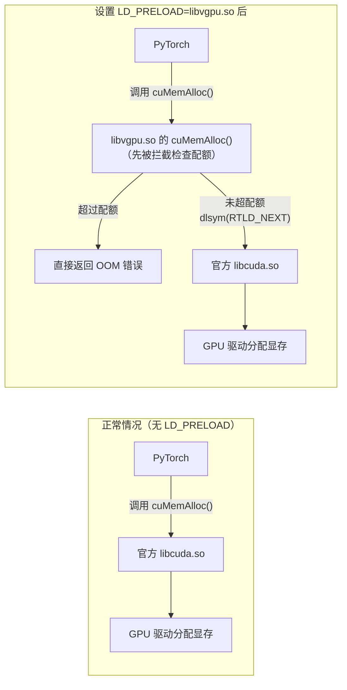
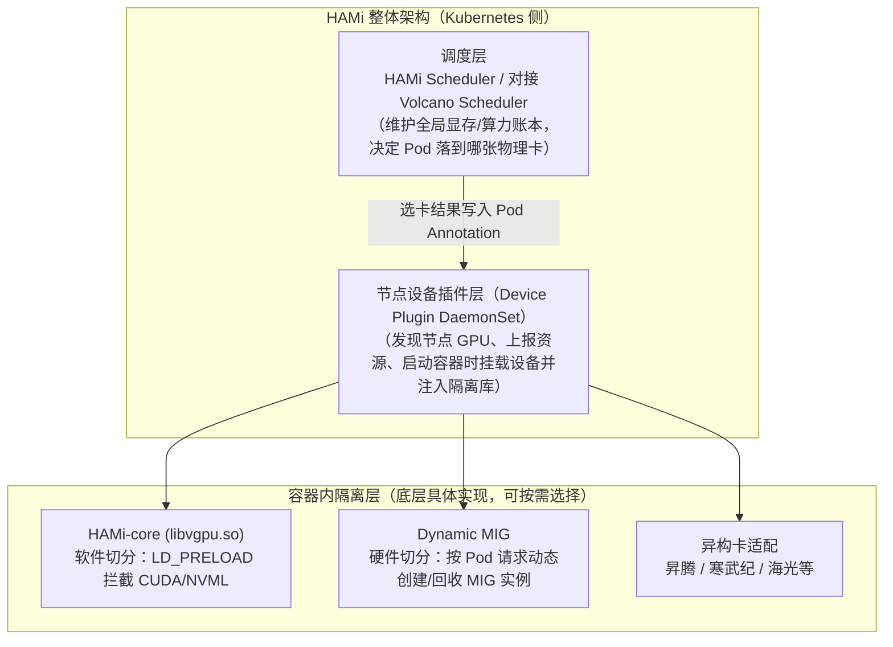
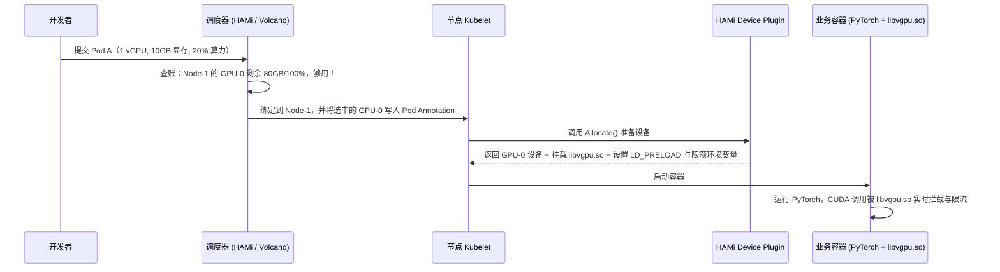

## 一、承接上篇：在 Kubernetes 里，我们需要怎样的 GPU 切分？

上一篇我们聊了 NVIDIA MIG。它像给大平层砌承重墙一样，在硬件层面把一张大 GPU 物理隔开，性能几乎零损耗、隔离性拉满。

但一旦把视角放到真实的 **Kubernetes 集群**里，MIG 的短板就非常明显了：

- 集群里大量存量卡是 **T4、V100、A10、L40**，根本不支持 MIG；
- 业务需求五花八门：有人只要 **2GB 显存**跑 Embedding，有人要 **12GB 显存 + 30% 算力**跑小模型，固定规格的 MIG 切不出这么细的粒度；
- 静态预切分在 K8s 里极易产生规格碎片——整张卡空着，却因为规格对不上导致 Pod 一直 Pending。

于是问题变成了：**能不能不依赖特殊硬件，在软件层面把任意一张 GPU 按需切分，并且无缝融入 Kubernetes 的调度体系？**

答案就是 CNCF 开源项目 **HAMi**（Heterogeneous AI Computing Virtualization Middleware，异构 AI 算力虚拟化中间件）以及它最核心的底层组件 **HAMi-core**。

不过，在直接拆解 HAMi-core 的原理之前，我们需要先补两个非常经典、也非常简单的 Linux 底层基础知识：**动态链接器（`ld.so`）** 和 **`LD_PRELOAD`**。弄懂了这两个概念，HAMi-core 的核心魔法你一眼就能看穿。

---

## 二、前置知识：动态链接器（`ld.so`）与 `LD_PRELOAD`

### 2.1 什么是动态链接器（`ld.so`）？

我们平时写的程序（比如 `python`），里面会调用大量公共函数——比如打印日志用的 `printf`、申请内存用的 `malloc`，或者操作显卡用的 CUDA 函数 `cuMemAlloc`。

编译程序时，处理这些公共库有两种方式：

- **静态链接**：编译时把所有依赖库的代码全部复制打包进可执行文件。优点是独立性强，缺点是文件巨大，且多个进程无法共享同一份库代码。
- **动态链接（Linux 默认方式）**：编译时**不复制库代码**，只在可执行文件里留一张“依赖清单”（需要哪些 `.so` 共享库、要调用哪些函数名），等程序真正启动时再去加载系统里的 `.so` 文件。

正因为库代码不在可执行文件里，程序运行前必须有一个“搬运工 + 接线员”先把库装进来——这个角色就是 **动态链接器（`ld.so`）**（在 64 位 x86 Linux 上，它通常是 `/lib64/ld-linux-x86-64.so.2`）。

当你敲下 `python train.py` 时，幕后其实发生了这 4 步：

1. **内核先唤醒 `ld.so`**：Linux 内核发现这个程序是动态链接的，不会直接运行它的 `main()`，而是先把 `ld.so` 跑起来。
2. **加载 `.so` 库**：`ld.so` 读取程序的依赖清单（用 `ldd /bin/ls` 就能看到这张清单），按顺序把需要的 `.so`（如 `libc.so`、`libcuda.so`）映射到内存。
   > 日常开发中遇到 `error while loading shared libraries: libxxx.so: cannot open shared object file`，就是 `ld.so` 在这一步找不到库文件报的错。
3. **符号解析（接线）**：程序里只写了“我要调 `cuMemAlloc`”，但不知道它在内存哪个地址。`ld.so` 就按加载顺序去 `.so` 里查表，把找到的**第一个**同名函数的内存地址填进程序里。
4. **交出控制权**：线全部接好后，`ld.so` 跳转到程序的 `main()`，你的程序才正式开始执行。

### 2.2 什么是 `LD_PRELOAD`？

注意上面第 3 步里一个极其关键的规则：**`ld.so` 查找函数地址时是“先到先得”的**。

而 **`LD_PRELOAD`** 就是 Linux 动态链接器提供的一个环境变量（也可以通过 `/etc/ld.so.preload` 文件全局配置），作用非常霸道：

> **强制让 `ld.so` 在加载任何其他共享库之前，先把我指定的 `.so` 库排在最前面加载。**

这意味着什么？

假设程序原本要调用官方 `libcuda.so` 里的 `cuMemAlloc()` 来申请显存。现在我们自己写一个 `libvgpu.so`，里面也定义一个**一模一样名字**的 `cuMemAlloc()`，然后设置 `LD_PRELOAD=/path/to/libvgpu.so`。

程序启动时，`ld.so` 先加载了 `libvgpu.so`，再加载 `libcuda.so`。等接线时，`ld.so` 第一个找到的就是 `libvgpu.so` 里的 `cuMemAlloc()`！



打个比方，这就像在电话线路中间串了一个**接线员**：程序以为自己在直接给 CUDA 打电话，其实请求先经过了我们的 `.so` 检查——合规就转接给真正的 CUDA（通过 `dlsym(RTLD_NEXT, ...)` 找到下一个库里的原函数），超标就直接挂断。

**最妙的地方在于：整个过程对业务代码完全透明、零侵入。** PyTorch、TensorFlow、业务镜像一行代码都不用改。

---

## 三、理清架构：HAMi 和 HAMi-core 是什么关系？

有了上面的铺垫，我们就可以非常清晰地看懂 **HAMi** 的整体设计了。

很多人容易把 **HAMi** 和 **HAMi-core** 混为一谈，其实它们是**整体与底层核心模块**的关系：

- **HAMi** 是整套 Kubernetes 异构算力管理平台（Go 语言为主），相当于**“大管家”**，负责集群里的资源上报、调度选卡、账本管理、容器注入；
- **HAMi-core** 是 HAMi 旗下的底层 C/C++ 核心库（独立仓库，编译产物就是 **`libvgpu.so`**），相当于装在每个业务容器里的**“水电表/门禁”**，专门通过 `LD_PRELOAD` 实现 NVIDIA GPU 的软件层隔离。



这里顺带解开一个常见疑惑：**为什么说 HAMi 既能做软件切分，又能管 MIG？**

因为 HAMi 本身是一个上层调度与管理框架。在节点上：
- 如果卡不支持 MIG，或者你想按 MB / 1% 任意细粒度切分，就用 **HAMi-core 模式**（软件切分）；
- 如果节点上是 A100/H100 且你想要硬件强隔离，HAMi 也支持 **Dynamic MIG 模式**——平时不提前把卡切死，等 Pod 来了，HAMi 根据 Pod 申请的规格**自动调用接口动态切出一个 MIG 实例**给它，Pod 结束后自动回收，顺手解决了上篇提到的静态 MIG 碎片痛点。

---

## 四、Step by Step：一个 vGPU Pod 在 K8s 里是怎么跑起来的？

假设你的 Kubernetes 集群里有一台装有 **1 张 80GB A100** 的节点，已经部署好了 HAMi（或 Volcano + HAMi Device Plugin）。现在两个开发者分别提交了 Pod A（要 10GB 显存、20% 算力）和 Pod B（要 15GB 显存、30% 算力）。

完整流程如下：



拆解成 4 个关键步骤：

### 第 1 步：Pod 按需申请资源

开发者不再写 `nvidia.com/gpu: 1`，而是直接声明自己需要的显存和算力（不同接入方式资源名略有差异，以下是 HAMi / Volcano 的典型写法）：

```yaml
resources:
  limits:
    nvidia.com/gpu: 1          # 申请 1 块 vGPU（Volcano 下为 volcano.sh/vgpu-number）
    nvidia.com/gpumem: 10000   # 显存上限 10000 MB（约 10GB）
    nvidia.com/gpucores: 20    # 算力上限 20%
```

### 第 2 步：调度器记账与选卡

调度器手里维护着集群里**每一张物理 GPU** 的实时账本：
- 给 Pod A 分配 GPU-0 后，账本扣减为剩余 `70GB / 80%`；
- 紧接着 Pod B 来了，账本依然够用，于是也调度到**同一张物理 GPU-0**，账本扣减为剩余 `55GB / 50%`。
- 调度器会把“具体选了哪张物理卡（UUID）”写进 Pod 的 Annotation 里。

### 第 3 步：Device Plugin 注入“门禁”

容器启动前，kubelet 调用节点上的 HAMi Device Plugin：
- 插件读取 Pod Annotation，把对应的物理 GPU-0 挂载进容器；
- **最关键的一步**：插件把宿主机上的 `libvgpu.so`（HAMi-core）挂载进容器，通过 `LD_PRELOAD`（或 `/etc/ld.so.preload`）使其生效，并注入环境变量告知该容器的配额（`10GB` 显存、`20%` 算力）。

### 第 4 步：容器运行期，HAMi-core 接管三大核心能力

容器启动后，PyTorch 跑起来，HAMi-core 就在幕后默默干三件事：

1. **显存硬限制**：拦截 `cuMemAlloc` 等显存分配 API 并持续记账。如果 Pod A 累计申请超过 10GB，即使物理卡还剩 55GB 空闲，`libvgpu.so` 也会直接返回 OOM，保护同卡上的 Pod B 不被挤爆。
2. **算力配额控制**：拦截 CUDA Kernel（计算核函数）的提交。`libvgpu.so` 会在很短的时间窗口内统计当前容器的算力使用占比，一旦超过 20%，就让后续提交短暂 sleep 排队，从而把算力平滑压在 20% 左右。
3. **视图虚拟化**：拦截 NVML 查询接口。当你在 Pod A 里敲 `nvidia-smi` 时，看到的显存总量就是 **10000 MiB**，而不是整张物理卡的 80GB，让容器觉得自己真的独占了一张 10GB 的小卡。

---

## 五、总结：MIG vs HAMi-core，到底怎么选？

把两篇文章放在一起对照，其实非常直观：

- **MIG** 像是给大平层**砌实心承重墙**（硬件级硬隔离）；
- **HAMi-core** 像是大家**合租一套大房子，但每个房间装了独立水电表和限流闸**（软件级软隔离）。

| 对比维度 | NVIDIA MIG（硬件切分） | HAMi-core（软件切分） |
| --- | --- | --- |
| **实现原理** | GPU 芯片硬件电路物理切分 | `LD_PRELOAD` 用户态劫持 CUDA/NVML API |
| **隔离强度** | **硬隔离**：算力、缓存、带宽、故障域完全隔离 | **软隔离**：共享物理硬件通路，存在一定噪声邻居和驱动级故障波及风险 |
| **硬件要求** | 仅限 A30、A100、H100 等高端数据中心卡 | 几乎支持**所有 NVIDIA GPU**（T4/V100/A10/L40/4090 等） |
| **切分粒度** | 固定 Profile，单卡最多 7 份 | 任意粒度（按 MB、按 1% 算力），单卡可切更多份 |
| **灵活性与利用率** | 传统静态切分易有碎片（可用 HAMi Dynamic MIG 缓解） | 极高，按需即时分配，支持算力复用与更高超卖比 |
| **性能开销** | 几乎为零 | 有轻微 API 拦截与时间片调度开销 |

**落地选型建议：**

- **开发测试、中小模型推理、存量非 MIG 卡（A10/L40/T4/V100）、追求极致利用率**：优先上 **HAMi-core**。
- **高 SLA 在线生产推理、强多租户安全隔离、手里有 A100/H100**：优先上 **MIG**；如果业务规格多变，建议用 **HAMi 的 Dynamic MIG 模式**，兼顾硬件隔离与动态调度。
- **混合集群**：在 Kubernetes（尤其是搭配 Volcano）中，完全可以按节点维度混配——一部分节点跑 HAMi-core 吃下碎片化和开发任务，另一部分节点跑 MIG 承接核心在线推理。

至此，关于 GPU 虚拟化的两条主流技术路线（硬件切分 MIG 与软件切分 HAMi / HAMi-core）就全部串起来了。希望这两篇文章能帮你建立起清晰的底层认知，下次在集群里看到 vGPU、MIG、HAMi 这些词时，心里能有底。
