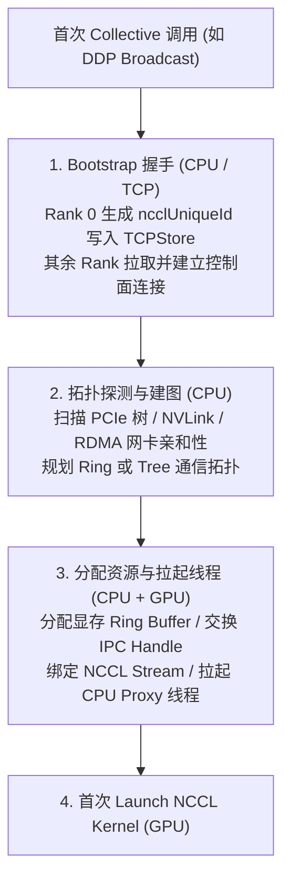
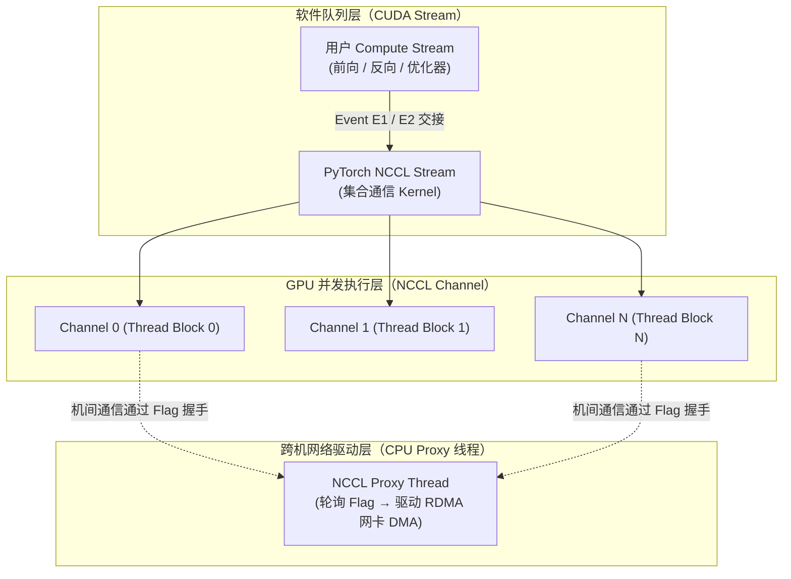

# 一次 DDP 训练背后：CPU、GPU 与 NCCL 是如何协作的

> 写这篇文章的起因，是最近排查了一次 PyTorch DDP 训练中的 NCCL 通信异常。复盘时我发现，平时写分布式训练代码，调几行 `init_process_group`、`DDP(model)`、`loss.backward()` 看起来非常轻松；但一旦线上遇到 `invalid resource handle`、通信 Hang 住、GPU 利用率 100% 却不往前走这类问题，如果脑子里没有一张完整的“**CPU、GPU、CUDA Stream 与 NCCL 到底是怎么协作的**”全景图，排障就只能靠猜。
>
> 这篇文章不堆砌零散概念，而是直接从一段最简单的 PyTorch DDP 代码出发，按时间顺序把从进程启动、前向、反向梯度同步到参数更新的完整通信链路走一遍，最后再回到排障现场，把那些看似诡异的报错和卡死现象彻底闭环。

---

## 一、从一个最简单的 DDP 训练脚本说起

假设我们用 `torchrun` 启动一个 **2 机 4 卡**（每机 2 张 GPU，机内走 NVLink，机间走 InfiniBand / RoCE）的 DDP 训练任务。核心代码只有短短十几行：

```python
import os
import torch
import torch.distributed as dist
from torch.nn.parallel import DistributedDataParallel as DDP

# 阶段 1：进程组握手
dist.init_process_group(backend="nccl")
local_rank = int(os.environ["LOCAL_RANK"])
torch.cuda.set_device(local_rank)

# 阶段 2：模型封装（首次真正通信发生在这里）
model = MyModel().cuda()
ddp_model = DDP(model, device_ids=[local_rank])
optimizer = torch.optim.AdamW(ddp_model.parameters(), lr=1e-4)

for x, y in dataloader:
    x, y = x.cuda(), y.cuda()
    optimizer.zero_grad()

    # 阶段 3：前向计算
    out = ddp_model(x)
    loss = criterion(out, y)

    # 阶段 4：反向传播 + 梯度 AllReduce
    loss.backward()

    # 阶段 5：参数更新
    optimizer.step()
```

在这十几行代码背后，真正参与协作的其实有 **四个角色**：

1. **CPU 主线程（Python / PyTorch）**：负责跑控制流、下发算子和通信指令，绝大部分时候**塞完就走，不等 GPU 算完**。
2. **GPU Compute Stream（计算流）**：PyTorch 默认的 `current_stream`，所有前向、反向、优化器算子都按顺序排在这里执行。
3. **GPU NCCL Stream（通信流）**：PyTorch `ProcessGroupNCCL` 内部维护的独立 CUDA Stream，专门跑 NCCL 集合通信 kernel，目的是**不阻塞计算流，让计算和通信重叠**。
4. **CPU NCCL Proxy 线程**：NCCL 在后台拉起的 CPU 线程，专门帮 GPU 驱动跨机网卡（IB / RoCE / TCP）收发数据。

在正式进入五个阶段之前，我们先花一分钟补齐一个最底层的前提：**GPU 是怎么接活干活的？**

---

## 二、先建一个底层直觉：GPU 靠 Stream（队列）异步干活

很多人理解 GPU 容易带着写普通 CPU 代码的惯性，以为执行到 `y = x @ W` 时，CPU 会在原地等矩阵乘算完才走下一行。

实际上完全不是这样。**GPU 是一台异步的干活机器**：CPU 只要对 GPU 说一句“去算这个矩阵乘”（`cudaLaunchKernel`），**立刻返回**，马上就去执行下一行 Python 代码了。

那问题来了：既然 CPU 塞完就跑，GPU 怎么保证“先算第 1 层，再算第 2 层”的先后依赖？靠的就是 **CUDA Stream（流）**。

> **Stream 本质上就是一条 FIFO（先进先出）的任务队列。** CPU 往队尾塞任务，GPU 从队头取任务执行。

记住关于 Stream 的**三条铁律**：

| 铁律 | 含义 |
| --- | --- |
| **同 Stream 内有序** | 任务 A 比任务 B 早入队，GPU 一定保证 A 执行完才开始执行 B |
| **不同 Stream 间并行** | 两条队列里的任务没有先后约束，只要硬件资源（SM、拷贝引擎）够，就能同时跑 |
| **入队是异步的** | CPU 塞完任务立刻往下走；如果真的需要等结果，必须显式同步 |

既然不同 Stream 之间是并行的，那如果 **Stream B 里的某个任务必须等 Stream A 里的某个任务算完** 怎么办？CUDA 提供了两种同步手段：

- **粗暴同步：`stream.synchronize()`** —— CPU 原地死等整条队列彻底清空。简单，但会直接打断流水线，性能极差。
- **精细交接：`Event`（路标）** —— 在 Stream A 的某个位置插一个路标 `E`（`cudaEventRecord`），然后让 Stream B 执行 `wait_event(E)`（`cudaStreamWaitEvent`）。**这个操作对 CPU 是完全异步的**，只是在 GPU 硬件调度层建立一条“看到路标再放行”的依赖。

理解了“异步入队 + Stream 队列 + Event 路标”，后面整套 DDP 和 NCCL 的运转就会变得无比顺理成章。

---

## 三、全流程拆解：一次 DDP 训练的五个阶段

下面我们回到那段 15 行的代码，顺着时间轴一层层剥开。

### 阶段 1：`dist.init_process_group("nccl")` —— 纯 CPU 的“建群”，GPU 还没动

`torchrun` 启动任务后，每张 GPU 对应一个独立的操作系统进程（1 进程 = 1 Rank = 1 GPU）。

执行到 `dist.init_process_group(backend="nccl")` 时：

- **发生了什么**：Rank 0 会在 CPU 侧起一个 `TCPStore`（监听 `MASTER_ADDR:MASTER_PORT`），所有 Rank 通过普通 TCP Socket 连上来，交换各自的 `rank`、`world_size` 等元数据。
- **容易忽略的关键点（懒初始化）**：在默认配置下，这一行**只在 CPU 内存里创建了一个 `ProcessGroupNCCL` 对象**，**并不会去初始化 GPU 上的 NCCL Communicator**。

打个比方，这一步只是“拉了个微信群、点了个名”，但群里还没人发过第一条消息——此时 GPU 显存通信缓冲区、NVLink 点对点连接、RDMA 网卡队列全都还没建。

---

### 阶段 2：`DDP(model)` —— 第一次真正通信，NCCL 通信栈在此刻搭建

很多人以为 `DDP(model)` 只是给模型套了个壳，其实它在初始化时立刻干了三件大事：

1. **按反向顺序划桶（Bucket）**：把模型参数按 `model.parameters()` 的**逆序**切成若干个 Bucket（默认约 25MB 一个桶）。为什么要逆序？因为反向传播是从最后一层往前算的，这样后几层的梯度一算完就能凑满第一个桶，立刻发出去同步。
2. **注册 Autograd Hook**：给每个参数挂上钩子，一旦反向传播算完它的梯度，立刻通知 DDP 的 C++ Reducer。
3. **发起全生命周期的第一次集合通信：`Broadcast`**：把 Rank 0 的初始模型权重广播给其他所有 Rank，确保大家的起点参数完全一致。

正是这次 `Broadcast`，触发了真正的 **NCCL Communicator 懒初始化（`ncclCommInitRank`）**：



到这里，NCCL 这套通信基础设施才算真正搭起来。

---

### 阶段 3：`out = ddp_model(x)` —— CPU 疯狂“点单”，GPU 按队列“做菜”

进入训练循环，前向传播本身不需要同步梯度（暂不考虑 SyncBatchNorm）：

1. CPU 主线程飞快地遍历网络每一层，把一个个算子（矩阵乘、激活、LayerNorm 等）通过 CUDA Runtime 塞进当前设备的 **Compute Stream**。
2. 因为入队是异步的，CPU 通常跑得比 GPU 快得多，很快就跑完前向代码进入 `loss.backward()`；与此同时，GPU 正老老实实地从 Compute Stream 队头挨个取出算子，在 SM 上执行。

---

### 阶段 4：`loss.backward()` —— 核心大戏：计算与通信如何重叠？

反向传播是 DDP 最精妙的地方。为了不让 GPU 傻等所有梯度都算完再统一通信，DDP 的核心策略是：**一边算前面层的梯度，一边同步后面层已经算好的梯度（Compute-Communication Overlap）**。

假设模型梯度被切成了 **Bucket 0（后半段层）** 和 **Bucket 1（前半段层）**，整个协作时序如下：

```text
时间轴 ────────────────────────────────────────────────────────────────────────▶

CPU 主线程:
  [塞入 B0 反向] → (B0 满! 触发 Hook) → [插 E1 / wait E1 / 塞入 AllReduce(B0)] → [塞入 B1 反向] → ...
  (全程异步不阻塞，立刻回头继续塞 B1)

GPU Compute Stream:
  [====== 算 Bucket 0 梯度 ======] ──(标记 E1)──▶ [====== 算 Bucket 1 梯度 ======] ──(等 E2)──▶ [AdamW step]
                                      │                                              ▲
                                      ▼ (Event E1 触发，无需 CPU 介入)                │ (Event E2 触发)
GPU NCCL Stream:                      │                                              │
                         (等 E1) ─────┴─▶ [==== AllReduce(Bucket 0) kernel ====] ────┘
                                                    ▲          │
                                                    │ (共享内存 │ (机内: NVLink P2P 直读写)
                                                    │  Flag)   ▼ (机间: 写 Buffer + 翻 Flag)
CPU Proxy 线程 + 网卡:                                     [轮询 Flag → RDMA 网卡 DMA 收发]
```

把上面这张图拆成 5 个动作，整条链路就彻底透明了：

#### 1）Bucket 0 满，Autograd Hook 在 CPU 侧触发
当 CPU 把 Bucket 0 最后一个参数的反向算子塞进 Compute Stream 后，Autograd 引擎在 CPU 侧立刻触发 DDP 的 Hook，Reducer 标记 Bucket 0 就绪，随即调用 `ProcessGroupNCCL` 发起异步 `all_reduce(Bucket 0)`。

**注意一个关键事实**：此时此刻在物理时间上，**GPU 大概率还没算完 Bucket 0 的梯度**，甚至可能还在算前向！因为 CPU 永远跑在队列前面。

#### 2）Event E1 交接：Compute Stream → NCCL Stream
既然 GPU 还没算完，NCCL Stream 如果立刻启动去读 Bucket 0 的梯度显存，就会读到脏数据。但 CPU 又不能调 `stream.synchronize()` 傻等，否则后续 Bucket 1 的反向算子就没法继续入队了。

于是 PyTorch 用上了前面说的 **Event 路标**：
- 在 Compute Stream 里记一个 `E1`（`cudaEventRecord(E1, compute_stream)`）：“当 GPU 算到这儿时，Bucket 0 的梯度就齐了”。
- 让 NCCL Stream 等待 `E1`（`cudaStreamWaitEvent(nccl_stream, E1)`）：“没看到 `E1` 亮灯前，NCCL Stream 先别动”。

**这两步对 CPU 依然是异步的**，毫秒级返回。

#### 3）CPU 塞入 `ncclAllReduce`，马不停蹄去塞 Bucket 1
CPU 往 NCCL Stream 里提交 `ncclAllReduce(Bucket 0)` 后立刻返回，继续把 Bucket 1 的反向算子塞进 Compute Stream。

#### 4）GPU 硬件上真正实现“计算与通信重叠”
当 GPU 的 Compute Stream 终于算完 Bucket 0 的最后一个梯度算子时，`E1` 被标记完成：
- Compute Stream 紧接着开始在 SM 上算 Bucket 1 的梯度；
- **与此同时**，NCCL Stream 解除等待，立刻在另一些 SM 上启动 AllReduce kernel。

此时，**计算和通信在 GPU 硬件上真正并行跑了起来**。

#### 5）NCCL Kernel 内部的两条数据通路：机内 vs 跨机
当 AllReduce kernel 在 GPU 上跑起来后，数据到底是怎么穿过卡间和机间的？这里分为两条截然不同的路径：

- **机内卡间（NVLink / PCIe P2P）**：GPU 线程直接执行显存读写指令，通过 NVLink 读写同机另一张卡的显存并做规约（Reduce）。**整个数据搬运过程零 CPU 参与**。
- **跨机节点间（InfiniBand / RoCE / TCP）**：在常规架构下，GPU 不能直接去敲网卡的门铃，于是采用 **GPU Kernel ↔ CPU Proxy 线程** 的接力模式：
  1. GPU 上的 NCCL kernel 把切好的数据片写进通信 Buffer，然后翻转一个共享内存/显存里的 **Flag（头尾指针）**；
  2. 后台的 **NCCL Proxy 线程（CPU）** 一直在轮询这个 Flag，发现有新数据后，调用 RDMA Verbs（如 `ibv_post_send`）通知网卡；
  3. 网卡通过 **GPUDirect RDMA** 直接从本机 GPU 显存把数据 DMA 走，经交换机写进远端机器的 GPU 显存（全程绕过主机内存）；
  4. 网卡完成后通知 Proxy 线程更新完成 Flag，GPU kernel 看到 Flag 变化，继续下一轮 Ring 规约。

---

### 阶段 5：`optimizer.step()` —— 用 Event E2 交接回来，形成闭环

当 `loss.backward()` 走到尾声，所有 Bucket 的梯度都已经异步入队到 NCCL Stream 后，DDP 会执行收尾同步：

- 在 NCCL Stream 的 AllReduce 后面插一个路标 **Event `E2`**；
- 让 Compute Stream 执行 `wait_event(E2)`；
- 紧接着，CPU 主线程把 `optimizer.step()`（如 AdamW 参数更新）的算子塞进 Compute Stream。

这样一来，GPU 硬件层就严格保证了：**Compute Stream 必须等到所有 Bucket 的梯度都完成 AllReduce（`E2` 达成），才会开始用同步后的平均梯度去更新模型参数。**

整个迭代从头到尾，CPU 几乎不需要停下来等 GPU，直接就迈进下一个 `for` 循环去准备下一个 batch 了——直到代码里出现类似 `loss.item()` 打印日志这种需要把 GPU 显存数据拷回 CPU 内存的操作，或者 CUDA 命令队列被塞满时，CPU 才会真正阻塞等待 GPU 追上来。

---

## 四、把三个容易混淆的概念彻底分清：Stream、Channel、Proxy

在看 NCCL 源码或日志时，最容易把 **Stream、Channel、Proxy** 混为一谈（我最初记笔记时也差点把 Channel 和 Stream 划等号）。它们其实处在三个完全不同的维度：



- **Stream（队列维度）**：CUDA 的软件任务队列。PyTorch DDP 通常只维护 **1 条用户 Compute Stream + 1 条 NCCL Stream**。一次 `ncclAllReduce(..., nccl_stream)` 只会在这一条 `nccl_stream` 上 launch **1 个 CUDA Kernel**。
- **Channel（Kernel 内部并发维度）**：NCCL 为了打满 NVLink 和多网卡的物理带宽，会把一次大的集合通信切分成 `n` 份并行跑，这 `n` 条 Channel 对应的是**同一个通信 Kernel 里的 `n` 个 CUDA Thread Block（CTA）**，而不是 `n` 条独立的 CUDA Stream。
- **Proxy（CPU 侧网络搬运维度）**：跑在 CPU 上的后台线程，专门替 GPU 驱动跨节点网卡（IB / RoCE / Socket）的发送和接收队列。

---

## 五、回到排障现场：这套模型如何解释常见的诡异现象？

把上面整套“CPU 异步入队 + 懒初始化 + Stream/Event 交接 + Kernel 内轮询”的机制串起来后，平时 DDP 排障时最让人摸不着头脑的三个现象就能一瞬间闭环：

### 1. 为什么环境/驱动问题（如 `invalid resource handle`）总爆在第一个 collective，而不是 `init_process_group`？
因为 `init_process_group` 默认只建了 CPU 侧的 `TCPStore`。真正的 GPU 显存分配、IPC 句柄交换、Communicator 构建和首次 kernel launch，全部**懒加载**在第一个集合通信上（比如 `DDP(model)` 内部的权重 `broadcast`，或者训练框架如 `mmengine` 在 `setup_env` 阶段发起的首次 `broadcast`）。如果容器里存在 `libcudart` / `libnccl` 版本混搭或驱动句柄异常，炸点就会精准落在这里。

### 2. 为什么 NCCL 通信卡死（Hang）时，`nvidia-smi` 看 GPU 利用率反而是 100%？
因为真正的等待不是发生在 CPU 线程里，而是发生在 **GPU 的 NCCL Kernel 内部**。只要有一个 Rank 慢了、挂了，或者跨机 RDMA 丢包导致 Proxy 线程迟迟没更新完成 Flag，其他卡上的 NCCL Kernel 就会在 SM 里**死循环轮询 Flag**。从 `nvidia-smi` 视角看，SM 一直有指令在跑，利用率就是 100%，实际上全在空转干等。

### 3. 为什么 CUDA / NCCL 报错的 Python 调用栈经常“指鹿为马”？
因为 CPU 入队是异步的。当第 100 行下发的某个 kernel 在 GPU 上真正执行并崩溃时，CPU 可能早就跑到第 150 行了。CUDA 只能在**下一次同步 API 调用**时把这个异步错误抛出来，所以报错堆栈经常指向一个完全无辜的张量操作。

---

## 六、实用排障与观察工具箱

理解原理之后，排查具体问题时可以按层次使用下面几个工具把黑盒打开：

```bash
# 1. 打开 NCCL 详细日志：观察 Communicator 懒初始化、拓扑探测、Channel 数量和 Proxy 建连全过程
NCCL_DEBUG=INFO NCCL_DEBUG_SUBSYS=INIT,NET,GRAPH python train.py

# 2. 用 Nsight Systems 抓时间轴：最直观地看到 Compute Stream、NCCL Stream 和 Event 的重叠情况
nsys profile -o ddp_prof --trace=cuda,nvtx,osrt torchrun --nproc_per_node=2 train.py

# 3. 排查动态库版本混搭：看看进程最终加载的是哪个路径下的 libcudart / libnccl / libcuda
LD_DEBUG=libs python -c "import torch" 2>&1 | grep -iE "libcudart|libnccl|libcuda\.so"

# 4. 定位真实报错行 / 防止通信无限期卡死（调试用，会影响性能，生产慎开）
CUDA_LAUNCH_BLOCKING=1 \
TORCH_NCCL_ASYNC_ERROR_HANDLING=1 \
TORCH_NCCL_TRACE_BUFFER_SIZE=1048576 \
torchrun --nproc_per_node=2 train.py
```

---

## 七、一句话总结

**Stream 是 GPU 的异步任务队列，Event 是跨队列的轻量级路标；PyTorch DDP 通过 Compute Stream 和 NCCL Stream 的分离与 Event 交接，把反向计算和梯度通信重叠在一起；而 NCCL 在其上用懒加载的 Communicator、多 Channel 并发 Kernel 以及 CPU Proxy 线程，打通了从显存到 NVLink 再到跨机 RDMA 网卡的整条通路。** 记住这条主线，以后再面对 DDP 的性能调优或 NCCL 诡异报错，就能一眼看穿问题出在哪一层。
