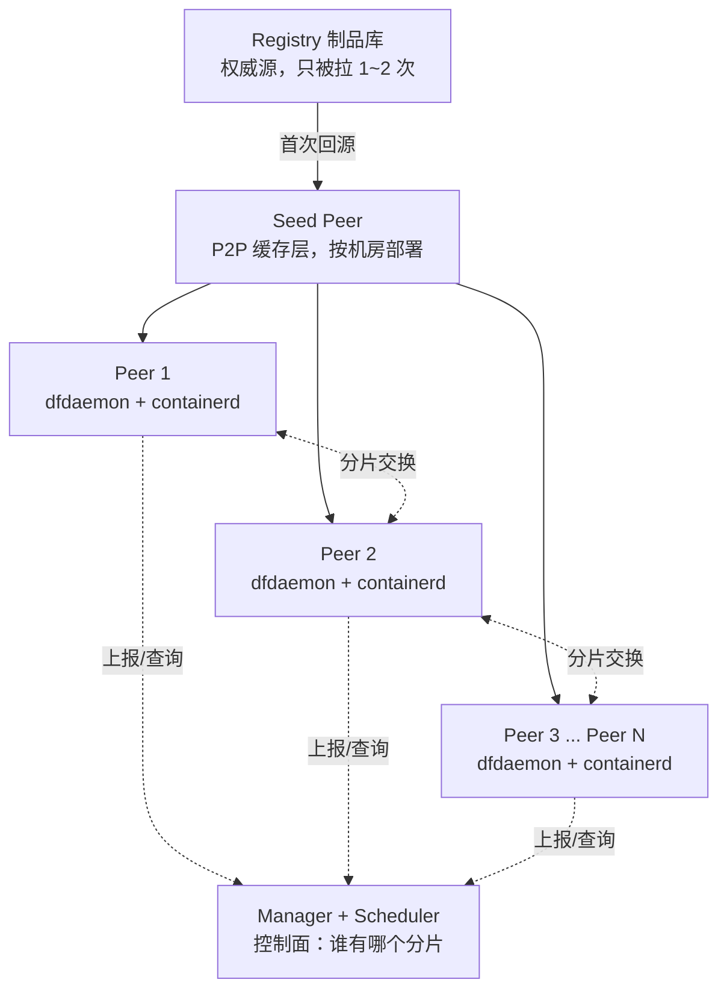

# 分布式训练之镜像加速（一）：P2P 分发如何把"不可接受"变成"可接受"

> 本系列两篇，聚焦分布式训练中的容器镜像加速问题。这一篇讲 P2P 分发路线（以 Dragonfly 为代表），下一篇讲懒加载路线（eStargz 和 Nydus）。

---

## 一、一个能上到 CFO 会议的账单

先算一笔账。你是一家做大模型的公司，训练集群规模 200 台 H100 节点，每台跑一个训练任务，容器镜像 30 GB（PyTorch + CUDA + 各种自研 kernel + 依赖，你可以自己估一下体积，通常都在这个量级）。

某天你做了一次模型代码更新，需要重新发版。集群里所有节点同时去容器制品库拉新镜像。假设制品库的出口带宽是 10 Gbps。

理论下限是多少？

$$ \text{总时间} \ge \frac{200 \times 30, \text{GB}}{10, \text{Gbps}} = \frac{6, \text{TB}}{1.25, \text{GB/s}} \approx 80, \text{分钟} $$

这是**下限**。实际上 TCP 公平共享、TLS 握手开销、磁盘 IO 会把它推到 1.5 - 2 小时。整个过程中 200 张 H100 完全空转。

把这个换算成钱：

$$ 200\ \text{卡} \times 1.5\ \text{小时} \times 3\ \text{USD/卡·小时} \approx 900\ \text{USD} $$

每次发版 900 美元蒸发。如果一个季度发版 30 次，就是 2.7 万美元。加上工程师等待期间的心智损耗，这不是运维问题，是财务问题。

而这只是"制品库带宽"这**一个**瓶颈算出来的账。真实情况下还有另外两个瓶颈叠加，我们下面分别看。

---

## 二、拆解：这个账单是被三个瓶颈决定的

### 瓶颈 1：带宽瓶颈

制品库的出口带宽是**共享**的。N 个并发拉取会让每个节点分到 `总带宽 / N`。这个式子里 N 越大，每个节点越慢；但总耗时（所有节点都拉完的时间）**不会随 N 减小** —— 因为总数据量是 `N × 镜像大小`，管道就那么粗。

这就是为什么"多加几台机器帮忙"没用：加机器不改变管道粗细，只是把带宽分得更薄。

### 瓶颈 2：冷启动延迟

即使制品库带宽无限，单节点从零到运行至少要经过：拉镜像 → 解压 → 挂载 → 启动进程。GPU 训练镜像通常几十 GB，即使 10 Gbps 满速也要 20~30 秒起步。这段时间里 GPU 是完全闲置的。

冷启动延迟对**弹性训练**（比如 Spot 抢占式）尤其致命 —— 每次被抢占换节点，就要付一次冷启动的时间成本。

### 瓶颈 3：中心化单点

制品库不仅是带宽瓶颈，还是**可用性瓶颈**。如果 200 节点同时打过来，制品库上层的负载均衡、鉴权、限流可能会先崩。生产上很多"镜像拉取失败"的告警其实是制品库限流触发的，不是网络本身的问题。

### 传统方案的局限性

在 Dragonfly 之前，业界的解决办法基本是三类，都有明显天花板：

- **Registry Mirror**：在集群本地部署一份完整制品库副本。解决了跨机房带宽问题，但**没解决 N 节点并发压 mirror 的问题**。mirror 内部的瓶颈还在。
- **CDN**：跨地域场景有用，但同一机房内 200 节点同时拉，压力全在最近那个边缘节点，本质上还是 mirror 的变种。
- **预热（pre-warming）**：任务下发前先在节点上跑一次 `docker pull`，把镜像常驻本地。适合稳定镜像，但镜像每次更新都要重新预热；而且如果镜像池大、节点空间小，还要考虑清理策略。

这三类方案有一个共同的思维定式：**数据从一个中心点扇出到多个节点，是一个星型拓扑。加速的方式是让中心变强、变多。**

Dragonfly 的核心想法是打破这个定式。

---

## 三、Dragonfly 的核心想法：把星型拓扑变成图

想象一下：如果节点 A 已经拉完了镜像的一部分，它其实**就有能力**把这部分分给节点 B，而不需要节点 B 去问制品库。如果 B 拿到后又能分给 C，C 又能分给 D……

这不是新思想。BitTorrent 二十年前就是这么干的。这也是 gossip 协议、CDN 内部数据同步、区块链数据传播的共同套路。

Dragonfly 把它用到了容器镜像分发场景。**核心机制**是：

> 每个节点既是消费者，也是提供者。数据在节点之间以点对点（P2P）的方式流动。制品库只作为最后的回源手段，理想情况下**整个集群只需要一次或两次完整回源**。

这带来一个反直觉的性质：**集群规模从 200 扩到 2000，拉取总时间几乎不变。** 我们稍后会用数学解释为什么。

先看架构。

---

## 四、Dragonfly 的架构



四个核心组件，各司其职：

**dfdaemon（每个节点一个）**

- 常驻在每台业务节点上的守护进程
- 对外暴露成一个 HTTP 代理端口
- 负责拦截 containerd 的镜像拉取请求，转成 P2P 分片下载

**Scheduler**

- 维护"谁有哪个分片"的全局元数据
- 每个 dfdaemon 拿到分片后上报给它
- 其他 dfdaemon 想要分片时向它查询，它返回一份 peer 列表（按网络距离排序）

**Seed Peer**（老版本叫 Supernode）

- 一批**专职**的 P2P 缓存节点，通常每机房 3~5 台
- 不跑业务，只做镜像缓存
- 集群里第一次遇到某镜像时，由它代表整个集群去制品库回源，并把结果缓存下来供后续 peer 拉取

**Manager**

- 集群级别的控制面：配置管理、调度策略、监控
- 通常和 Scheduler 一起部署

有一个设计哲学**必须**在这里说清楚，它决定了 Dragonfly 的整体形态：

> **数据面分布式，控制面集中式。**

数据（分片本身）在 peer 之间 P2P 流动，用不到中心节点；但"谁有什么分片"这张查询表由中心化的 Scheduler 维护。

这不是唯一选择。理论上你可以用 DHT（分布式哈希表）来去中心化地维护"谁有什么"（BitTorrent 就是这么做的）。但 DHT 查询延迟高、实现复杂、故障排查困难。对于容器镜像分发这种"节点数一般不超过万级、集群边界清晰"的场景，中心化元数据是更简洁的工程选择。

这个设计哲学和 Kubernetes 的 etcd 是一个思路。

---

## 五、一次完整拉取的流程

我们跟着一个具体请求走一遍。假设你在节点 2 上的 containerd 需要拉 `myimage:v1` 的某一层，这一层 200 MB。

**Step 1：拦截**

节点 2 上的 containerd 按照配置去 `http://127.0.0.1:65001` 拉。这是本地 dfdaemon 监听的端口。containerd 以为自己在跟制品库通信，实际请求被 dfdaemon 劫持。

要让这个拦截生效，只需要在 containerd 的配置里把制品库地址改成 dfdaemon 的地址（registry mirror 配置）。这是标准配置项，不需要改 containerd 源码。对上层的 Kubernetes、docker CLI 完全透明。

**Step 2：切片与注册**

dfdaemon 不会去整层拉这 200 MB，而是把它逻辑切成 **piece**，默认 4 MB 一个，所以是 50 个 piece。然后向 Scheduler 注册一个 Task：`"我要 myimage:v1 layer abc，需要 50 个 piece"`。

为什么是 4 MB 这个数？这是个经验值。

- **太粗**（比如以整层为单位）：peer A 正在拉这一层，还没拉完时它没有任何东西能分给别人。整个 P2P 网络"冷启动"太慢。
- **太细**（比如 4 KB）：元数据爆炸，Scheduler 压力大，网络握手开销比数据传输还多。
- **4 MB 的甜蜜点**：在 10 Gbps 网络上传输约 3 ms，比调度的 RPC 延迟略大，效率最高。

**Step 3：询问调度**

Scheduler 查表回复：

- piece #1~10：Seed Peer 有
- piece #11~25：Peer 5 有（同机架，网络最近）
- piece #26~50：还没人有，让 Seed Peer 去回源拉

dfdaemon 拿到这张"piece → peer"的路由表。

**Step 4：并行拉取 + 边拉边贡献**

dfdaemon **并行**从多个 peer 拉不同的 piece。同时，**每拉完一个 piece 就立刻上报 Scheduler**：`"我也有 piece#3 了"`。

这一步是 Dragonfly 的关键。上报的瞬间，整个集群的"可用源"多了一个。第 100 个开始拉的节点会发现 piece#3 已经有几十个 peer 都可以提供了。**拉取的节点越多，每个新节点能找到的源越多，速度越快。** 这就是 P2P 的雪球效应。

**Step 5：回吐给 containerd**

dfdaemon 把 piece 按原始顺序拼装成完整层，通过 HTTP 流式回给 containerd。containerd 看到的完全是一个正常的 layer 下载响应，它不知道下面在搞 P2P。

---

## 六、几个不那么显眼但至关重要的设计问题

### Q1：为什么用 HTTP 代理拦截，而不是改 containerd？

**答**：为了对上层完全透明。改 containerd 源码需要跟着上游节奏，也需要每个用户都用你改过的版本。而 HTTP 代理 + registry mirror 配置是 containerd 官方支持的标准机制，任何符合 OCI 规范的容器运行时都能兼容。

这是"侵入性最小"的接入方式。同样的思路也让 Dragonfly 能被 Docker、CRI-O、Podman 使用，一套架构管所有。

### Q2：鉴权怎么办？

**答**：多租户场景下不同用户的私有镜像需要 token 鉴权。dfdaemon 是代理，它**不存储 token**，而是把 containerd 发来的 `Authorization` 头透传给 Seed Peer，让 Seed Peer 拿这个 token 去回源。

这样做保证了两件事：

- Peer 只能拉自己有权限的镜像（因为回源鉴权时用的是它自己的 token）
- Peer 之间传的是**已经鉴权过的镜像分片**，谁能拉到 piece 只取决于它是否属于同一个 Task

这个设计非常巧妙 —— 鉴权语义被完全保留，同时不需要 Dragonfly 自己承担 token 管理的复杂度。

### Q3：Peer 中途挂了怎么办？

**答**：Scheduler 定时心跳。Peer 挂了会被移出路由表。正在从它拉的 dfdaemon 会收到失败，向 Scheduler 重新查询，切到其他 peer 或回退到 Seed Peer。这个过程对 containerd 层无感 —— 它只会觉得某个 piece 稍微慢了一点。

### Q4：Seed Peer 缓存怎么淘汰？

**答**：Seed Peer 的磁盘不是无限大，用 LRU 淘汰。被淘汰的镜像下次访问会触发重新回源。所以**冷门镜像不享受 P2P 加速** —— 每次都要走回源，等同于普通 pull。这是一个可以接受的取舍：Dragonfly 优化的是"高频、高并发"场景，冷门镜像本来就不是瓶颈。

---

## 七、真正的性能上限在哪

现在我们来解释那个反直觉的结论：**为什么集群从 200 扩到 2000，拉取总时间几乎不变。**

关键在于 piece 在 P2P 网络里的传播是**指数扩散**：

```
T = 0    │ Seed Peer 拿到 piece#1
         │      ↓ 复制给 1 个 peer
T = 1·Δ  │ Seed Peer + Peer_A（2 个源）
         │      ↓ 每个源再复制给 1 个 → +2 个新源
T = 2·Δ  │ 4 个源
T = 3·Δ  │ 8 个源
T = 8·Δ  │ 256 个源 —— 200 节点集群已全员到货
T = 11·Δ │ 2048 个源 —— 2000 节点集群也到货了
```

Δ 是单次传输一个 piece 的时间，几十毫秒量级。这是个二进制树式的扩散，**深度只有 log₂(N)**：

- N = 200 → 8 轮，约 200~400 ms
- N = 2000 → 11 轮，约 300~600 ms
- N = 20000 → 14 轮，约 400~800 ms

集群规模翻十倍，扩散时间只增加几百毫秒。

那真正的瓶颈在哪？在**主项**：

$$ \text{总时间} \approx \underbrace{\frac{\text{镜像大小}}{\text{Seed Peer↔registry 带宽}}}_{\text{常数级，主项}} + \underbrace{\log_2(N) \times \text{单 piece 时间}}_{\text{对数级，次项}} $$

这个式子有一句话可以概括：**Dragonfly 把拉取时间从 $O(N \times \text{镜像大小} / \text{制品库带宽})$ 砍到了 $O(\text{镜像大小} / \text{Seed Peer 带宽}) + O(\log N \times \text{单 piece 时间})$。N 从乘法位置移到了对数位置。**

这就是 P2P 的全部魔法。

**如果你要进一步优化 Dragonfly**，永远先看主项 —— 也就是 Seed Peer 那段带宽。加更多 Seed Peer 让它们并行回源（用 HTTP Range 请求拉不同字节段）、或者升级 Seed Peer 到制品库那段网络。**改 piece 大小、加 Scheduler CPU 都是在优化次项**，边际收益近乎零。

这条原则不止适用于 Dragonfly，是所有性能优化的通用心法：**先画出系统图，找到最细的那条边，看能不能加粗它。其他地方再精巧都是徒劳。**

---

## 八、什么时候不该用 Dragonfly

Dragonfly 有明确的适用边界。以下场景中它要么无用，要么运维负担超过收益：

**节点拓扑割裂时。** P2P 的前提是节点之间能互通。如果你的 5 个节点分布在 5 个不同的边缘站点、彼此隔离，Dragonfly 完全用不上 —— peer 之间物理上就不通。这种场景下，直接用本地 registry mirror + 预热是更合理的选择。

**单机或小集群。** 3 个节点的集群，直接 `docker pull` 也很快。装 Dragonfly 的意义只在运维复杂度上（Manager、Scheduler、Seed Peer 都要部署维护、监控、扩容、升级）。经验阈值大概是 20 节点以上、且镜像大于 5 GB 时开始有价值。

**镜像本来就很小 + 集群很稳定。** 比如 500 MB 的微服务镜像，制品库压力小到可以忽略。上 Dragonfly 属于杀鸡用牛刀。

**镜像每次都不一样、无法复用。** 这是个更微妙的场景：如果你的镜像是每次 CI 构建都完全独一无二的（比如包含随机的构建时间戳），P2P 也没什么可分享的。**但要注意**，OCI 镜像是分层的，通常 CI 场景下顶层每次不同、但基础层（`python:3.11`、`cuda:12.x` 等）在整个公司范围内被反复使用 —— 这些**基础层**依然享受 Dragonfly 加速，只是顶层 unique 部分绕不开回源。

---

## 九、P2P 思想的外延

Dragonfly 不是孤例。你在系统世界里到处能看到"星型改图型"的思想：

- **BitTorrent** 是这套思路的教科书实现，Dragonfly 在很多设计细节上向它致敬（piece、tracker、announce 循环）
- **Kafka 副本同步**、**Cassandra gossip 协议** 用类似机制在集群内传播元数据
- **CDN 内部的边缘节点相互填充** 本质也是节点间 P2P
- **区块链的数据传播** 是全球范围的 P2P
- **模型分片同步**（比如 AllReduce 的 Ring 拓扑）虽然目的不同，但"避免中心瓶颈"的思路一致

理解 Dragonfly，本质上是在理解一类通用的分布式设计模式：**当你有 N 个消费者需要同一份数据、且这份数据可以被分成独立单元时，让它们互相服务是几乎总是比让它们共同压向一个中心更好的选择。**

---

## 十、经济学意义

回到开头的账单。加上 Dragonfly 后，同样的 200 节点 30 GB 镜像发版：

- 制品库不再被 200 节点并发压，只被 Seed Peer 拉 1~2 次
- 集群内传播是 O(log N) 的扩散，理论下限约等于"单节点拉取时间 + 几百毫秒扩散"
- 实际发版时间可以从 90 分钟降到 5~10 分钟
- 一次发版省下大约 80% 的 GPU 空转时间，也就是 700 美元左右

对经常发版的 AI 团队，这一年下来是六位数美元级的节省。

但比金钱更重要的是**它解锁了新的算力消费模式**：

- **抢占式训练**：把长任务拆成小片段挂在 Spot 实例上，被回收就换节点继续。这个模式的成立前提是新节点能秒级冷启动 —— 没有镜像加速，抢占的经济性根本谈不上
- **Serverless 训练**：按需起 GPU 跑一段任务，跑完释放。镜像启动延迟必须低到用户感知不到
- **训练-推理混部**：同一批 GPU 白天推理、夜里训练，切换时要换镜像。切换开销必须小到不影响利用率

这些模式都在最近两三年才开始成为主流。**镜像加速间接催生了新的算力消费方式**，这是我认为这个话题真正有意思的地方 —— 它是一个基础设施优化如何解锁上层新范式的例子。

---

## 下一篇预告

Dragonfly 解决的是"多节点同时拉同一份数据"的问题，它的假设是"我们**必须**拉这么多数据"。

但如果这个假设本身是错的呢？

如果我告诉你，一个容器启动到能正常服务，平均只读取了镜像里的 **6.4%** 内容 —— 那我们为什么还要传输剩下的 93.6%？

下一篇《分布式训练之镜像加速（二）》会讲另一条正交的路线：**懒加载**。核心问题变成"如何让 `docker pull` 只在几十 KB 数据的时候就能返回，容器立刻起来，剩下的按需去拉"。我们会拆解 eStargz 的格式设计（它是如何在不破坏 OCI 兼容性的前提下让 `.tar.gz` 变成可 seek 的）、Nydus 的更激进方案、以及这两种懒加载技术如何和 Dragonfly 组合使用，覆盖真实的生产场景。